# BodhiTree Product Manual & Instructor Guide

Welcome to the **BodhiTree Product Manual**. This guide gives you an end-to-end, practical walkthrough of how to use BodhiTree to run your courses. It is written in simple, everyday English so that any instructor, teacher, or teaching assistant (TA) can easily understand the platform, set up learning materials, and manage students without confusion.

> [!NOTE]
> This manual covers the core teaching tools on BodhiTree:
> * **Course Setup & Management** (creating courses, managing settings, publish controls)
> * **Multimedia Book (MMB)** (chapters, sections, documents, videos, URLs, and in-book quizzes)
> * **Multimedia Quiz Editor** (creating question modules and questions directly via the web UI)
> * **In-Video Quizzes** (timeline markers, video checkpoints, and inline editing)
> * **Practice Labs** (creating labs, bulk show/hide actions)
> * **Programming Activities** (problem setup, starter code, visible and hidden test cases, autograding)
> * **Lab Quizzes (OtherLabs)** (timed lab assignments created via the web UI or `.odt` templates)
> * **Submissions & Grading** (lab overview submissions, programming code viewer and test runs, quiz submissions, and Force Run re-evaluation)
> * **People & Enrollment** (single student enrollment and bulk CSV upload)
> * **Course Settings & Protection** (general course details, forum moderation, PDF download locks, and student watermarking)
> * **Interactions** (discussion forums and class announcements)
> * **Performance & Grades** (gradebook table and CSV export)
> * **Recycle Bin** (restoring deleted lab activities)

---

## Table of Contents

* [Section 1: Getting Started & Signing In](#section-1-getting-started--signing-in)
  * [1.1 Accessing the BodhiTree Portal](#11-accessing-the-bodhitree-portal)
  * [1.2 Signing In with Your Instructor Account](#12-signing-in-with-your-instructor-account)
* [Section 2: Course Dashboard & Course Management](#section-2-course-dashboard--course-management)
  * [2.1 The My Courses Dashboard](#21-the-my-courses-dashboard)
  * [2.2 Creating a New Course Offering](#22-creating-a-new-course-offering)
  * [2.3 Course Card Options (Three-Dot Menu)](#23-course-card-options-three-dot-menu)
* [Section 3: Course Navigation Overview](#section-3-course-navigation-overview)
  * [3.1 The Course Sidebar Navigation](#31-the-course-sidebar-navigation)
  * [3.2 Organization of Menu Items](#32-organization-of-menu-items)
* [Section 4: The Multimedia Book (MMB): Chapters & Sections](#section-4-the-multimedia-book-mmb-chapters--sections)
  * [4.1 Book Organization & Structure](#41-book-organization--structure)
  * [4.2 Creating a New Chapter](#42-creating-a-new-chapter)
  * [4.3 Managing Chapters & Adding Sections](#43-managing-chapters--adding-sections)
* [Section 5: Adding Learning Materials (Sections, In-Book Quizzes, Documents, Videos & URLs)](#section-5-adding-learning-materials-sections-in-book-quizzes-documents-videos--urls)
  * [5.1 The Add Content Menu](#51-the-add-content-menu)
  * [5.2 Adding a Section](#52-adding-a-section)
  * [5.3 Adding an In-Book Quiz](#53-adding-an-in-book-quiz)
  * [5.4 Adding a Document (PDF Handouts)](#54-adding-a-document-pdf-handouts)
  * [5.5 Adding a Video Lecture](#55-adding-a-video-lecture)
  * [5.6 Adding External Web URLs](#56-adding-external-web-urls)
* [Section 6: The Multimedia Quiz Editor: Generating Quizzes via UI](#section-6-the-multimedia-quiz-editor-generating-quizzes-via-ui)
  * [6.1 Purpose of the Quiz Editor](#61-purpose-of-the-quiz-editor)
  * [6.2 Organizing Questions with Modules](#62-organizing-questions-with-modules)
  * [6.3 Adding and Configuring Questions](#63-adding-and-configuring-questions)
  * [6.4 Understanding Hints, Answer Descriptions, and Error Descriptions](#64-understanding-hints-answer-descriptions-and-error-descriptions)
* [Section 7: In-Video Quizzes & Timeline Markers](#section-7-in-video-quizzes--timeline-markers)
  * [7.1 Purpose of In-Video Quizzes](#71-purpose-of-in-video-quizzes)
  * [7.2 The Video Player Workspace](#72-the-video-player-workspace)
  * [7.3 Section Markers vs. Quiz Markers](#73-section-markers-vs-quiz-markers)
  * [7.4 Adding, Editing, and Deleting Markers (CRUD Operations)](#74-adding-editing-and-deleting-markers-crud-operations)
* [Section 8: Practice Labs Management & Bulk Actions](#section-8-practice-labs-management--bulk-actions)
  * [8.1 Practice Labs Dashboard](#81-practice-labs-dashboard)
  * [8.2 Creating a New Practice Lab](#82-creating-a-new-practice-lab)
  * [8.3 Bulk Show & Hide Operations](#83-bulk-show--hide-operations)
  * [8.4 Inside a Practice Lab](#84-inside-a-practice-lab)
* [Section 9: Programming Activities & Autograding](#section-9-programming-activities--autograding)
  * [9.1 What is a Programming Activity?](#91-what-is-a-programming-activity)
  * [9.2 Setting Up Problem Statements, Starter Code, and Reference Solutions](#92-setting-up-problem-statements-starter-code-and-reference-solutions)
  * [9.3 Configuring Test Cases: Visible vs. Hidden](#93-configuring-test-cases-visible-vs-hidden)
  * [9.4 Setting CPU and Memory Resource Limits](#94-setting-cpu-and-memory-resource-limits)
* [Section 10: Lab Quizzes: Creation, Authoring & Settings](#section-10-lab-quizzes-creation-authoring--settings)
  * [10.1 Important Difference: In-Book Quiz vs. Lab Quiz](#101-important-difference-in-book-quiz-vs-lab-quiz)
  * [10.2 Creating a Lab Quiz Activity & Settings](#102-creating-a-lab-quiz-activity--settings)
  * [10.3 Authoring Questions via Web UI Quiz Editor](#103-authoring-questions-via-web-ui-quiz-editor)
  * [10.4 Monitoring Submissions & Individual Student Grading](#104-monitoring-submissions--individual-student-grading)
* [Section 11: Submissions Management & Student Evaluation](#section-11-submissions-management--student-evaluation)
  * [11.1 Overall Lab Submissions Page](#111-overall-lab-submissions-page)
  * [11.2 Programming Activity Submissions & Code Viewer](#112-programming-activity-submissions--code-viewer)
  * [11.3 Lab Quiz Submissions & Force Run Re-evaluation](#113-lab-quiz-submissions--force-run-re-evaluation)
* [Section 12: People & Student Enrollment](#section-12-people--student-enrollment)
  * [12.1 The People Dashboard](#121-the-people-dashboard)
  * [12.2 Single User Enrollment](#122-single-user-enrollment)
  * [12.3 Bulk CSV Student Upload](#123-bulk-csv-student-upload)
  * [12.4 Role Responsibilities (Students, TAs, Instructors)](#124-role-responsibilities-students-tas-instructors)
* [Section 13: Course Settings & Content Protection](#section-13-course-settings--content-protection)
  * [13.1 General Course Settings](#131-general-course-settings)
  * [13.2 Discussion Forum Moderation Settings](#132-discussion-forum-moderation-settings)
  * [13.3 Content Protection & PDF Watermarking](#133-content-protection--pdf-watermarking)
* [Section 14: Interactions: Discussion Forums & Announcements](#section-14-interactions-discussion-forums--announcements)
  * [14.1 Class Discussion Forum](#141-class-discussion-forum)
  * [14.2 Course Announcements](#142-course-announcements)
* [Section 15: Performance Tracking & Gradebook](#section-15-performance-tracking--gradebook)
  * [15.1 Grades Dashboard](#151-grades-dashboard)
  * [15.2 Exporting Grades to CSV](#152-exporting-grades-to-csv)
* [Section 16: Recycle Bin & Common Troubleshooting](#section-16-recycle-bin--common-troubleshooting)
  * [16.1 Restoring Deleted Items from Recycle Bin](#161-restoring-deleted-items-from-recycle-bin)
  * [16.2 Common Issues & Quick Solutions](#162-common-issues--quick-solutions)

---

## Section 1: Getting Started & Signing In

BodhiTree is an interactive e-learning platform developed at IIT Bombay. It allows teachers to build structured course textbooks, conduct coding labs with instant automated evaluation, share videos with in-video checkpoints, and review student grades in one place.

### 1.1 Accessing the BodhiTree Portal

To access BodhiTree, open your web browser (Google Chrome or Mozilla Firefox work best) and type the web address given by your institution (for example, `https://tiger.bodhi-tree.in`).


*Figure 1: BodhiTree Landing Page with top navigation bar and Login button.*

As shown in **Figure 1**, the landing page displays general platform information. In the top-right corner of the navigation bar, you will find the **Login** button.

---

### 1.2 Signing In with Your Instructor Account

1. Click the **Login** button on the top-right navigation bar (**Figure 1**).
2. The sign-in dialog opens in the center of your screen, as shown in **Figure 2**.
3. In the **Email** field, enter your registered email address (e.g. `abc@example.com`).
4. In the **Password** field, enter your password.
5. Click the blue **Sign In** button.

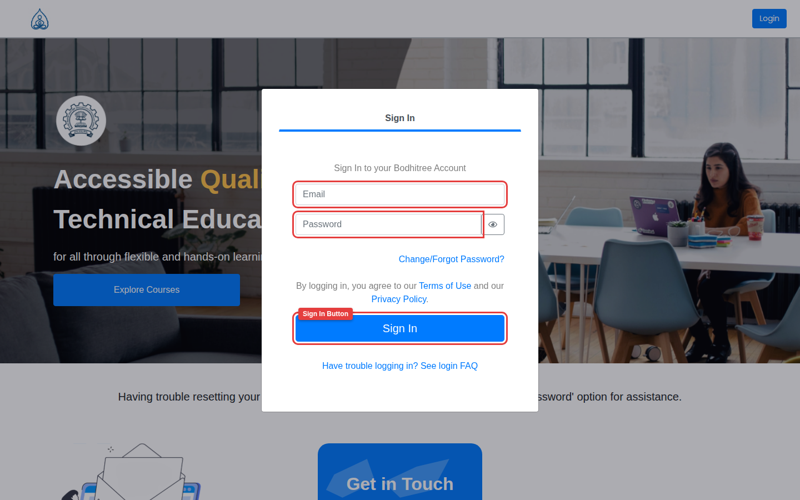
*Figure 2: BodhiTree Sign In Dialog for entering email and password.*

> [!TIP]
> BodhiTree automatically keeps your login session active in your browser. You do not need to sign in repeatedly when opening different courses or chapters. If you stay away for several days, your session will automatically time out for security, and you can simply log in again.

---

## Section 2: Course Dashboard & Course Management

After logging in, BodhiTree takes you to the **My Courses** dashboard. This is your home screen where every course you teach or manage is listed.

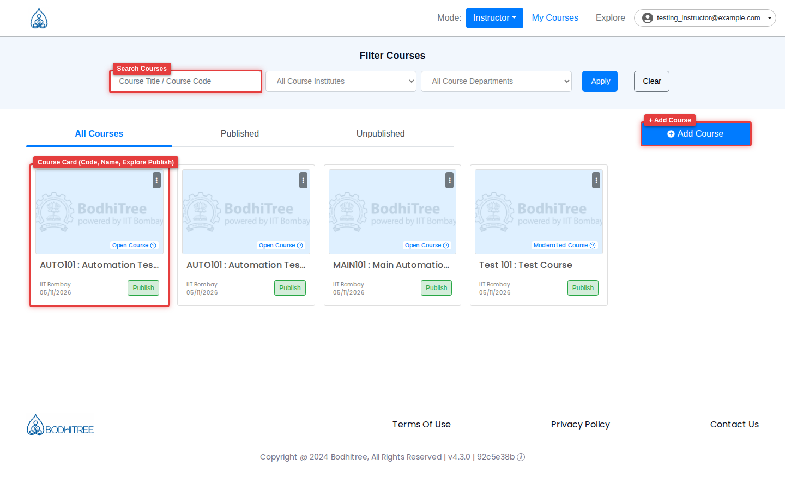
*Figure 3: My Courses Dashboard showing course cards, search bar, and Add Course button.*

---

### 2.1 The My Courses Dashboard

As shown in **Figure 3**, the dashboard has three main areas:
* **Course Cards:** Every course is shown as a card displaying the Course Code, Course Title, and Institution name. If the course is not published yet, you will see a green **Publish** button to make it visible in the Explore catalog. Once published, the card displays a green published badge.
* **Search Courses Input:** Located at the top-left, this search bar lets you find any course instantly by typing its code (like `CS101`) or title keyword.
* **+ Add Course Button:** Located at the top-right, this blue button opens the course creation form.

---

### 2.2 Creating a New Course Offering

To create a new course:
1. Click the **+ Add Course** button on the dashboard (**Figure 3**).
2. The **Add Course** popup dialog appears on your screen, as shown in **Figure 4**.

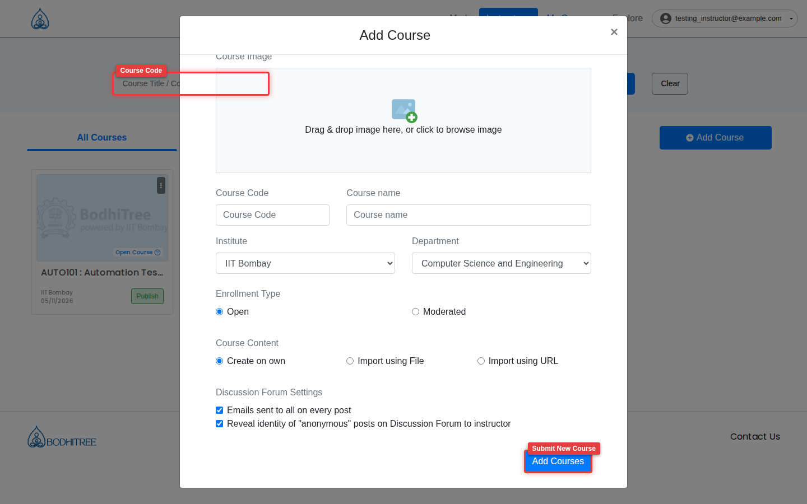
*Figure 4: Add Course Dialog with Course Code, Course Name, and Enrollment Type.*

3. Fill in the fields:
   * **Course Code:** Enter a unique identifier for your course (e.g., `CS101`, `EE204`, or `MAIN101`).
   * **Course Name:** Enter the full course title (e.g., `Computer Programming Fundamentals`).
   * **Enrollment Type:** Choose between:
     * **Open Course:** Any student registered on the portal can click and join the course directly.
     * **Moderated Course:** Students can request to join, but an instructor or TA must review and approve their request before they get access.
4. Click the blue **Add Course** button inside the modal to save.
5. Your new course card will appear on the dashboard right away.

> [!IMPORTANT]
> Course codes must be unique in your institution. If another course is already using that exact code, the system will show an error asking you to choose a different course code.

---

### 2.3 Course Card Options (Three-Dot Menu)

On every course card (shown in **Figure 3**), there is a three-dot menu button (`⋮`) in the top-left corner. Clicking it reveals two actions:
1. **Download Course:** Creates and downloads an archive file containing the course structure and materials.
2. **Delete Course:** Permanently deletes the course and all its student records from the database.

> [!NOTE]
> There is **no Edit Course option** inside the three-dot menu on the course card. If you want to change the course name, description, or enrollment mode, open the course and go to **Course Settings** (described in [Section 13.1](#131-general-course-settings)).

---

## Section 3: Course Navigation Overview

Click on any course card from your dashboard to enter that course workspace. The left sidebar gives you quick access to all parts of the course.

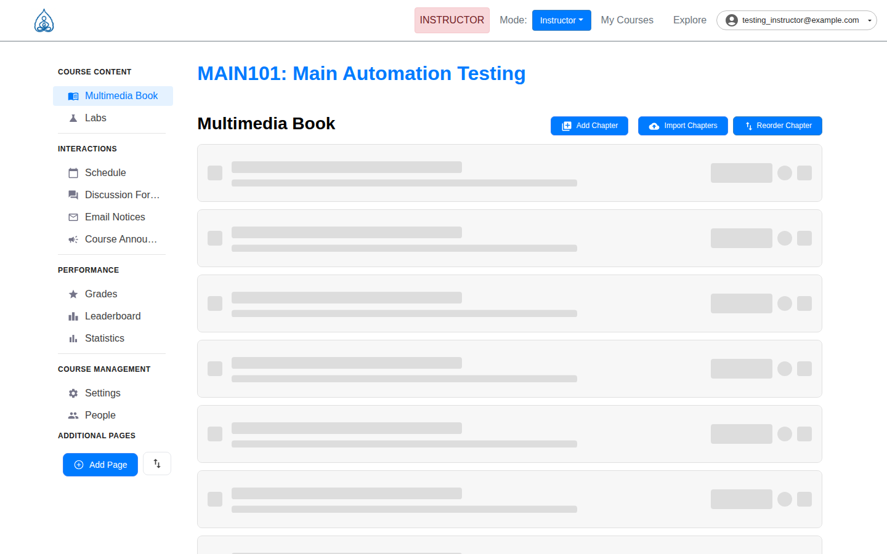
*Figure 5: Course Workspace Sidebar showing navigation sections.*

---

### 3.1 The Course Sidebar Navigation

As shown in **Figure 5**, the sidebar organizes your course into distinct functional areas.

### 3.2 Organization of Menu Items

| Section | Menu Option | What It Is Used For |
| :--- | :--- | :--- |
| **Course Content** | **Multimedia Book** | The textbook view. Contains chapters, sections, lecture notes, video lessons, and in-book quizzes (see [Section 4](#section-4-the-multimedia-book-mmb-chapters--sections)). |
| **Course Content** | **Labs** | The laboratory section for practice coding problems and graded lab quizzes (see [Section 8](#section-8-practice-labs-management--bulk-actions)). |
| **Interactions** | **Schedule** | Displays the course calendar with scheduled activities, assignment deadlines, and lecture timings. |
| **Interactions** | **Discussion Forum** | The class discussion board where students post questions and instructors/TAs reply (see [Section 14.1](#141-class-discussion-forum)). |
| **Interactions** | **Email Notices** | Send official email notices directly to all enrolled students' registered email inboxes. |
| **Interactions** | **Course Announcements** | Post broadcast notices that display on students' course home screens (see [Section 14.2](#142-course-announcements)). |
| **Performance** | **Grades** | The complete gradebook table showing marks across all labs, coding tasks, and quizzes (see [Section 15.1](#151-grades-dashboard)). |
| **Performance** | **Labs Performance** | Detailed activity-wise performance statistics and completion percentages. |
| **Performance** | **Leaderboard** | Shows student rankings based on points scored in practice activities. |
| **Performance** | **Statistics** | Visual charts showing score distributions and class averages. |
| **Course Management**| **Settings** | General course information, forum moderation settings, and content protection toggles (see [Section 13](#section-13-course-settings--content-protection)). |
| **Course Management**| **People** | View enrolled students, invite teaching assistants, or upload a class list via CSV (see [Section 12](#section-12-people--student-enrollment)). |
| **Additional Pages** | **Add Page** | Create custom markdown or rich-text web pages (e.g. Course Syllabus, Grading Policy, TA Office Hours). |

---

## Section 4: The Multimedia Book (MMB): Chapters & Sections

The **Multimedia Book (MMB)** is the digital textbook of your course. You can organize your syllabus into **Chapters**, subdivide them into **Sections**, and add learning materials inside each section.

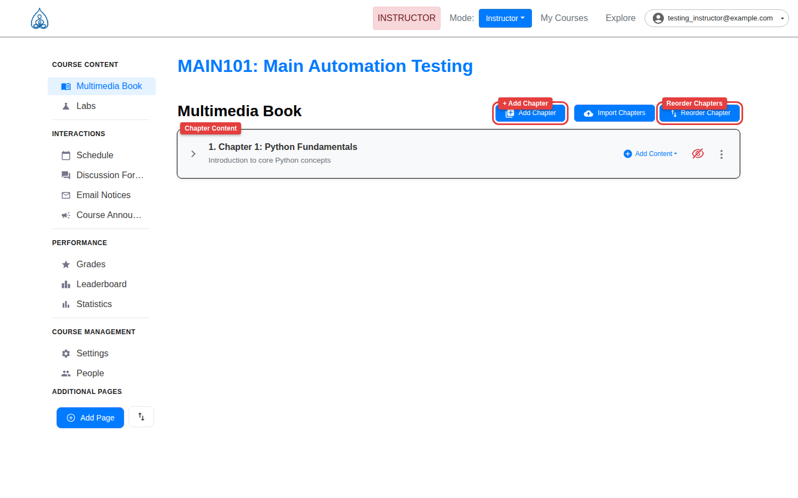
*Figure 6: Multimedia Book Overview showing chapters and Add Chapter button.*

---

### 4.1 Book Organization & Structure

As shown in **Figure 6**, the Multimedia Book displays your chapters in vertical sequence. Each chapter functions as an accordion card that expands to show its sections and contents.

---

### 4.2 Creating a New Chapter

To add a new chapter to your book:
1. Click the blue **+ Add Chapter** button at the top-right of the Multimedia Book (**Figure 6**).
2. The **Add Chapter** modal dialog opens, as shown in **Figure 7**.

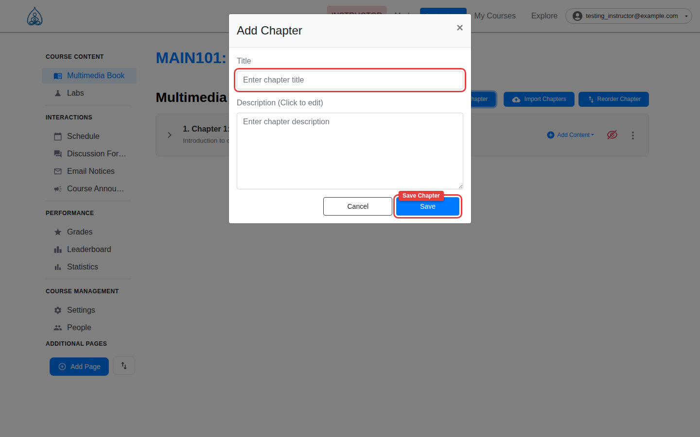
*Figure 7: Add Chapter Modal with Title and Description fields.*

3. Enter the **Chapter Title** (e.g., `Chapter 1: Python Fundamentals`).
4. Enter an optional **Description** giving an overview of the chapter topics.
5. Click **Save Chapter**. The new chapter accordion appears in your book immediately.

---

### 4.3 Managing Chapters & Adding Sections

Once a chapter is created, you can manage it using the controls shown in **Figure 8**:

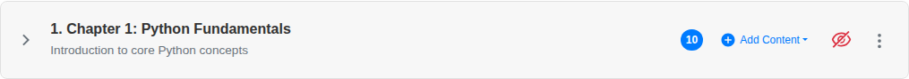
*Figure 8: Chapter Card showing header bar, Add Content button, and publish toggle.*

* **Expand / Collapse Accordion:** Click on the chapter header bar to reveal or hide the contents inside.
* **Chapter Menu (`⋮`):** Provides options to edit the chapter title/description or delete the chapter. When deleting a chapter, BodhiTree asks for a confirmation and permanently removes the chapter (chapters do not move to the Recycle Bin).
* **Publish / Eye Icon:** Click to toggle the chapter between Published (visible to enrolled students) and Unpublished (hidden from students).
* **+ Add Content Button:** Opens the menu to add learning materials inside this chapter.

---

## Section 5: Adding Learning Materials (Sections, In-Book Quizzes, Documents, Videos & URLs)

Inside any chapter, clicking the **+ Add Content** button opens the dropdown menu shown in **Figure 9**:

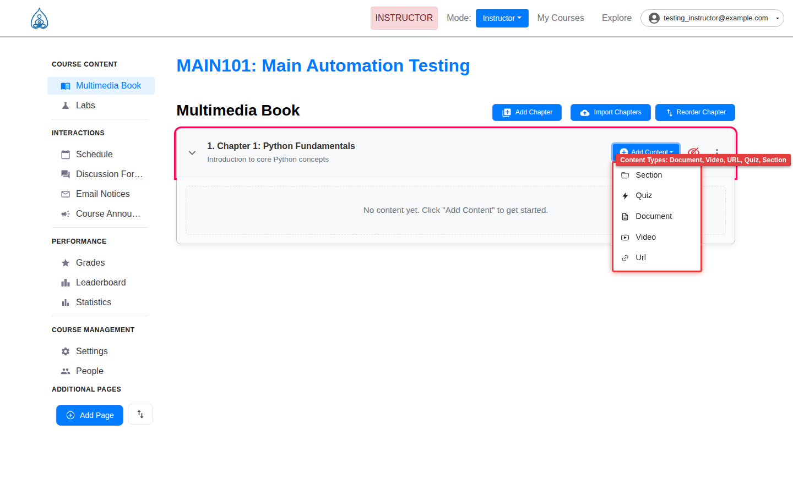
*Figure 9: Add Content Dropdown offering Section, Quiz, Document, Video, and URL options.*

---

### 5.1 The Add Content Menu

The dropdown provides five distinct content types in exact order:
1. **Section:** Group learning materials into clear topical sub-sections within the chapter.
2. **Quiz:** Add an interactive In-Book Quiz directly inside the chapter to test concepts while reading.
3. **Document:** Upload PDF reading handouts and lecture slides for students.
4. **Video:** Upload video lectures for students to watch.
5. **URL:** Link external web pages and reference documentation.

---

### 5.2 Adding a Section

Sections act as sub-folders inside a chapter to organize your topics cleanly:
1. Select **Section** from the dropdown (**Figure 9**).
2. In the popup dialog, enter the **Section Title** (e.g., `1.1 Variables and Assignment Statements`).
3. Enter an optional **Description** explaining the topics covered in this section.
4. Click **Save Section**. A new section card appears inside the chapter accordion where you can attach reading documents, videos, and quizzes.

---

### 5.3 Adding an In-Book Quiz

An **In-Book Quiz** is an interactive practice checkpoint placed directly inside a chapter or section. While students read through textbook chapters, they can solve questions on-screen to check their understanding right away:
1. Select **Quiz** from the dropdown (**Figure 9**).
2. The **Add Quiz** modal opens.
3. Enter the **Quiz Title** (e.g., `Concept Check 1: Python Data Types`).
4. Enter an optional **Description** describing what the quiz covers.
5. Click **Submit** to attach the quiz card inside your chapter.
6. Once created, click on the quiz card to open the **Quiz Editor** and add question modules and questions directly via the web UI (detailed in [Section 6](#section-6-the-multimedia-quiz-editor-generating-quizzes-via-ui)).

---

### 5.4 Adding a Document (PDF Handouts)

1. Select **Document** from the dropdown (**Figure 9**).
2. The **Add Document** modal appears, as shown in **Figure 10**.

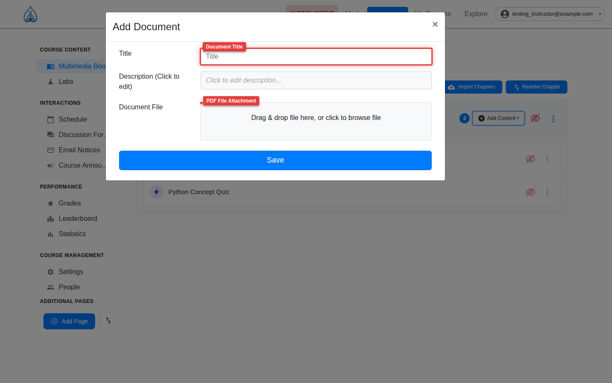
*Figure 10: Add Document Modal with Title and PDF File Upload.*

3. Enter the **Document Title** (e.g., `Lecture 1 Notes - Variables & Expressions`).
4. Enter an optional description.
5. Click **Choose File** and select your `.pdf` document from your computer.
6. Click **Submit** to attach the document.

---

### 5.5 Adding a Video Lecture

1. Select **Video** from the dropdown (**Figure 9**).
2. The **Add Video** modal appears, as shown in **Figure 11**.

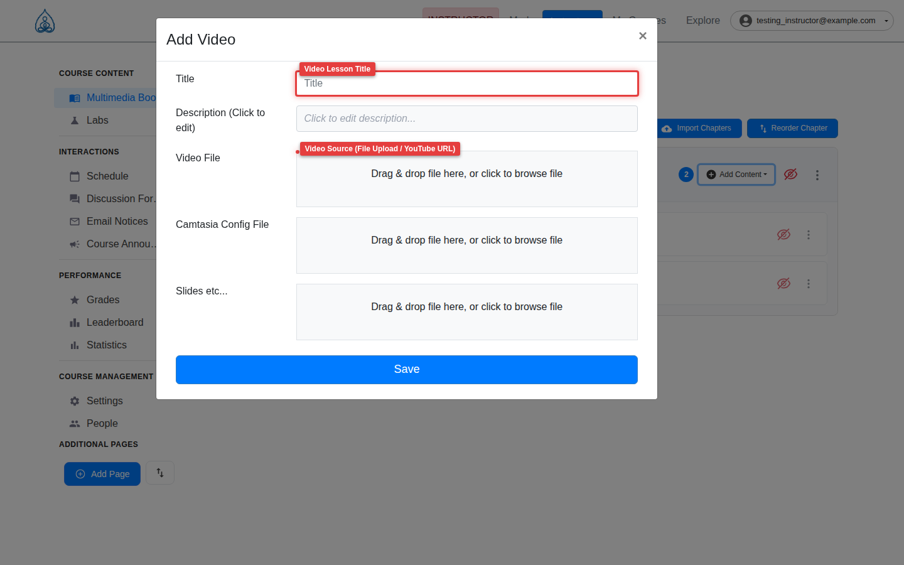
*Figure 11: Add Video Modal with Title, Description, and Video File Upload.*

3. Enter the **Video Title** and an optional description.
4. Click **Choose File** and select your video file (`.mp4` or `.webm`) from your computer.
5. Click **Save** to upload and attach the video lesson under your chapter.

---

### 5.6 Adding External Web URLs

1. Select **URL** from the dropdown (**Figure 9**).
2. The **Add URL** modal opens, as shown in **Figure 12**.

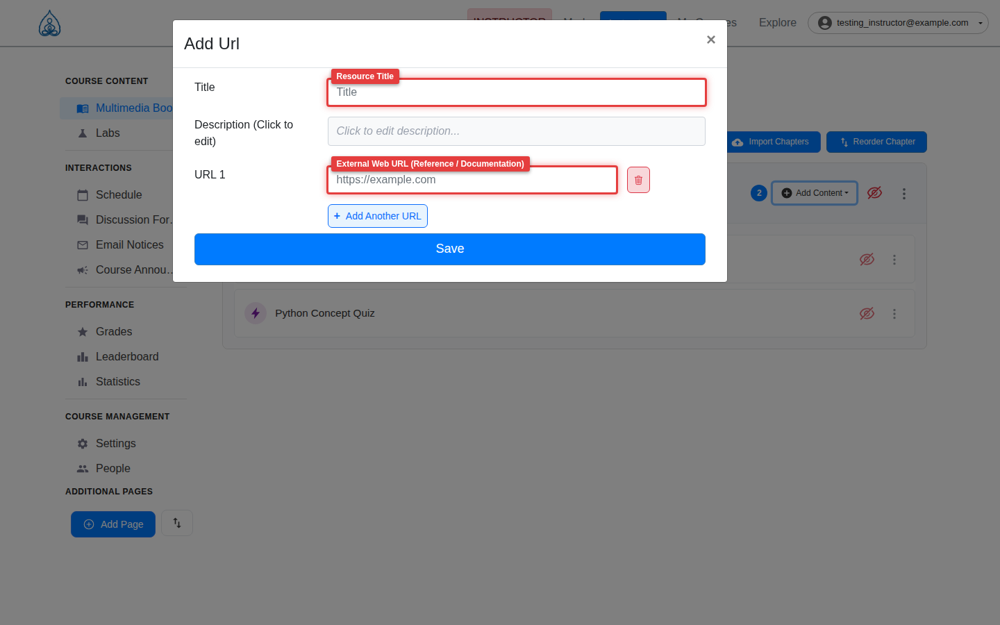
*Figure 12: Add URL Modal with Resource Title and Web URL fields.*

3. Enter the **Resource Title** (e.g., `Python Standard Library Documentation`).
4. In the **URL** field, enter the full web address (starting with `https://`).
5. Click **Submit**. When students click this card, the webpage opens in a clean inline frame or in a new browser tab.

---

## Section 6: The Multimedia Quiz Editor: Generating Quizzes via UI

BodhiTree provides a built-in web-based **Quiz Editor** that lets instructors author interactive quizzes directly in their browser. You do not need to prepare complex spreadsheet templates or external files; you can create questions, set correct options, and configure marks using simple visual forms.

### 6.1 Purpose of the Quiz Editor

The Quiz Editor is used to author questions for both **In-Book Quizzes** in the Multimedia Book and **Lab Quizzes** in Practice Labs. It provides a visual interface for:
* Grouping questions into structured modules.
* Adding questions across multiple formats (Single Choice, Multiple Choice, Numerical, and Descriptive).
* Setting point values, answer explanations, and student hints.
* Reordering, editing, and deleting questions directly on screen.

---

### 6.2 Organizing Questions with Modules

In BodhiTree, questions inside a quiz are grouped into **Modules**. A module represents a topic or subsection of the quiz (for example, "Module 1: Basic Syntax" or "Module 2: Loop Logic").

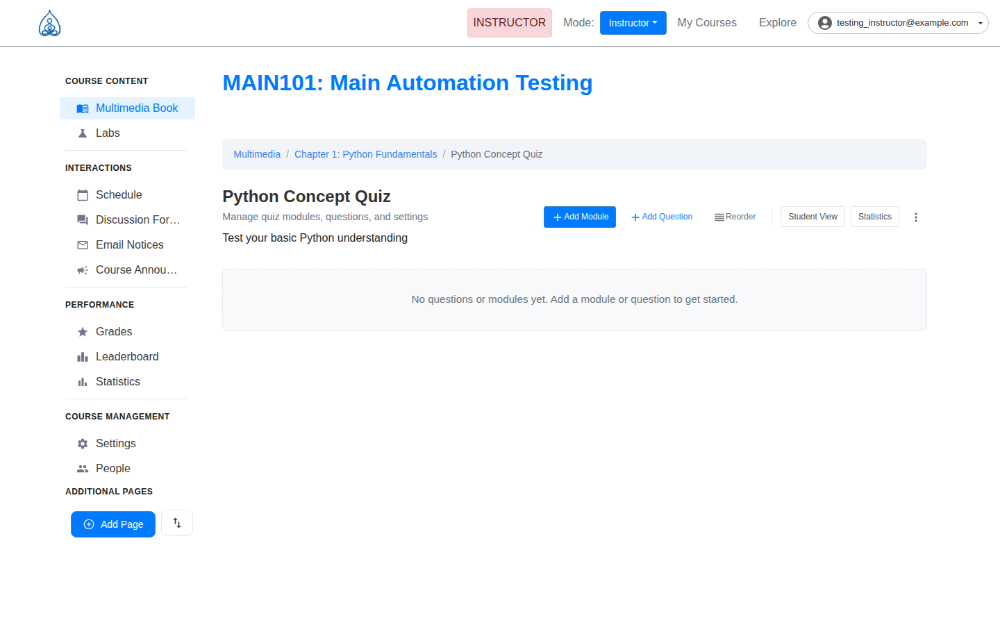
*Figure 13: Quiz Editor showing question modules, question list, and action buttons.*

As shown in **Figure 13**, the Quiz Editor workspace provides:
* **Module Container:** Displays the module title, total questions, and question cards.
* **+ Add Module Button:** Creates a new question module group.
* **+ Add Question Button:** Opens the question builder modal inside that specific module.
* **Action Buttons:** Lets you edit module titles, reorder modules up or down, or delete empty modules.

---

### 6.3 Adding and Configuring Questions

To add a question to any module:
1. Click the blue **+ Add Question** button inside that module (**Figure 13**).
2. The **Add Question** modal dialog opens, as shown in **Figure 14**.

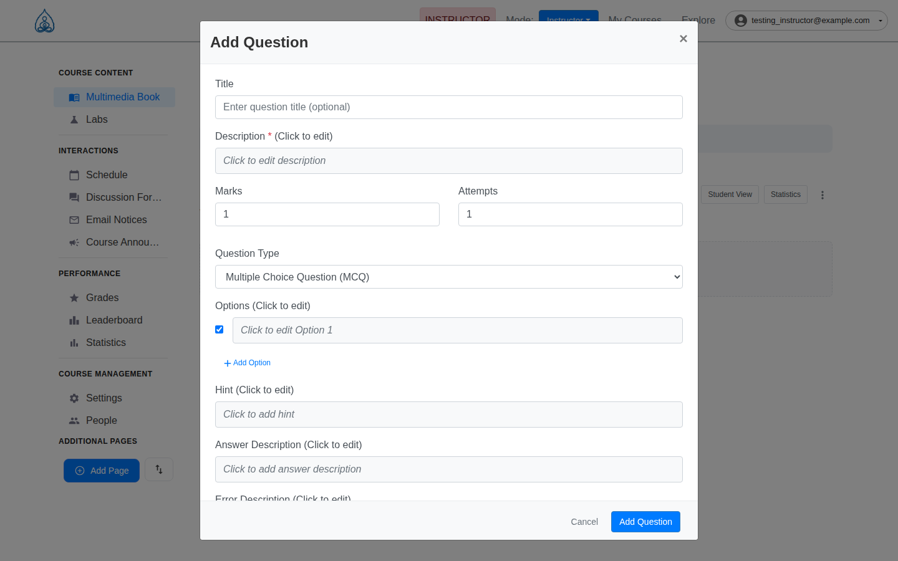
*Figure 14: Add Question Modal with Question Type selection, Options, Marks, and Hints.*

3. Configure the question details:
   * **Question Type:** Select the question format:
     * **Single Choice (SCQ):** A multiple choice question with one correct answer.
     * **Multiple Choice (MCQ):** A question with one or more correct options.
     * **Numerical:** Students type an exact numerical answer or value.
     * **Descriptive:** An open-ended question where students type detailed written answers.
   * **Question Statement:** Enter the problem text, code snippet, or prompt for students.
   * **Choices / Options:** Add option choices for SCQ and MCQ questions. Select the radio button or checkbox next to the correct answer choice.
   * **Marks / Points:** Enter the points awarded for a correct answer.
4. Click **Save** to add the question into the module.

---

### 6.4 Understanding Hints, Answer Descriptions, and Error Descriptions

The Quiz Editor gives students rich educational feedback:
* **Hints:** You can provide one or more hints that students can open if they are stuck during practice.
* **Answer Description:** Enter a detailed solution explanation that students see after submitting their quiz, explaining why the correct choice is right.
* **Error Description:** Enter specific explanations displayed when a student selects an incorrect option, helping them understand where their reasoning went wrong.

---

## Section 7: In-Video Quizzes & Timeline Markers

In the **Multimedia Book**, instructors can embed interactive assessments directly inside lecture videos. This transforms passive lecture viewing into active learning by verifying comprehension at key points in the video.

### 7.1 Purpose of In-Video Quizzes

Unlike traditional quizzes that are attempted separately, **In-Video Quizzes** pause video playback automatically when a student reaches a designated timestamp. The student must answer the prompt before playback continues. This ensures students understand each concept before the lecture moves forward.

---

### 7.2 The Video Player Workspace

When you open an uploaded video lesson as an instructor, BodhiTree presents an interactive video player workspace with the **Chapters & Markers** toolbar located directly beneath the player screen:

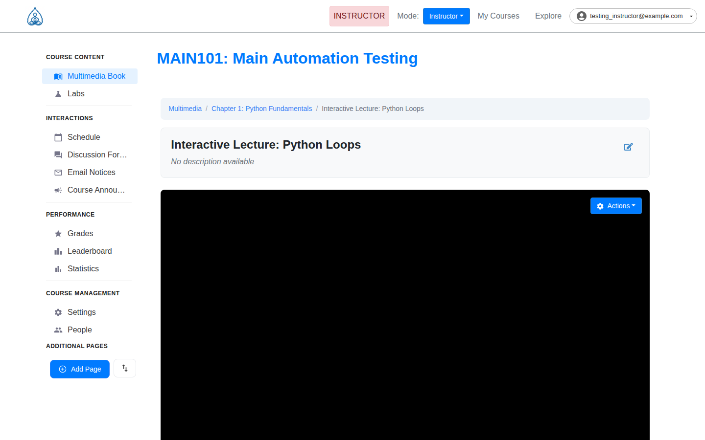
*Figure 15: Video Player Workspace showing the video screen and Chapters & Markers timeline toolbar.*

As shown in **Figure 15**, the timeline bar displays color-coded markers at exact seconds. Instructors can scrub the playhead to any second and create markers.

---

### 7.3 Section Markers vs. Quiz Markers

BodhiTree supports two types of timeline markers on video lectures:

1. **Section Marker (`S`):**
   * Acts as a named bookmark on the video progress bar (e.g., `0:00 - Introduction to Iteration`).
   * Indexes long lectures into topics so students can quickly jump to concepts without scrubbing.
2. **Quiz Marker (`Q`):**
   * Placed at an assessment timestamp (e.g., `0:05 - Concept Check: While Loops`).
   * Automatically pauses playback and displays an interactive assessment prompt.
   * When setting up a Quiz Marker, BodhiTree gives you two creation paths:
     * **Add Question:** Creates a single question right at that timestamp.
     * **Add Module:** Links a whole question group/module containing multiple questions.

---

### 7.4 Adding, Editing, and Deleting Markers (CRUD Operations)

Instructors can perform full management operations directly from the video workspace:

* **Adding Markers:** Play or scrub the video to your desired timestamp, then click **Add Marker/Quiz** above the timeline bar. Choose the marker type (`Section Marker` or `Quiz Marker`), enter the title, and save.
* **Editing Markers:** Click on any marker in the timeline bar. The inline **Edit Marker** panel opens directly below the video player, as shown in **Figure 16**:

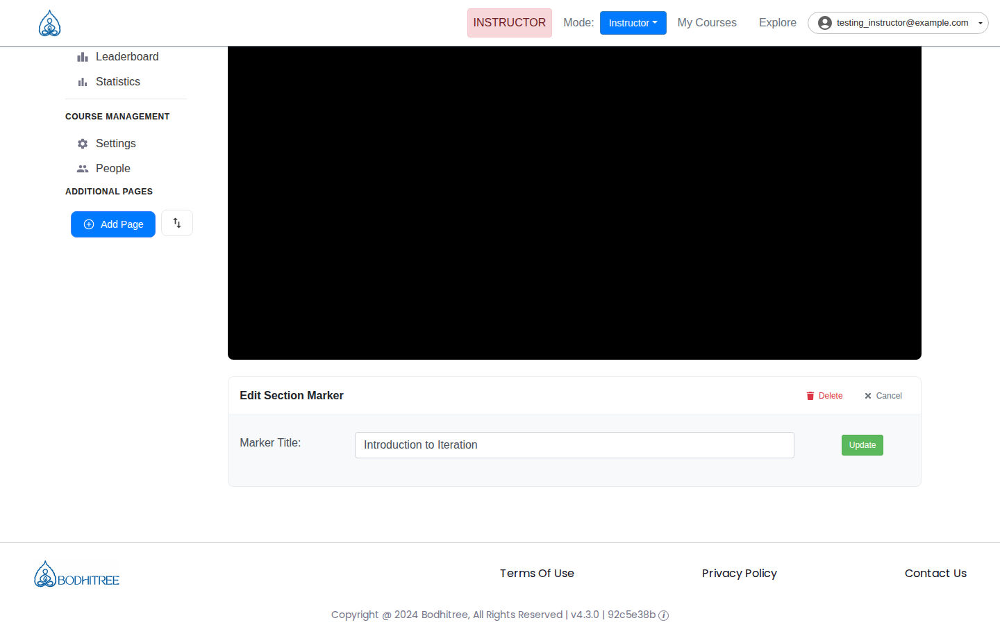
*Figure 16: Inline Edit Marker Panel for updating marker title, timestamp, questions, or deleting markers.*

* **Updating Content:** Inside the Edit Marker panel (**Figure 16**), you can modify the marker title, adjust the timestamp, update question options and marks, or toggle visibility.
* **Deleting Markers:** Click the red **Delete** button inside the Edit Marker panel to remove the marker from the video timeline.

---

## Section 8: Practice Labs Management & Bulk Actions

The **Practice Labs** section (`/courseware/course/<id>/content/labs`) is where instructors host hands-on coding exercises and laboratory assignments.

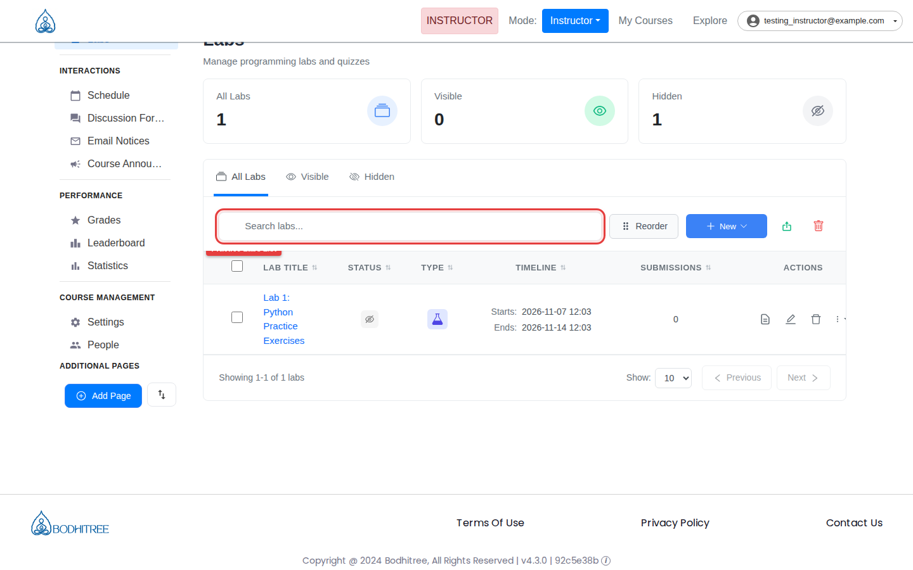
*Figure 17: Practice Labs Dashboard showing lab list, search, and New dropdown.*

---

### 8.1 Practice Labs Dashboard

As shown in **Figure 17**, the labs dashboard lists all practice labs in your course:
* **Lab Cards/Rows:** Display the Lab Title, Start Date, Due Date, and active activities count.
* **+ New Dropdown:** Located at the top-right, lets you create a new lab.

---

### 8.2 Creating a New Practice Lab

1. Click the **+ New** dropdown at the top-right (**Figure 17**) and choose **New Lab**.
2. The **Create Lab** modal opens, as shown in **Figure 19**.

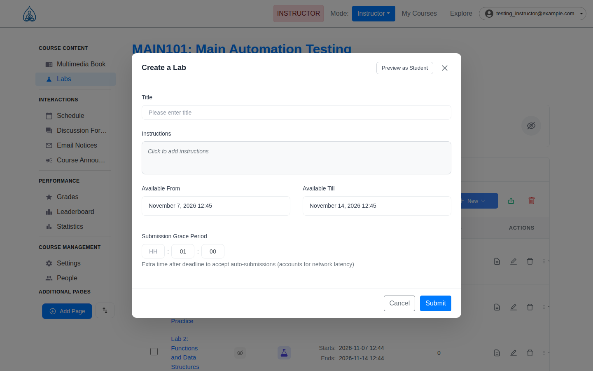
*Figure 19: Create Practice Lab Modal with Title, Instructions, and Availability Dates.*

3. Fill in the fields:
   * **Title:** e.g., `Lab 1: Python Basics Practice`.
   * **Instructions:** Detailed problem overview, objectives, and laboratory rules.
   * **Available From & Available Till:** The date and time window when the lab is open for student submissions.
4. Click **Create Lab** to save.

---

### 8.3 Bulk Show & Hide Operations

When managing multiple labs across a semester, you do not need to publish them one by one. You can use bulk actions:

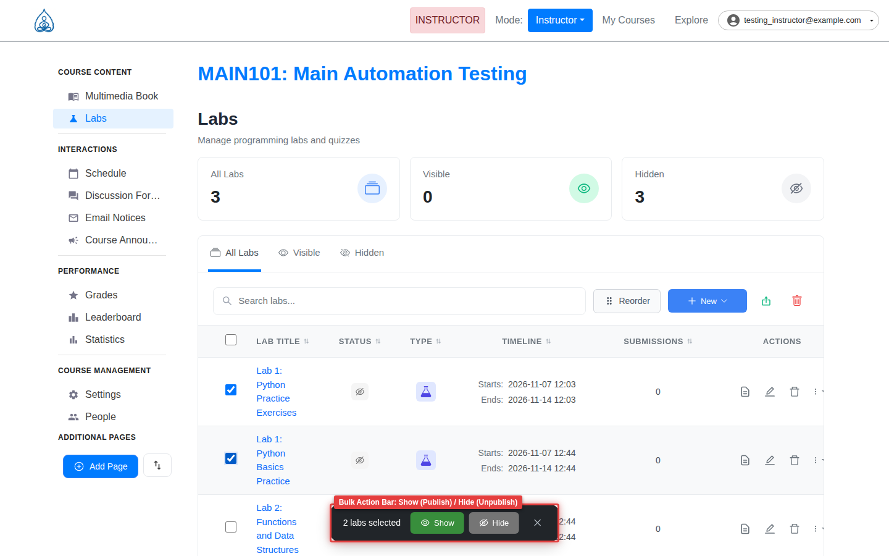
*Figure 18: Practice Labs List with multiple checkboxes selected and Bulk Action Bar at bottom.*

1. Check the selection checkbox next to one or more labs in the list (as shown in **Figure 18**).
2. The **Bulk Action Bar** pops up at the bottom of the screen.
3. Click **Show** to publish all selected labs to students at once.
4. Click **Hide** to unpublish and hide the selected labs from students.

---

### 8.4 Inside a Practice Lab

Click on any lab title to open its detail page, shown in **Figure 20**:

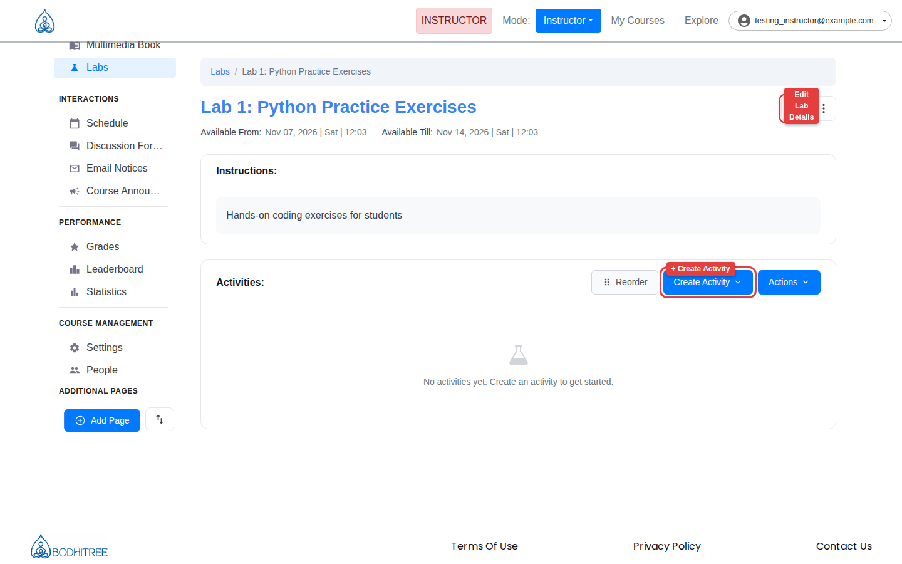
*Figure 20: Lab Detail Page showing Activities list, + Add Activity button, and Submissions tab.*

* **+ Add Activity Button:** Create a **Programming Activity** (coding problem with automated test cases) or a **Quiz Activity** (graded lab quiz).
* **Submissions Tab:** View all student submission attempts, overall scores, and download reports (see [Section 11.1](#111-overall-lab-submissions-page)).
* **Lab Settings:** Change availability dates and instructions.

---

## Section 9: Programming Activities & Autograding

A **Programming Activity** provides a hands-on coding environment. Students write and run code directly in their browser, and BodhiTree automatically evaluates their solutions against test cases.

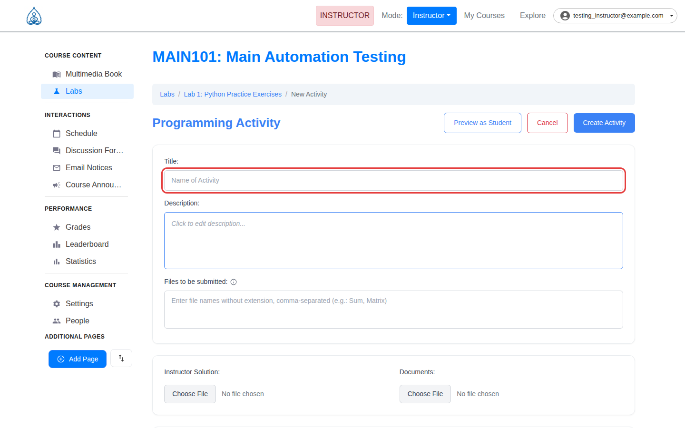
*Figure 21: Programming Activity Editor showing problem statement, code editor, and test case panels.*

---

### 9.1 What is a Programming Activity?
In a programming activity, students write code in an interactive code editor. When they click "Run Code", the platform executes their program inside a secure sandbox and checks the output against your test cases.

---

### 9.2 Setting Up Problem Statements, Starter Code, and Reference Solutions

When creating or editing a programming activity (**Figure 21**), configure the following:

1. **Problem Statement:** Clear instructions explaining what the program should do, input formats, expected outputs, and constraints.
2. **Language Selection:** Choose the programming language (e.g., Python 3, C, C++, Java).
3. **Starter / Boilerplate Code:** Pre-written skeleton code provided to students (such as function definitions, required imports, or input handling).
4. **Instructor Reference Solution:** A complete working solution written by the instructor. BodhiTree runs this reference code against all test cases to verify that your test cases are correct.

---

### 9.3 Configuring Test Cases: Visible vs. Hidden

BodhiTree supports two types of test cases:

* **Visible Test Cases:** Students can see both the input given to the program and the expected output. These help students test and debug their code while working on the problem.
* **Hidden Test Cases:** Students cannot see the inputs or outputs. These test edge cases, large inputs, and boundary conditions. They are evaluated when the student submits code for final grading to ensure they did not hardcode answers.

---

### 9.4 Setting CPU and Memory Resource Limits

To keep the platform responsive and prevent accidental infinite loops, configure resource limits:
* **CPU Time Limit:** Maximum execution time allowed per run (e.g., 2.0 seconds). If a student writes an infinite `while` loop, execution stops with a "Time Limit Exceeded" message.
* **Memory Limit:** Maximum RAM allocated per run (e.g., 256 MB) to prevent out-of-memory errors.

---

## Section 10: Lab Quizzes: Creation, Authoring & Settings

A **Lab Quiz** is a graded assessment activity housed inside a practice lab. It evaluates student performance as part of lab coursework alongside programming activities.

### 10.1 Important Difference: In-Book Quiz vs. Lab Quiz

| Feature | In-Book Quiz (In Multimedia Book) | Lab Quiz (In Practice Labs) |
| :--- | :--- | :--- |
| **Location** | Inside chapter reading view (see [Section 5.3](#53-adding-an-in-book-quiz)) | Inside Practice Labs activity list (see [Section 8.4](#84-inside-a-practice-lab)) |
| **Primary Goal** | Self-paced practice with instant learning feedback | Graded lab assessment and evaluation |
| **Timeline & Deadlines** | Available whenever the chapter is released | Governed by the parent Lab timeline (`Available From` / `Available Till`), identical to programming activities |
| **Authoring Method** | Built directly on screen using Modules & Questions (see [Section 6](#section-6-the-multimedia-quiz-editor-generating-quizzes-via-ui)) | Web-based Quiz Editor via **Edit Questions** (identical UI to In-Book Quiz), or optional ODT upload |
| **Resubmission Control** | Unlimited practice attempts | Configurable: **Allow students to resubmit until deadline** |
| **Score Visibility** | Instant score and explanations displayed | Configurable: **Allow students to see their marks on quiz submission** |
| **Answer Revelation** | Direct solution explanation provided | Configurable: **Reveal correct answers to students** |
| **Feedback & Grading** | Immediate formative hints | Graded submissions dashboard with individual student answer sheets |

---

### 10.2 Creating a Lab Quiz Activity & Settings

To create a Lab Quiz:
1. Inside your lab (**Figure 20**), click **Create Activity** and choose **Quiz Activity**.
2. The Quiz Activity creation form opens, as shown in **Figure 22**:

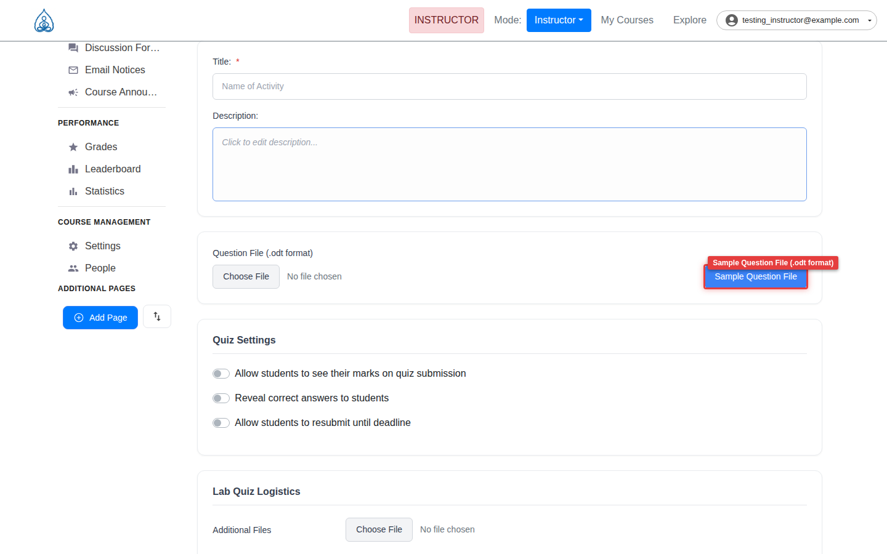
*Figure 22: Quiz Activity Creation Form with Title, Instructions, and Quiz Settings.*

3. Configure the activity settings:
   * **Title:** Enter the quiz title (e.g., `Midterm Lab Quiz: Algorithms & Complexity`).
   * **Description:** Add instructions, syllabus topics, and rules for students.
   * **Allow students to see their marks on quiz submission:** When enabled, students see their score right after submitting.
   * **Reveal correct answers to students:** When enabled, students can see the correct answers after submission.
   * **Allow students to resubmit until deadline:** When enabled, students can update and resubmit their answers as long as the parent lab is active.
   * **Additional Files:** Optionally specify if students must upload supporting files (code files, calculations, or report documents).
4. Click **Create Activity** to save the quiz.

> [!NOTE]
> **Lab Timelines Manage Deadlines:**
> Individual quiz activities do not have separate soft or hard deadlines. All activities inside a lab share the lab's `Available From` and `Available Till` schedule. When the lab timeline ends, submissions for all activities in that lab are locked.

---

### 10.3 Authoring Questions via Web UI Quiz Editor

Once a quiz activity is created, you do not need external software or file templates to build your questions:
1. On the lab page, click on the quiz activity to open its view page, shown in **Figure 23**:

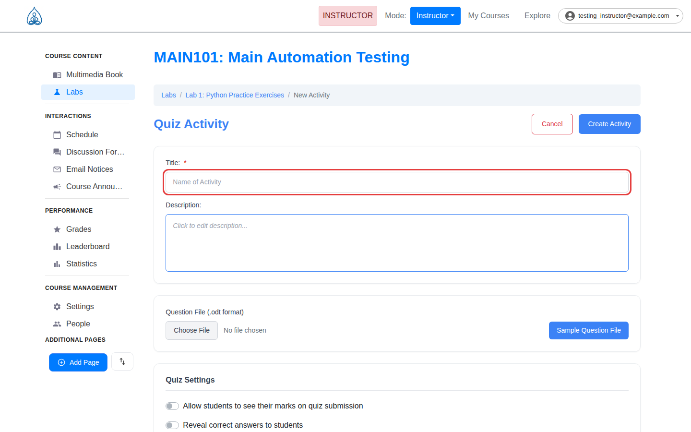
*Figure 23: Quiz Activity Detail Page showing Edit and Edit Questions buttons.*

2. Click **Edit** in the top action bar.
3. Click **Edit Questions** to open the interactive web-based **Quiz Editor**.
4. The Quiz Editor provides the exact same authoring interface as In-Book quizzes (detailed in [Section 6](#section-6-the-multimedia-quiz-editor-generating-quizzes-via-ui)):
   * Click **+ Add Question** to create questions inside modules.
   * Add Single Choice (SCQ), Multiple Choice (MCQ), Numerical, or Descriptive questions.
   * Set question prompts, option choices, points/marks, and explanation notes.
   * Save changes directly in your browser without preparing external documents.

---

### 10.4 Monitoring Submissions & Individual Student Grading

BodhiTree provides a detailed submission dashboard for lab quizzes:
1. On the quiz activity page, click the **Submissions** button (or view the lab submissions dashboard).
2. The dashboard displays the full student roster:
   * **S.No., Email, Name, and Roll Number**
   * **Marks & Total Marks:** Automatically computed score.
   * **Submission Timestamp:** When the student submitted their attempt.
   * **View Submission Action:** Clicking on a student's row opens their complete answer sheet, displaying their chosen options, marked answers, and awarded scores question by question.

---

## Section 11: Submissions Management & Student Evaluation

BodhiTree provides tools to inspect student code, view test case evaluations, and grade quiz submissions.

---

### 11.1 Overall Lab Submissions Page

Access the lab submissions dashboard by clicking the **Submissions** tab inside any practice lab (`/courseware/course/<id>/content/labs/<lab_id>/submissions`):

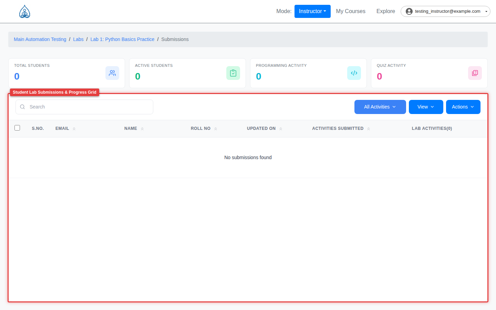
*Figure 24: Lab Submissions Dashboard showing student roster, activity scores, and export buttons.*

As shown in **Figure 24**, this page displays:
* A table listing all enrolled students with their Roll Numbers and Names.
* Scores achieved across each programming problem and quiz in the lab.
* An **Export CSV** button to download the entire submission report as an Excel spreadsheet.

---

### 11.2 Programming Activity Submissions & Code Viewer

To review student code for a specific programming problem:
1. Open the programming activity and click the **Submissions** tab.
2. The student list displays each student's latest submission timestamp, evaluation status (Accepted, Wrong Answer, Time Limit Exceeded), and score.
3. Click **View Code** next to any student to open the code viewer modal, as shown in **Figure 25**:

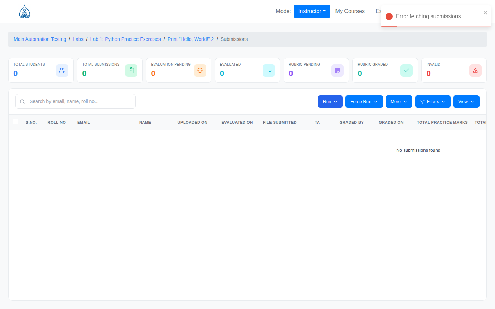
*Figure 25: Programming Submission Viewer showing student submitted code and test case evaluations.*

* **Code Viewer Panel:** Displays the exact code submitted by the student with syntax highlighting.
* **Test Case Results:** Shows which visible test cases passed or failed, execution time, and stdout/stderr output.
* **Manual Feedback:** Instructors can leave comments directly for the student to read.

---

### 11.3 Lab Quiz Submissions & Force Run Re-evaluation

To inspect quiz attempts and regrade:
1. Open the quiz activity and click **Submissions**, shown in **Figure 26**:

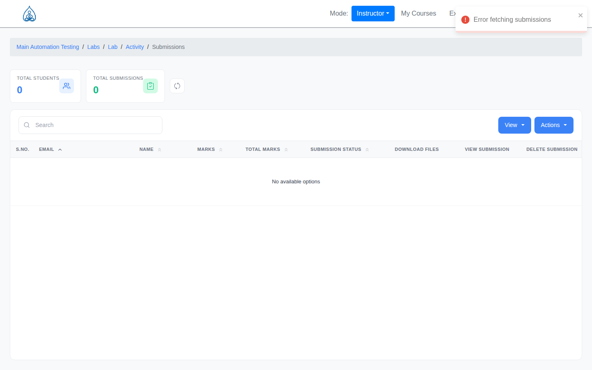
*Figure 26: Lab Quiz Submissions Dashboard showing student marks and Force Run button.*

2. Click on any student row to view their full answer sheet with marked choices and question-level scores.
3. **The Force Run Button:** If you update an answer key, correct a typo in a question, or adjust point weights after students have already submitted their answers, click the **Force Run** button at the top of the submissions table (**Figure 26**). BodhiTree will automatically re-evaluate all past student submissions against the updated answer key and refresh their marks immediately.

---

## Section 12: People & Student Enrollment

The **People** page (`/courseware/course/<id>/settings/people`) lets instructors manage course participants, assign roles, and handle enrollment.

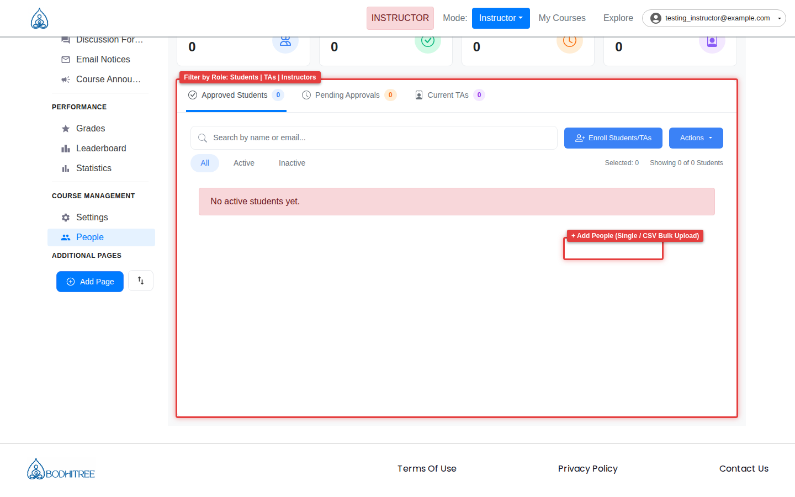
*Figure 27: People Dashboard showing enrolled users, roles, and Add User button.*

---

### 12.1 The People Dashboard

As shown in **Figure 27**, the People dashboard lists all enrolled users in a table with their Name, Email address, and assigned Role (`Student`, `Teaching Assistant`, or `Instructor`).

---

### 12.2 Single User Enrollment

To enroll an individual user:
1. Click the blue **+ Add User** button at the top-right (**Figure 27**).
2. Enter the user's registered email address.
3. Select their role:
   * **Student:** Can access published chapters, videos, and labs, and submit assignments.
   * **Teaching Assistant (TA):** Can grade submissions, answer discussion forum posts, and assist instructors.
   * **Instructor:** Has full administrative rights to add content, create labs, modify settings, and manage enrollment.
4. Click **Save** to add the user immediately.

---

### 12.3 Bulk CSV Student Upload

For classes with dozens or hundreds of students, enrolling students one by one is impractical. BodhiTree provides bulk CSV upload:
1. On the People page, click **Upload CSV**.
2. Prepare a standard `.csv` file in your spreadsheet software with the following column headers:
   ```csv
   email,roll_number,name
   student1@example.com,210050001,Aarav Sharma
   student2@example.com,210050002,Diya Patel
   student3@example.com,210050003,Rohan Verma
   ```
3. Click **Choose File**, select your CSV, and click **Upload**.
4. BodhiTree creates accounts for any new students, enrolls them in the course, and assigns their roll numbers automatically.

---

### 12.4 Role Responsibilities (Students, TAs, Instructors)

| Role | Access Permissions | Primary Responsibilities |
| :--- | :--- | :--- |
| **Student** | Read published content, submit code/quizzes, post on forums | Attending lectures, completing assignments, participating in discussions |
| **Teaching Assistant** | Grade submissions, view test results, moderate discussion forums | Helping students troubleshoot code, endorsing forum answers, grading lab work |
| **Instructor** | Full course control: add/delete materials, edit settings, manage grades | Course design, lecture uploads, setting grading policies, final grade exports |

---

## Section 13: Course Settings & Content Protection

Access course settings by clicking **Settings** under Course Management in the left sidebar (`/courseware/course/<id>/settings/general`).

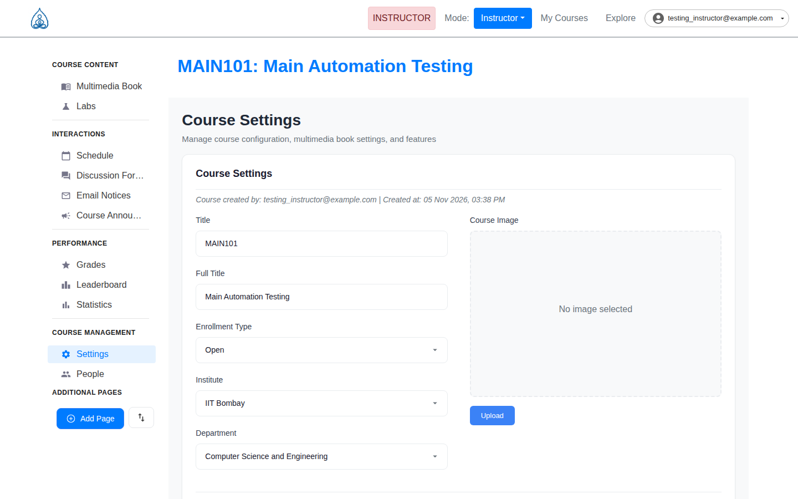
*Figure 28: Course Settings page showing general details and content protection toggles.*

---

### 13.1 General Course Settings

As shown in **Figure 28**, the General Settings tab allows you to configure:
* **Course Title & Code:** Update course display name or code.
* **Enrollment Mode:** Switch between Open Enrollment and Moderated Approval.
* **Course Description & Syllabus:** Provide background information and learning outcomes.

---

### 13.2 Discussion Forum Moderation Settings

Under the **Forum Settings** section:
* **Enable / Disable Discussion Forum:** Turn the course discussion board on or off.
* **Moderation Mode:** Require instructor or TA approval before student questions become visible to the whole class, preventing spam or inappropriate posts.
* **Anonymous Posting:** Allow students to ask questions without revealing their identity to classmates (instructors can still see the author's identity).

---

### 13.3 Content Protection & PDF Watermarking

To prevent unauthorized distribution of your lecture notes and handouts:
* **Disable PDF Downloads:** When enabled, the download button is removed from all PDF viewers in the course. Students can only read notes inside the secure BodhiTree viewer.
* **Student Watermarking:** Dynamically overlays the student's name, email, and roll number across every page of the PDF while they view it, discouraging screenshots and leaks.

---

## Section 14: Interactions: Discussion Forums & Announcements

BodhiTree includes integrated communication tools so instructors and students do not need external messaging groups.

### 14.1 Class Discussion Forum

Access the forum by clicking **Discussion Forum** under Interactions in the sidebar (`/courseware/course/<id>/interactions/discussion-forum`):

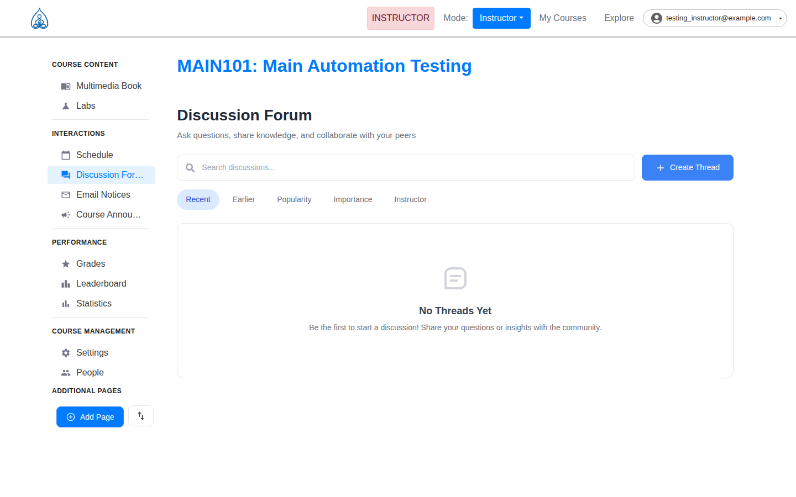
*Figure 29: Course Discussion Forum showing question threads and New Thread button.*

* **+ New Thread Button:** Students and instructors can post questions categorized by chapter or lab topic (**Figure 29**).
* **Instructor Endorsement:** Instructors and TAs can click "Approved by Instructor" on correct student replies to highlight the right answer to the class.
* **Upvoting:** Students can upvote helpful questions and answers.

---

### 14.2 Course Announcements

Access announcements by clicking **Course Announcements** under Interactions (`/courseware/course/<id>/interactions/announcements`):

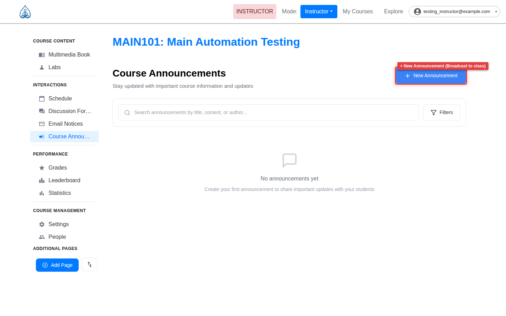
*Figure 30: Announcements Board showing broadcast updates and New Announcement button.*

* Click **+ New Announcement** (**Figure 30**).
* Enter a title (e.g., `Lab 1 Deadline Extended by 2 Days`) and your message body.
* When published, an announcement card appears on every enrolled student's course dashboard.

---

## Section 15: Performance Tracking & Gradebook

The **Grades** dashboard (`/courseware/course/<id>/performance/grades`) gathers student scores across all course activities into one view.

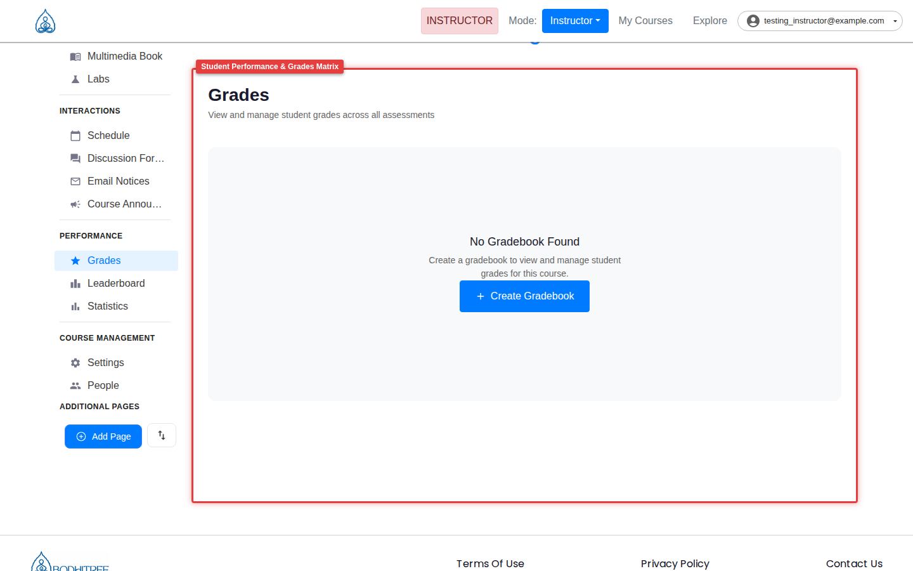
*Figure 31: Gradebook Grid showing student scores across all lab exercises and quizzes.*

---

### 15.1 Grades Dashboard

As shown in **Figure 31**, the gradebook displays:
* Rows for each student with their Roll Number and Name.
* Columns for every lab exercise, programming problem, and quiz.
* Summary statistics at the bottom showing Highest Score, Class Average, and Submission Count.

---

### 15.2 Exporting Grades to CSV

At the end of the semester, click the **Export CSV** button on the top-right of the gradebook. BodhiTree downloads an Excel-compatible spreadsheet containing all student marks, ready for institutional grading.

---

## Section 16: Recycle Bin & Common Troubleshooting

### 16.1 Restoring Deleted Items from Recycle Bin

If you accidentally delete a practice lab or lab activity, you can easily restore it from the **Recycle Bin** (`/courseware/course/<id>/content/labs/recyclebin`):

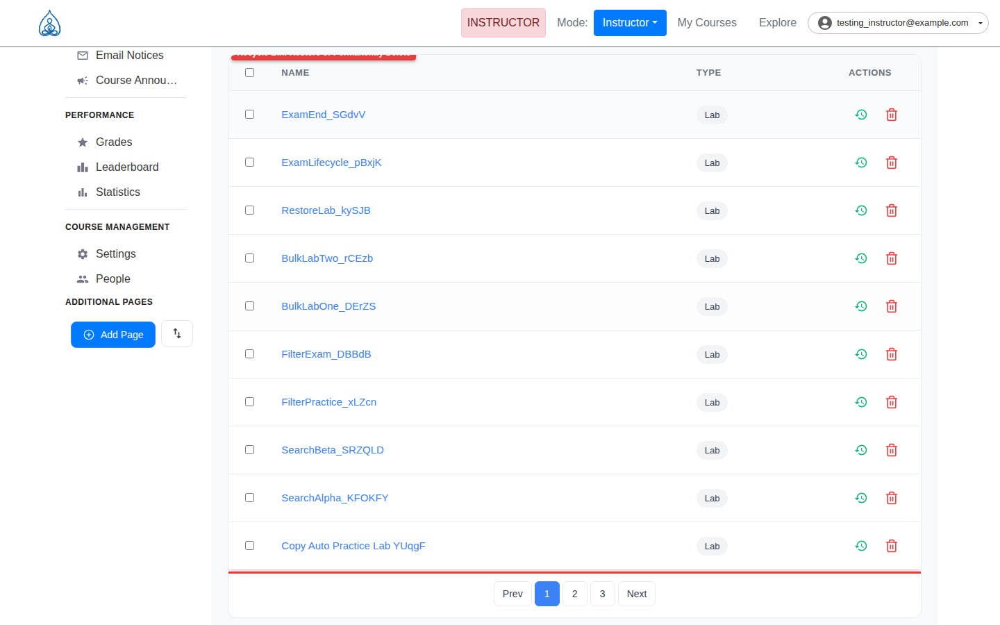
*Figure 32: Recycle Bin showing deleted activities with Restore and Delete Permanently actions.*

1. Open the Recycle Bin from the sidebar or labs menu (**Figure 32**).
2. Locate the deleted item.
3. Click the green **Restore** button. The item returns to its original lab with all student submissions intact.

---

### 16.2 Common Issues & Quick Solutions

| Issue | Likely Cause | How to Fix |
| :--- | :--- | :--- |
| **Students cannot find the course on Explore page** | Course is marked as Unpublished on the dashboard | Click the green Publish button on the course card ([Section 2.1](#21-the-my-courses-dashboard)). Enrolled students can still access it directly. |
| **Students cannot see a chapter, video, or lab** | Item is currently Unpublished (Draft mode) | Open the chapter or lab and click the eye / publish icon to make it visible to students ([Section 4.3](#43-managing-chapters--adding-sections)). |
| **Code submission gives "Time Limit Exceeded"** | The student's code contains an infinite loop | Ask the student to check their loop termination conditions, or increase the CPU time limit in activity settings ([Section 9.4](#94-setting-cpu-and-memory-resource-limits)). |
| **Need to re-evaluate quiz after correcting answer key** | Questions or marks were modified after student submissions | Open the Lab Quiz Submissions page and click the **Force Run** button ([Section 11.3](#113-lab-quiz-submissions--force-run-re-evaluation)). |
| **Students are sharing PDF handouts online** | Raw PDF downloads are currently permitted | Go to Course Settings and turn on **Disable PDF Downloads** and **Watermarking** ([Section 13.3](#133-content-protection--pdf-watermarking)). |

---

*End of BodhiTree Product Manual & Instructor Guide.*
