# BodhiTree Product Manual & Instructor Guide

Welcome to the **BodhiTree Instructor Guide and Product Manual**. BodhiTree is an interactive e-learning platform developed at IIT Bombay for blended learning, digital coursebooks, hands-on programming labs, and automated grading. This manual provides instructors, teachers, and teaching assistants (TAs) with a complete walkthrough of course setup, learning content management, laboratory exercises, and student evaluation.

> [!NOTE]
> This manual covers the core teaching tools on BodhiTree:
> * **Course Setup & Management** (creating courses, managing settings, publish controls)
> * **Multimedia Book (MMB)** (chapters, sections, documents, videos, URLs, and in-book quizzes)
> * **Multimedia Quiz Editor** (creating question modules and questions directly via the web UI)
> * **In-Video Quizzes** (timeline markers, video checkpoints, and inline editing)
> * **Labs Management** (creating labs, bulk show/hide actions)
> * **Programming Activities** (problem setup, template code, visible and hidden test cases, autograding)
> * **Lab Quizzes** (timed lab assignments created via the web UI or `.odt` templates)
> * **Submissions & Grading** (lab overview submissions, programming code viewer and test runs, quiz submissions, and Force Run re-evaluation)
> * **People & Enrollment** (single student enrollment, searching existing users, STA/JTA roles, and bulk CSV upload)
> * **Course Settings & Protection** (general course details, forum moderation, and disabling file downloads)
> * **Interactions** (discussion forums and class announcements)
> * **Performance & Grades** (gradebook table and CSV export)
> * **Recycle Bin** (restoring deleted lab activities)

---

## Table of Contents

* [Section 1: Getting Started & Signing In](#section-1-getting-started--signing-in)
  * [1.1 Accessing the BodhiTree Portal](#11-accessing-the-bodhitree-portal)
  * [1.2 Signing In with Your Instructor Account](#12-signing-in-with-your-instructor-account)
* [Section 2: Course Dashboard & Course Management](#section-2-course-dashboard--course-management)
  * [2.1 The My Courses Dashboard](#21-the-my-courses-dashboard)
  * [2.2 Creating a New Course Offering](#22-creating-a-new-course-offering)
  * [2.3 Course Card Options (Three-Dot Menu)](#23-course-card-options-three-dot-menu)
* [Section 3: Course Navigation Overview](#section-3-course-navigation-overview)
  * [3.1 The Course Sidebar Navigation](#31-the-course-sidebar-navigation)
  * [3.2 Organization of Menu Items](#32-organization-of-menu-items)
* [Section 4: The Multimedia Book (MMB): Chapters & Sections](#section-4-the-multimedia-book-mmb-chapters--sections)
  * [4.1 Book Organization & Structure](#41-book-organization--structure)
  * [4.2 Creating a New Chapter](#42-creating-a-new-chapter)
  * [4.3 Managing Chapters & Adding Sections](#43-managing-chapters--adding-sections)
* [Section 5: Adding Learning Materials (Sections, In-Book Quizzes, Documents, Videos & URLs)](#section-5-adding-learning-materials-sections-in-book-quizzes-documents-videos--urls)
  * [5.1 The Add Content Menu](#51-the-add-content-menu)
  * [5.2 Adding a Section](#52-adding-a-section)
  * [5.3 Adding an In-Book Quiz](#53-adding-an-in-book-quiz)
  * [5.4 Adding a Document (File Attachments)](#54-adding-a-document-file-attachments)
  * [5.5 Adding a Video Lecture](#55-adding-a-video-lecture)
  * [5.6 Adding External Web URLs](#56-adding-external-web-urls)
* [Section 6: The Multimedia Quiz Editor: Generating Quizzes via UI](#section-6-the-multimedia-quiz-editor-generating-quizzes-via-ui)
  * [6.1 Purpose of the Quiz Editor](#61-purpose-of-the-quiz-editor)
  * [6.2 Organizing Questions with Modules](#62-organizing-questions-with-modules)
  * [6.3 Adding and Configuring Questions](#63-adding-and-configuring-questions)
  * [6.4 Understanding Hints, Answer Descriptions, and Error Descriptions](#64-understanding-hints-answer-descriptions-and-error-descriptions)
* [Section 7: In-Video Quizzes & Timeline Markers](#section-7-in-video-quizzes--timeline-markers)
  * [7.1 Purpose of In-Video Quizzes](#71-purpose-of-in-video-quizzes)
  * [7.2 The Video Player Workspace](#72-the-video-player-workspace)
  * [7.3 Section Markers vs. Quiz Markers](#73-section-markers-vs-quiz-markers)
  * [7.4 Adding, Editing, and Deleting Markers (CRUD Operations)](#74-adding-editing-and-deleting-markers-crud-operations)
* [Section 8: Labs Management & Bulk Actions](#section-8-labs-management--bulk-actions)
  * [8.1 The Labs Dashboard](#81-the-labs-dashboard)
  * [8.2 Creating a New Lab](#82-creating-a-new-lab)
  * [8.3 Bulk Show & Hide Operations](#83-bulk-show--hide-operations)
  * [8.4 Inside a Lab: Activities, Editing, and Actions](#84-inside-a-lab-activities-editing-and-actions)
* [Section 9: Programming Activities & Autograding](#section-9-programming-activities--autograding)
  * [9.1 What is a Programming Activity?](#91-what-is-a-programming-activity)
  * [9.2 Problem Statements, Template Code, and Instructor Solutions](#92-problem-statements-template-code-and-instructor-solutions)
  * [9.3 Configuring Test Cases: Visible vs. Hidden](#93-configuring-test-cases-visible-vs-hidden)
  * [9.4 Setting Resource Limits](#94-setting-resource-limits)
* [Section 10: Lab Quizzes: Creation & Authoring](#section-10-lab-quizzes-creation--authoring)
  * [10.1 Important Difference: In-Book Quiz vs. Lab Quiz](#101-important-difference-in-book-quiz-vs-lab-quiz)
  * [10.2 Creating a Lab Quiz Activity](#102-creating-a-lab-quiz-activity)
  * [10.3 Authoring Questions via Web UI Quiz Editor](#103-authoring-questions-via-web-ui-quiz-editor)
* [Section 11: Submissions Management & Student Evaluation](#section-11-submissions-management--student-evaluation)
  * [11.1 Overall Lab Submissions & Exporting Reports](#111-overall-lab-submissions--exporting-reports)
  * [11.2 Programming Submissions & Subjective Grading](#112-programming-submissions--subjective-grading)
  * [11.3 Lab Quiz Submissions & Individual Grading](#113-lab-quiz-submissions--individual-grading)
* [Section 12: People & Student Enrollment](#section-12-people--student-enrollment)
  * [12.1 The People Dashboard](#121-the-people-dashboard)
  * [12.2 Single User Enrollment (New User & Existing User Search)](#122-single-user-enrollment-new-user--existing-user-search)
  * [12.3 Bulk CSV Student Upload](#123-bulk-csv-student-upload)
  * [12.4 Course Roles: Students, TAs (STA / JTA), and Instructors](#124-course-roles-students-tas-sta--jta-and-instructors)
* [Section 13: Course Settings & Content Protection](#section-13-course-settings--content-protection)
  * [13.1 General Course Settings](#131-general-course-settings)
  * [13.2 Discussion Forum Moderation Settings](#132-discussion-forum-moderation-settings)
  * [13.3 Content Protection & Disabling Downloads](#133-content-protection--disabling-downloads)
* [Section 14: Interactions: Discussion Forums & Announcements](#section-14-interactions-discussion-forums--announcements)
  * [14.1 Class Discussion Forum](#141-class-discussion-forum)
  * [14.2 Course Announcements](#142-course-announcements)
* [Section 15: Performance Tracking & Gradebook](#section-15-performance-tracking--gradebook)
  * [15.1 Grades Dashboard](#151-grades-dashboard)
  * [15.2 Exporting Grades to CSV](#152-exporting-grades-to-csv)
* [Section 16: Recycle Bin & Common Troubleshooting](#section-16-recycle-bin--common-troubleshooting)
  * [16.1 Restoring Deleted Items from Recycle Bin](#161-restoring-deleted-items-from-recycle-bin)
  * [16.2 Common Issues & Quick Solutions](#162-common-issues--quick-solutions)

---

## Section 1: Getting Started & Signing In

BodhiTree is an interactive e-learning platform developed at IIT Bombay. It allows teachers to build structured course textbooks, conduct coding labs with instant automated evaluation, share videos with in-video checkpoints, and review student grades in one place.

### 1.1 Accessing the BodhiTree Portal

To access BodhiTree, open your web browser (Google Chrome or Mozilla Firefox work best) and type the web address given by your institution (for example, `https://tiger.bodhi-tree.in`).


*Figure 1: BodhiTree Landing Page with Login button.*

As shown in **Figure 1**, the landing page displays general platform information. In the top-right corner of the navigation bar, you will find the **Login** button.

---

### 1.2 Signing In with Your Instructor Account

1. Click the **Login** button on the top-right navigation bar (**Figure 1**).
2. The sign-in dialog opens in the center of your screen, as shown in **Figure 2**.
3. In the **Email** field, enter your registered email address (e.g. `abc@example.com`).
4. In the **Password** field, enter your password.
5. Click the blue **Sign In** button.

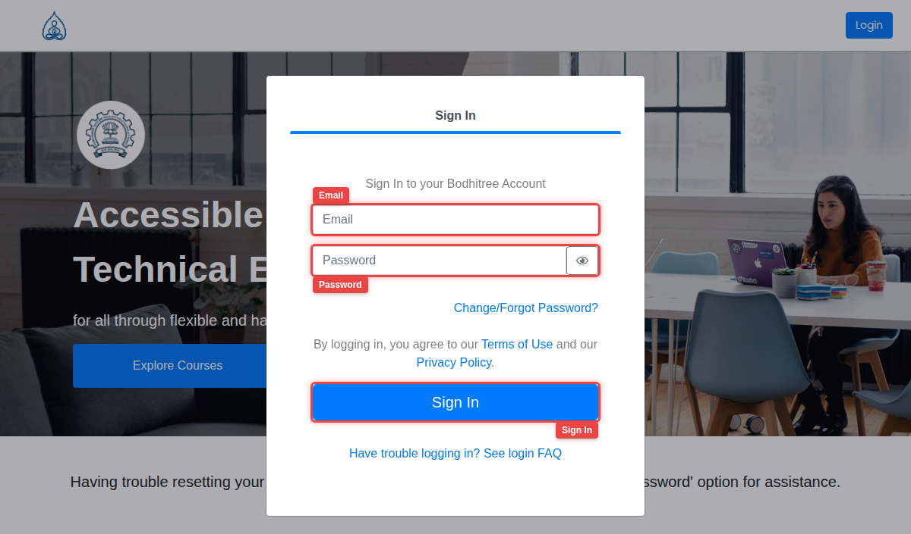
*Figure 2: BodhiTree Sign In Dialog for entering email and password.*

> [!TIP]
> BodhiTree automatically keeps your login session active in your browser. You do not need to sign in repeatedly when opening different courses or chapters. If you stay away for several days, your session will automatically time out for security, and you can simply log in again.

---

## Section 2: Course Dashboard & Course Management

After logging in, BodhiTree takes you to the **My Courses** dashboard. This is your home screen where every course you teach or manage is listed.

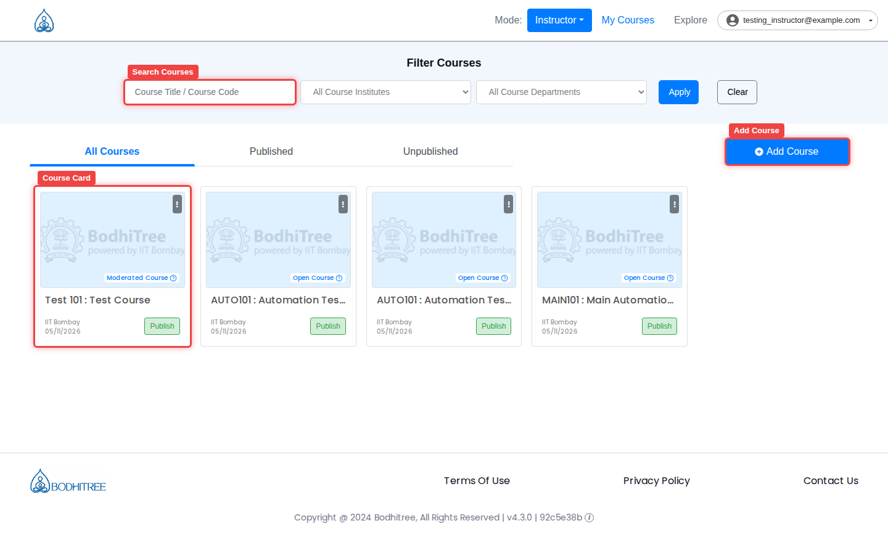
*Figure 3: My Courses Dashboard showing course cards, search bar, and Add Course button.*

---

### 2.1 The My Courses Dashboard

As shown in **Figure 3**, the dashboard has three main areas:
* **Course Cards:** Every course is shown as a card displaying the Course Code, Course Title, and Institution name. If the course is not published yet, you will see a green **Publish** button to make it visible in the Explore catalog. Once published, the card displays a green published badge.
* **Search Courses Input:** Located at the top-left, this search bar lets you find any course instantly by typing its code (like `CS101`) or title keyword.
* **+ Add Course Button:** Located at the top-right, this blue button opens the course creation form.

---

### 2.2 Creating a New Course Offering

To create a new course:
1. Click the **+ Add Course** button on the dashboard (**Figure 3**).
2. The **Add Course** popup dialog appears on your screen, as shown in **Figure 4**.

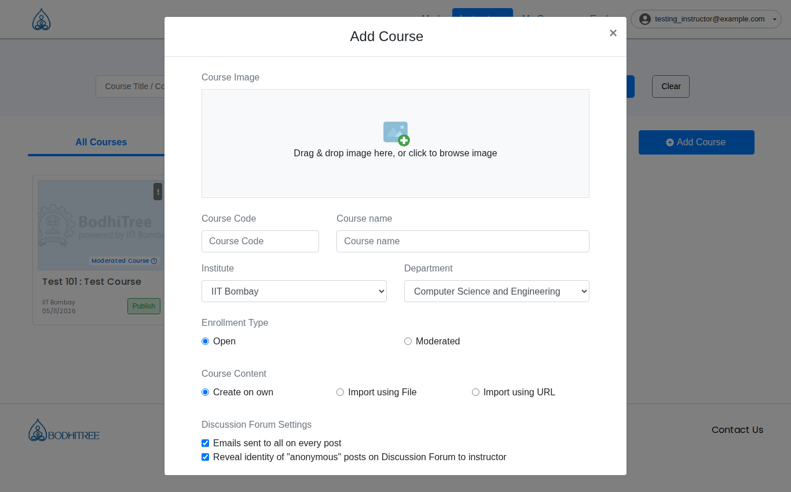
*Figure 4: Add Course Dialog with Course Image, Course Code, and Enrollment Type.*

3. Fill in the fields:
   * **Course Image:** Drag and drop or browse an image file (such as `.png`, `.jpg`, or `.webp`). This image acts as the poster on the course card shown on your dashboard and the course catalog.
   * **Course Code:** Enter a unique identifier up to 8 characters for your course (e.g., `CS101`, `EE204`, or `MAIN101`).
   * **Course Name:** Enter the full course title (e.g., `Computer Programming Fundamentals`).
   * **Institute & Department:** Select your institution and academic department from the dropdown menus.
   * **Enrollment Type:** Choose between:
     * **Open Course:** Any student registered on the portal can click and join the course directly.
     * **Moderated Course:** Students can request to join, but an instructor or TA must review and approve their request before they get access.
   * **Course Content:** Select **Create on own** to start with a blank course, or choose **Import using File** or **Import using URL** to bring in an existing course archive.
   * **Discussion Forum Settings:** Select whether email notifications are sent to everyone for every discussion post, and whether to show the identity of anonymous posts to the instructor.
4. Click the blue **Add Courses** button inside the modal to save.
5. Your new course card will appear on the dashboard right away.

> [!IMPORTANT]
> Course codes must be unique in your institution. If another course is already using that exact code, the system will show an error asking you to choose a different course code.

---

### 2.3 Course Card Options (Three-Dot Menu)

On every course card (shown in **Figure 3**), there is a three-dot menu button (`⋮`) in the top-left corner. Clicking it reveals two actions:
1. **Download Course:** Creates and downloads an archive file containing the course structure and materials.
2. **Delete Course:** Permanently deletes the course and all its student records from the database.

> [!NOTE]
> There is **no Edit Course option** inside the three-dot menu on the course card. If you want to change the course name, description, or enrollment mode, open the course and go to **Course Settings** (described in [Section 13.1](#131-general-course-settings)).

---

## Section 3: Course Navigation Overview

Click on any course card from your dashboard to enter that course workspace. The left sidebar gives you quick access to all parts of the course.

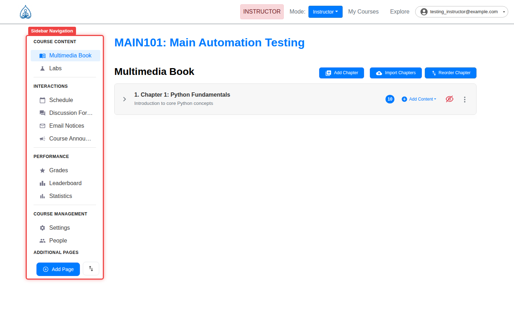
*Figure 5: Course Workspace Sidebar showing navigation sections.*

---

### 3.1 The Course Sidebar Navigation

As shown in **Figure 5**, the sidebar organizes your course into distinct functional areas.

### 3.2 Organization of Menu Items

| Section | Menu Option | What It Is Used For |
| :--- | :--- | :--- |
| **Course Content** | **Multimedia Book** | The digital textbook view. Contains chapters, sections, lecture notes, video lessons, and in-book quizzes (see [Section 4](#section-4-the-multimedia-book-mmb-chapters--sections)). |
| **Course Content** | **Labs** | The laboratory section for practice coding problems and graded lab quizzes (see [Section 8](#section-8-labs-management--bulk-actions)). |
| **Interactions** | **Schedule** | Displays the course calendar with scheduled activities, assignment deadlines, and lecture timings. |
| **Interactions** | **Discussion Forum** | The class discussion board where students post questions and instructors/TAs reply (see [Section 14.1](#141-class-discussion-forum)). |
| **Interactions** | **Email Notices** | Send official email notices directly to all enrolled students' registered email inboxes. |
| **Interactions** | **Course Announcements** | Post broadcast notices that display on students' course home screens (see [Section 14.2](#142-course-announcements)). |
| **Performance** | **Grades** | The complete gradebook table showing marks across all labs, coding tasks, and quizzes (see [Section 15.1](#151-grades-dashboard)). |
| **Performance** | **Labs Performance** | Detailed activity-wise performance statistics and completion percentages. |
| **Performance** | **Leaderboard** | Shows student rankings based on points scored in practice activities. |
| **Performance** | **Statistics** | Visual charts showing score distributions and class averages. |
| **Course Management**| **Settings** | General course information, forum moderation settings, and content protection toggles (see [Section 13](#section-13-course-settings--content-protection)). |
| **Course Management**| **People** | View enrolled students, invite teaching assistants, or upload a class list via CSV (see [Section 12](#section-12-people--student-enrollment)). |
| **Additional Pages** | **Add Page** | Create custom markdown or rich-text web pages (e.g. Course Syllabus, Grading Policy, TA Office Hours). |

---

## Section 4: The Multimedia Book (MMB): Chapters & Sections

The **Multimedia Book (MMB)** is the digital textbook of your course. You can organize your syllabus into **Chapters**, subdivide them into **Sections**, and add learning materials inside each section.

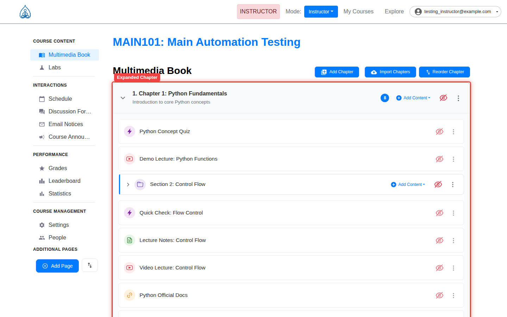
*Figure 6: Multimedia Book Overview showing expanded chapter accordion and content items.*

---

### 4.1 Book Organization & Structure

As shown in **Figure 6**, the Multimedia Book displays your chapters in vertical sequence. Each chapter functions as an accordion card that expands to show its sections and contents.

---

### 4.2 Creating a New Chapter

To add a new chapter to your book:
1. Click the blue **+ Add Chapter** button at the top-right of the Multimedia Book (**Figure 6**).
2. The **Add Chapter** modal dialog opens, as shown in **Figure 7**.

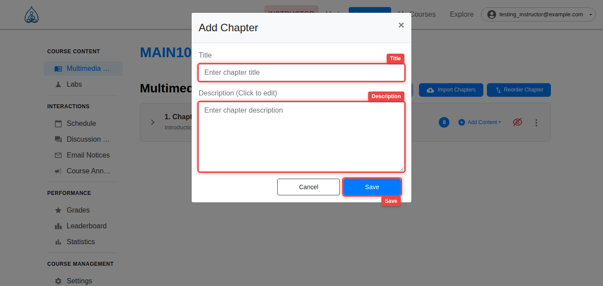
*Figure 7: Add Chapter Modal with Title, Description, and Save button.*

3. Enter the **Chapter Title** (e.g., `Chapter 1: Python Fundamentals`).
4. Enter an optional **Description** giving an overview of the chapter topics.
5. Click **Save**. The new chapter accordion appears in your book immediately.

---

### 4.3 Managing Chapters & Adding Sections

Once a chapter is created, you can manage it using the controls shown in **Figure 8**:


*Figure 8: Chapter Card showing header bar, Add Content button, and publish toggle.*

* **Expand / Collapse Accordion:** Click on the chapter header bar to reveal or hide the contents inside.
* **Chapter Menu (`⋮`):** Provides options to edit the chapter title/description or delete the chapter. When deleting a chapter, BodhiTree asks for a confirmation and permanently removes the chapter (chapters do not move to the Recycle Bin).
* **Publish / Eye Icon:** Click to toggle the chapter between Published (visible to enrolled students) and Unpublished (hidden from students).
* **+ Add Content Button:** Opens the menu to add learning materials inside this chapter.

---

## Section 5: Adding Learning Materials (Sections, In-Book Quizzes, Documents, Videos & URLs)

Inside any chapter, clicking the **+ Add Content** button opens the dropdown menu shown in **Figure 9**:

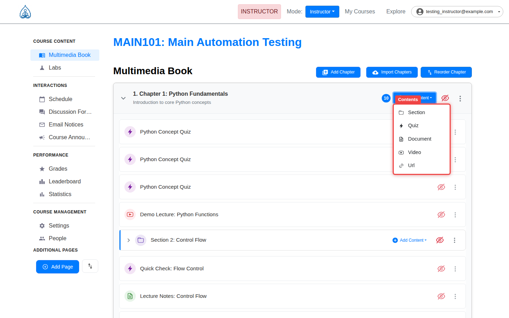
*Figure 9: Add Content Dropdown offering Section, Quiz, Document, Video, and URL options.*

---

### 5.1 The Add Content Menu

The dropdown provides five distinct content types in exact order:
1. **Section:** Group learning materials into clear topical sub-sections within the chapter.
2. **Quiz:** Add an interactive In-Book Quiz directly inside the chapter to test concepts while reading.
3. **Document:** Upload reading handouts and lecture slides for students (`.pdf`, `.txt`, and other document formats).
4. **Video:** Upload video lectures for students to watch.
5. **URL:** Link external web pages and reference documentation.

---

### 5.2 Adding a Section

Sections act as sub-folders inside a chapter to organize your topics cleanly:
1. Select **Section** from the dropdown (**Figure 9**).
2. In the popup dialog, enter the **Section Title** (e.g., `1.1 Variables and Assignment Statements`).
3. Enter an optional **Description** explaining the topics covered in this section.
4. Click **Save Section**. A new section card appears inside the chapter accordion where you can attach reading documents, videos, and quizzes.

---

### 5.3 Adding an In-Book Quiz

An **In-Book Quiz** is an interactive practice checkpoint placed directly inside a chapter or section. While students read through textbook chapters, they can solve questions on-screen to check their understanding right away:
1. Select **Quiz** from the dropdown (**Figure 9**).
2. The **Add Quiz** modal opens, as shown in **Figure 10**.

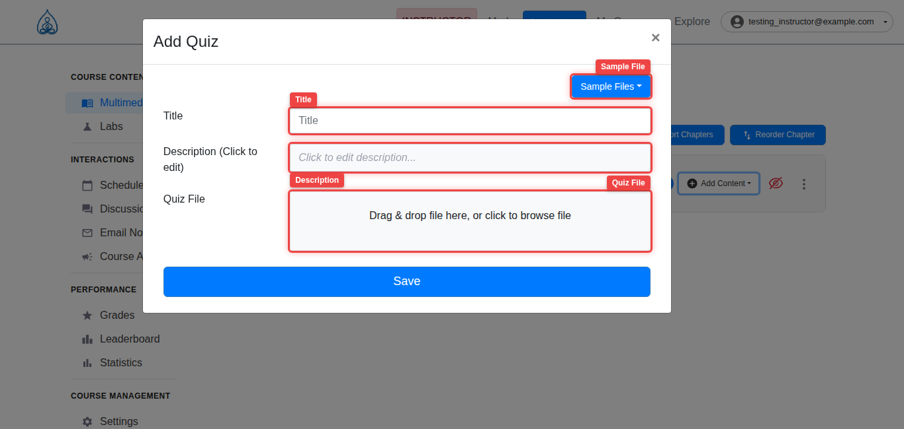
*Figure 10: Add Quiz Modal showing Title, Description, Sample Files download, and Quiz File upload.*

3. Enter the **Quiz Title** (e.g., `Concept Check 1: Python Data Types`).
4. Enter an optional **Description** describing what the quiz covers.
5. **Sample Files:** Click the **Sample Files** dropdown button at the top-right of the modal to download reference templates (such as `.odt` or `.csv`) for offline authoring.
6. **Quiz File:** Optionally attach a quiz file (`.odt`, `.csv`, or `.txt`) using the drag-and-drop file upload area. If you prefer creating questions directly using the web interface, leave this empty.
7. Click **Save** to attach the quiz card inside your chapter.
8. Once created, click on the quiz card to open the **Quiz Editor** and add question modules and questions directly via the web UI (detailed in [Section 6](#section-6-the-multimedia-quiz-editor-generating-quizzes-via-ui)).

---

### 5.4 Adding a Document (File Attachments)

BodhiTree allows uploading reading handouts in multiple formats, including `.pdf`, `.txt`, and other text extensions:
1. Select **Document** from the dropdown (**Figure 9**).
2. The **Add Document** modal appears, as shown in **Figure 11**.

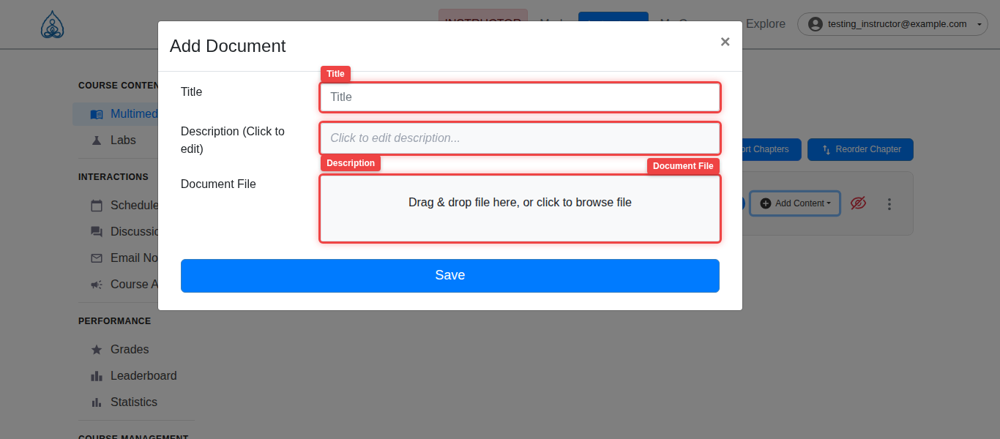
*Figure 11: Add Document Modal with Title, Description, and Document File upload.*

3. Enter the **Document Title** (e.g., `Lecture 1 Notes - Variables & Expressions`).
4. Enter an optional **Description** giving a summary of the reading material.
5. Drag and drop or browse to select your **Document File** (`.pdf`, `.txt`, etc.) from your computer.
6. Click **Save** to attach the document.

---

### 5.5 Adding a Video Lecture

1. Select **Video** from the dropdown (**Figure 9**).
2. The **Add Video** modal appears, as shown in **Figure 12**.

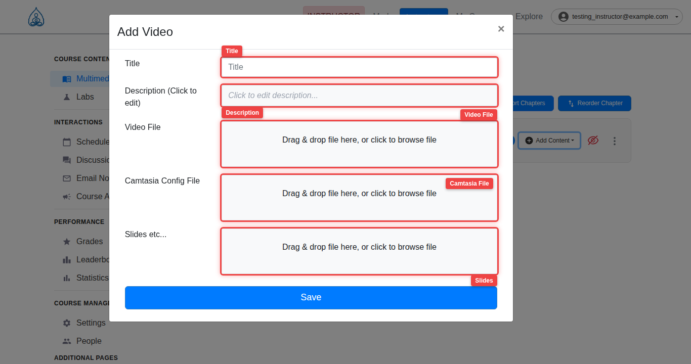
*Figure 12: Add Video Modal with Title, Description, Video File, Camtasia File, and Slides upload fields.*

3. Fill in the video details:
   * **Title:** Enter the title for the lecture (e.g., `Lecture 2: Python Functions and Scope`).
   * **Description:** Enter an optional description summarizing what this video lesson covers.
   * **Video File:** Drag and drop or browse your video recording (`.mp4`, `.webm`, `.avi`, `.mpeg`, or `.ogv`).
   * **Camtasia Config File:** If you recorded and edited your video using TechSmith Camtasia with chapters or markers, you can upload the exported `.xml` config file to import chapter timestamps automatically.
   * **Slides etc...:** Attach accompanying presentation slides (`.pdf`, `.pptx`, or documents) for students to follow along while watching.
4. Click **Save** to upload and attach the video lesson under your chapter.
5. Once uploaded, click on the video card to open the **Video Player Workspace** and add interactive timeline markers or in-video checkpoints (detailed in [Section 7](#section-7-in-video-quizzes--timeline-markers)).

---

### 5.6 Adding External Web URLs

1. Select **URL** from the dropdown (**Figure 9**).
2. The **Add URL** modal opens, as shown in **Figure 13**.

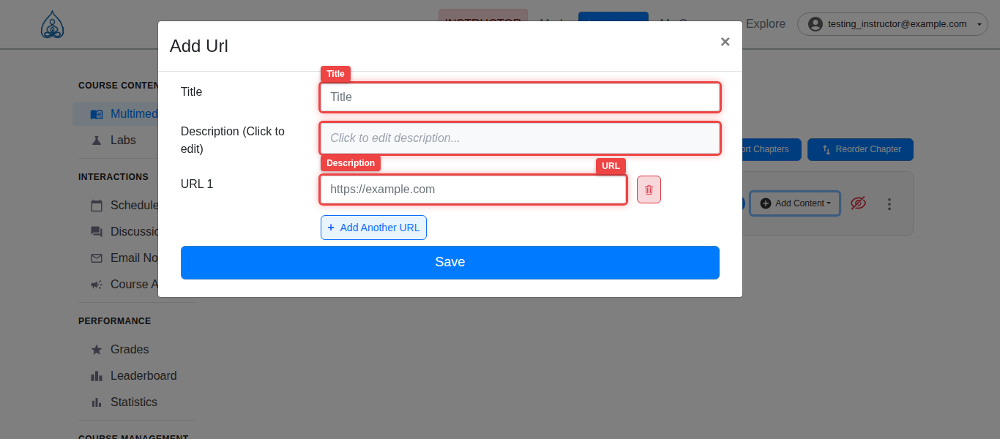
*Figure 13: Add URL Modal with Title, Description, and URL fields.*

3. Fill in the resource details:
   * **Title:** Enter the resource title (e.g., `Python Standard Library Documentation`).
   * **Description:** Enter an optional description summarizing what students will find at this link.
   * **URL:** Enter the full web address (e.g., `https://docs.python.org/3/`). You can also click **+ Add Another URL** if you want to attach multiple links under a single card.
4. Click **Save**. When students click this card, the webpage opens in a clean inline frame or in a new browser tab.

---

## Section 6: The Multimedia Quiz Editor: Generating Quizzes via UI

BodhiTree provides a built-in web-based **Quiz Editor** that lets instructors author interactive quizzes directly in their browser. You do not need to prepare complex spreadsheet templates or external files; you can create questions, set correct options, and configure marks using simple visual forms.

### 6.1 Purpose of the Quiz Editor

The Quiz Editor is used to author questions for both **In-Book Quizzes** in the Multimedia Book and **Lab Quizzes** in Labs. It provides a visual interface for:
* Grouping questions into structured modules.
* Adding questions across multiple formats (Single Choice, Multiple Choice, Numerical, and Descriptive).
* Setting point values, answer explanations, and student hints.
* Reordering, editing, and deleting questions directly on screen.

---

### 6.2 Organizing Questions with Modules

In BodhiTree, questions inside a quiz are grouped into **Modules**. A module represents a topic or subsection of the quiz (for example, "Module 1: Python Basics & Data Types" or "Module 2: Control Flow & Iteration").

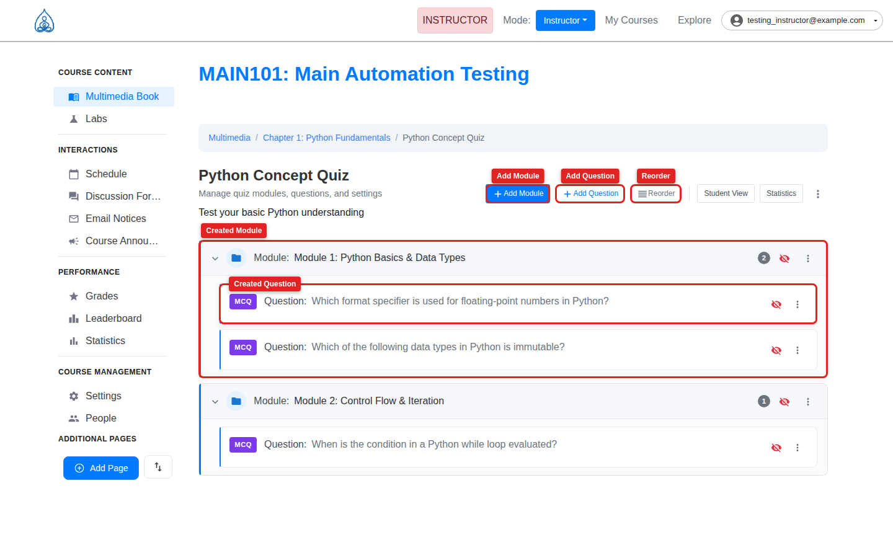
*Figure 14: Quiz Editor showing question modules, question list, and action buttons.*

As shown in **Figure 14**, the Quiz Editor workspace provides:
* **Add Module Button:** Creates a new question module to group related questions by topic.
* **Add Question Button:** Opens the question builder modal to author a new question.
* **Reorder Button:** Switches the workspace into reorder mode so you can drag and drop modules and questions to rearrange their sequence.
* **Created Module Container:** Shows the module header (`Module 1: Python Basics & Data Types`), total question badge, visibility toggle, and nested questions.
* **Created Question Card:** Displays the question format badge (e.g. `MCQ`), question prompt (`Which format specifier is used for floating-point numbers in Python?`), and action controls.

---

### 6.3 Adding and Configuring Questions

To add a question to any module:
1. Click the blue **+ Add Question** button inside that module (**Figure 14**).
2. The **Add Question** modal dialog opens, as shown in **Figure 15**.

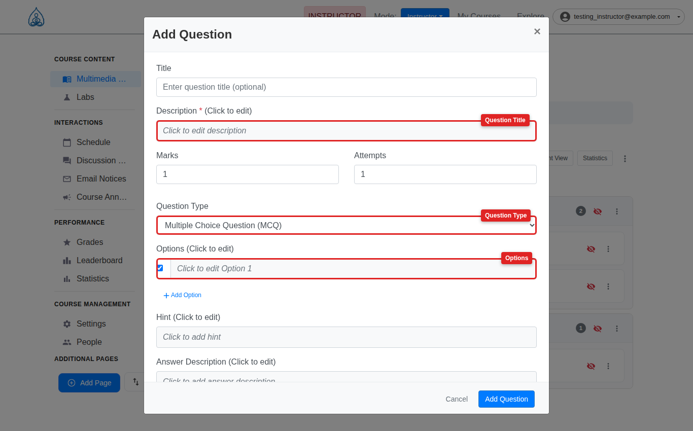
*Figure 15: Add Question Modal showing Question Title (Description), Question Type, and Options.*

3. Configure the question details (**Figure 15**):
   * **Question Title (Description):** Click the description box to enter the main question statement, problem prompt, or code snippet that students will see.
   * **Question Type:** Select the question format from the dropdown:
     * **Multiple Choice (MCQ):** Questions with one or more correct choices.
     * **Single Choice (SCQ):** Questions with only a single correct option.
     * **Fixed Answer (FAQ):** Questions requiring an exact text answer match.
     * **Numerical Answer (FIB):** Questions where students enter a numerical value within an acceptable range.
   * **Options:** Click to type each choice's text, select the checkbox/radio button to mark correct answers, and click **+ Add Option** to add more answer choices.
   * **Marks & Attempts:** Set points awarded for correct submissions and the number of allowed attempts.
4. Click **Add Question** to save the new question into the module.

---

### 6.4 Understanding Hints, Answer Descriptions, and Error Descriptions

The Quiz Editor gives students rich educational feedback:
* **Hints:** You can provide one or more hints that students can open if they are stuck during practice.
* **Answer Description:** Enter a detailed solution explanation that students see after submitting their quiz, explaining why the correct choice is right.
* **Error Description:** Enter specific explanations displayed when a student selects an incorrect option, helping them understand where their reasoning went wrong.

---

## Section 7: In-Video Quizzes & Timeline Markers

In the **Multimedia Book**, instructors can embed interactive assessments directly inside lecture videos. This transforms passive lecture viewing into active learning by verifying comprehension at key points in the video.

### 7.1 Purpose of In-Video Quizzes

Unlike traditional quizzes that are attempted separately, **In-Video Quizzes** pause video playback automatically when a student reaches a designated timestamp. The student must answer the prompt before playback continues. This ensures students understand each concept before the lecture moves forward.

---

### 7.2 The Video Player Workspace

When you open an uploaded video lesson as an instructor, BodhiTree presents an interactive video player workspace with the **Chapters & Markers** toolbar located directly beneath the player screen:

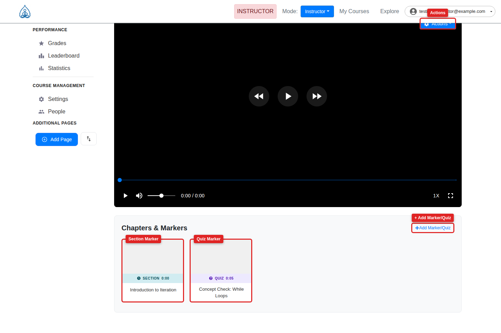
*Figure 16: Video Player Workspace showing the video screen with playback controls, Actions menu, and Chapters & Markers toolbar.*

As shown in **Figure 16**, the workspace provides:
* **Interactive Video Screen:** Displays the lecture video with on-hover playback controls (center play/pause, rewind/fast-forward, timeline seek bar with marker ticks, elapsed time, and volume).
* **Actions Menu Button:** Located at the top right of the video player, letting instructors switch to Student View, toggle bookmark visibility, and export/import quiz ODT files.
* **+ Add Marker/Quiz Button:** Placed on the Chapters & Markers header, enabling you to add a new Section or Quiz marker at the current timestamp.
* **Generated Section Marker:** Visual bookmark card (`SECTION 0:00 Introduction to Iteration`) indexing lecture topics for quick student navigation.
* **Generated Quiz Marker:** In-video assessment card (`QUIZ 0:05 Concept Check: While Loops`) that pauses playback at that exact second to test comprehension.

---

### 7.3 Section Markers vs. Quiz Markers

BodhiTree supports two types of timeline markers on video lectures:

1. **Section Marker (`S`):**
   * Acts as a named bookmark on the video progress bar (e.g., `0:00 - Introduction to Iteration`).
   * Indexes long lectures into topics so students can quickly jump to concepts without scrubbing.
2. **Quiz Marker (`Q`):**
   * Placed at an assessment timestamp (e.g., `0:05 - Concept Check: While Loops`).
   * Automatically pauses playback and displays an interactive assessment prompt.
   * When setting up a Quiz Marker, BodhiTree gives you two creation paths:
     * **Add Question:** Creates a single question right at that timestamp.
     * **Add Module:** Links a whole question group/module containing multiple questions.

---

### 7.4 Adding, Editing, and Deleting Markers (CRUD Operations)

Instructors can perform full management operations directly from the video workspace:

* **Adding Markers:** Play or scrub the video to your desired timestamp, then click **Add Marker/Quiz** above the timeline bar. Choose the marker type (`Section Marker` or `Quiz Marker`), enter the title, and save.
* **Editing Markers:** Click on any marker in the timeline bar. The inline **Edit Marker** panel opens directly below the video player, as shown in **Figure 17**:

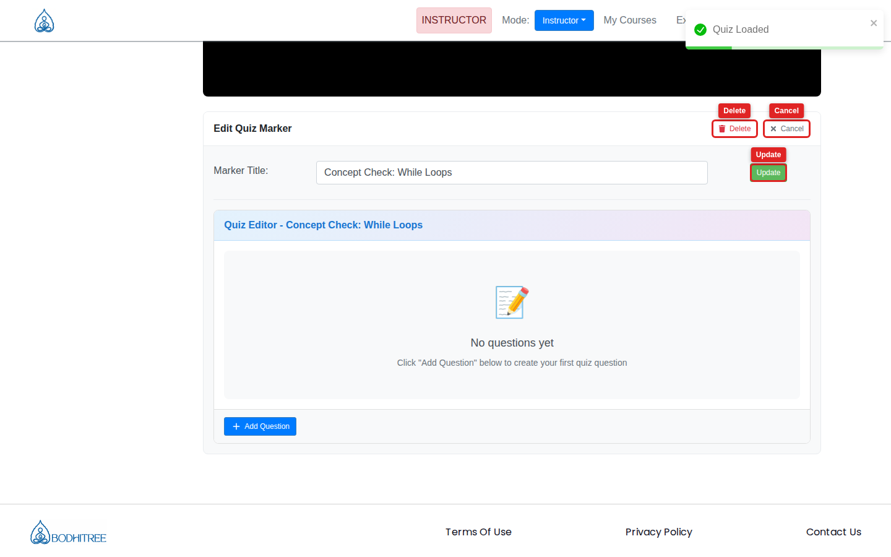
*Figure 17: Inline Edit Marker Panel showing Update, Delete, and Cancel action buttons.*

* **Updating Content:** Inside the Edit Marker panel (**Figure 17**), modify the marker title in the input field and click the green **Update** button to save the new title immediately.
* **Deleting Markers:** Click the red **Delete** button at the top right of the panel to permanently remove the marker from the video timeline.
* **Canceling Edits:** Click the gray **Cancel** button to close the edit panel and return to the horizontal marker cards without making changes.

---

## Section 8: Labs Management & Bulk Actions

The **Labs** section (`/courseware/course/<id>/content/labs`) is where instructors host hands-on coding exercises and laboratory assignments.

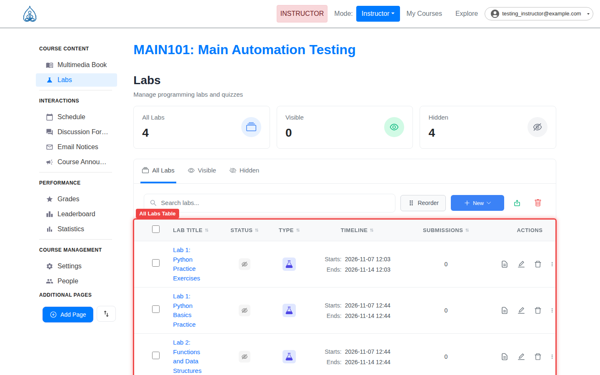
*Figure 18: Labs Dashboard showing search filter, status tabs, and All Labs table.*

---

### 8.1 The Labs Dashboard

As shown in **Figure 18**, the Labs dashboard provides controls to organize all laboratory coursework:
* **Search Bar & Filter Tabs:** Located at the top, allowing you to filter labs by typing titles or clicking filter tabs: **All Labs**, **Visible**, and **Hidden**.
* **Reorder Button:** Lets instructors drag and drop labs to rearrange their presentation order.
* **+ New Dropdown:** Located at the top-right, lets you create a new lab or import a lab package.
* **Labs Table Rows:** Each row displays:
  * **Title:** The name of the laboratory.
  * **Status:** Current visibility (Visible or Hidden).
  * **Timeline:** Availability date and time window.
  * **Submissions Count:** Number of student attempts received.
  * **Actions:** Quick links to edit, export, or manage activities.

---

### 8.2 Creating a New Lab

1. Click the **+ New** dropdown at the top-right (**Figure 18**) and choose **New Lab**.
2. The **Create Lab** modal opens, as shown in **Figure 19**.

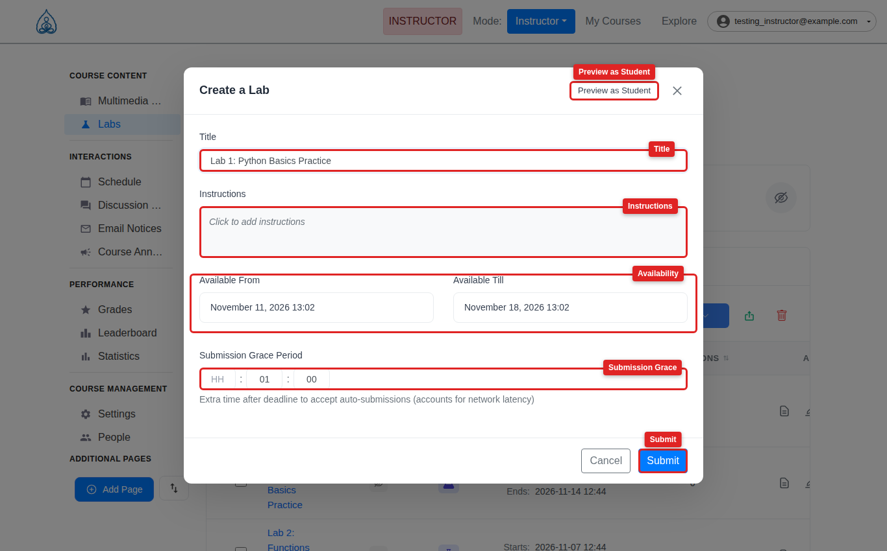
*Figure 19: Create Lab Modal showing Title, Instructions, Availability Dates, Submission Grace Period, and Action Buttons.*

3. Configure the lab parameters (**Figure 19**):
   * **Title:** Enter the lab name (e.g., `Lab 1: Python Basics Practice`).
   * **Instructions:** Detailed problem overview, objectives, and laboratory rules.
   * **Availability (Available From & Available Till):** The date and time window when the lab is open for student submissions.
   * **Submission Grace Period:** Specifies an extra buffer period (in HH:MM:SS) after the deadline during which students can still submit without being locked out.
   * **Preview as Student:** Click this button in the modal header to preview the student-facing view before saving.
   * **Submit:** Click the blue **Submit** button in the footer to create and save the lab.

---

### 8.3 Bulk Show & Hide Operations

When managing multiple labs across a semester, you do not need to publish them one by one. You can use bulk actions:

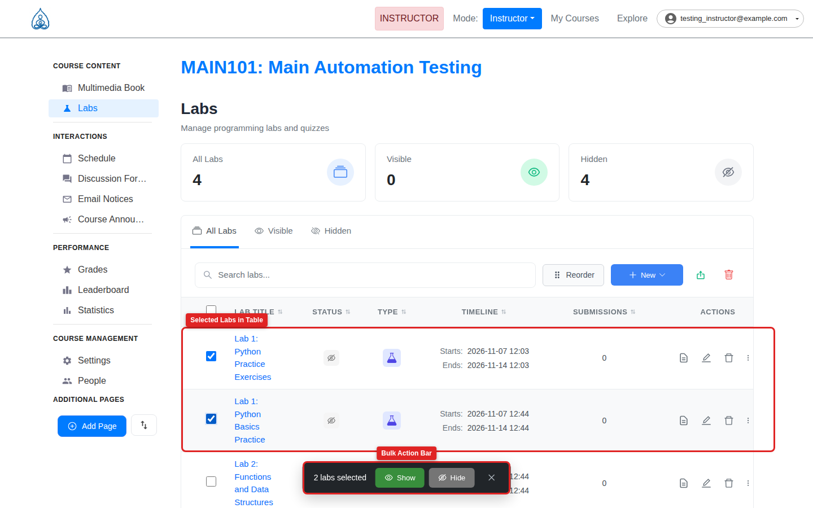
*Figure 20: Labs List with multiple checkboxes selected and floating Bulk Action Bar at bottom.*

1. Check the selection checkbox next to one or more labs in the list (highlighted as **Selected Labs in Table** in **Figure 20**).
2. The floating **Bulk Action Bar** pops up at the bottom of the screen.
3. Click **Show** to publish all selected labs to students at once.
4. Click **Hide** to unpublish and hide the selected labs from students.

---

### 8.4 Inside a Lab: Activities, Editing, and Actions

Click on any lab title to open its detail page, shown in **Figure 21**:

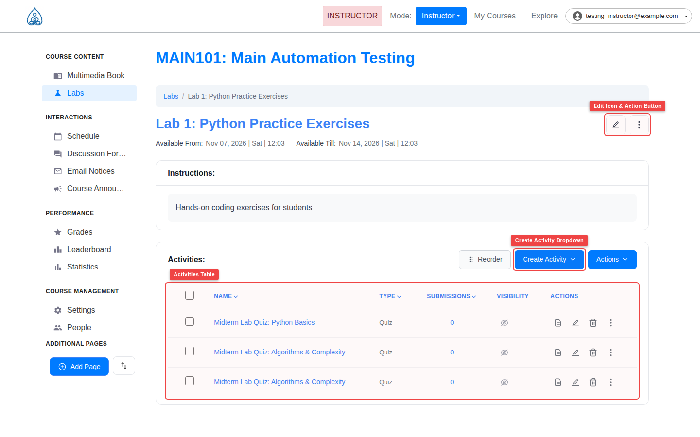
*Figure 21: Lab Detail Page highlighting the Activities Table, Create Activity dropdown, and Edit Icon with Action Button.*

The highlighted controls on this page include:
* **Edit Icon & Action Button:** Located at the top right next to the lab title. Click the **Edit** pencil icon to change the lab title, instructions, and availability dates. Click the neighboring **Action** button (`⋮` three-dot menu) to view the lab as a student, proctor the lab, download submission CSVs, or export the lab archive.
* **Create Activity Dropdown:** Click this blue dropdown above the table to add a new **Programming Activity** (hands-on coding problem with automated test cases) or a **Quiz Activity** (lab quiz).
* **Activities Table:** Lists every activity in this lab with its name, activity type, submission count, student visibility toggle, and row action buttons (view submissions, edit, delete, or clone).
* **Submissions Tab:** Switch to this tab to view all student submission attempts, check scores, and download reports (see [Section 11.1](#111-overall-lab-submissions--exporting-reports)). In the submissions table, using the **Actions** dropdown next to any student row allows viewing their individual submission.

---

## Section 9: Programming Activities & Autograding

A **Programming Activity** provides a hands-on coding environment. Students write and run code directly in their browser, and BodhiTree automatically evaluates their solutions against test cases.

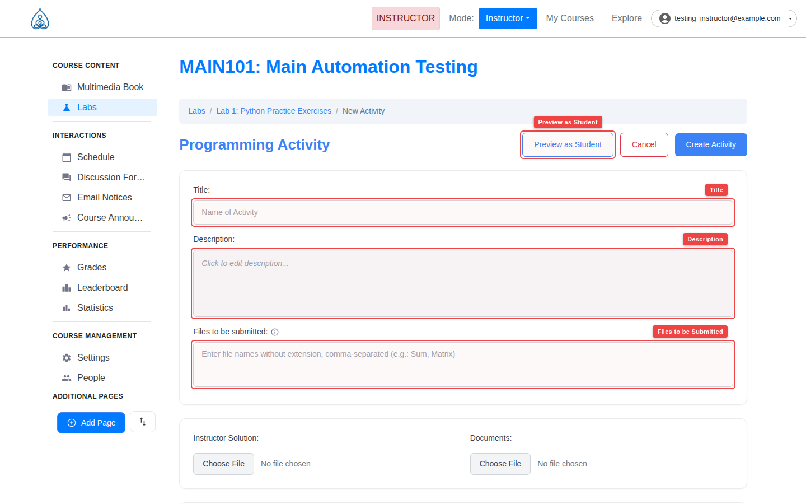
*Figure 22: Create Programming Activity Form highlighting Title, Description, Files to be Submitted, and the Preview as Student button.*

---

### 9.1 What is a Programming Activity?
In a programming activity, students write code in an interactive code editor. When they click "Run Code", the platform executes their program inside a secure sandbox and checks the output against your test cases.

---

### 9.2 Creating a Programming Activity: Basic Details & Setup

When creating a new programming activity (**Figure 22**), configure the primary settings in the **Basic Info** card:

1. **Title:** Enter a descriptive name for the activity (e.g., `Check Palindrome String` or `Matrix Multiplication`).
2. **Description:** Click inside the description box to open the editor and write clear problem instructions, expected inputs, outputs, and any constraints.
3. **Files to be Submitted:** Specify the expected submission file names without file extensions (e.g., `palindrome` or `Solution`). For Java activities, this must match the public class name (such as `public class Solution` in `Solution.java`).
4. **Preview as Student:** Click the **Preview as Student** button in the top action bar to inspect how the problem statement and editor interface appear from a student's perspective before publishing.
5. **Language Selection & Solution:** Further down the page, choose the programming language (e.g., Python 3, C, C++, Java), provide template skeleton code for students, and enter the instructor reference solution.
6. **Helper Document:** Reference material or notes uploaded by the instructor that students can open for background assistance while solving the problem.

---

### 9.3 Configuring Test Cases: Visible vs. Hidden

Scroll down inside the programming activity editor to access the test cases section, shown in **Figure 23**:

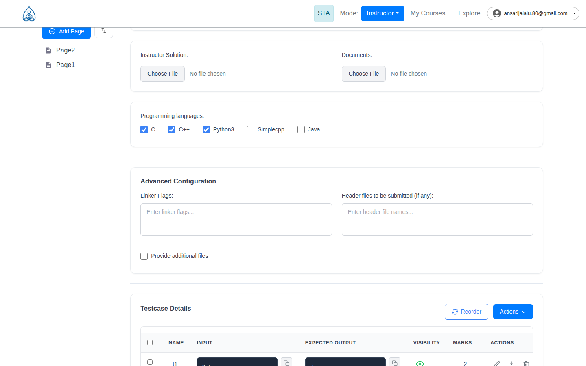
*Figure 23: Test Cases section showing Visible and Hidden test cases with inputs, outputs, and Actions menu.*

BodhiTree supports two types of test cases:

* **Visible Test Cases:** Students can see both the input given to the program and the expected output. These help students test and debug their code while working on the problem.
* **Hidden Test Cases:** Students cannot see the inputs or outputs. These test edge cases, large inputs, and boundary conditions. During evaluation, hidden testcases are run and evaluated by Teaching Assistants (TAs) to ensure students did not hardcode outputs.

---

### 9.4 Setting Resource Limits

To keep the platform responsive and prevent accidental infinite loops, configure resource limits:
* **CPU Time Limit:** Maximum execution time allowed per run (e.g., 2.0 seconds). If a student writes an infinite `while` loop, execution stops with a "Time Limit Exceeded" message.
* **Memory Limit:** Maximum RAM allocated per run (e.g., 256 MB) to prevent out-of-memory errors.

---

## Section 10: Lab Quizzes: Creation & Authoring

A **Lab Quiz** is a graded assessment activity housed inside a lab. It evaluates student performance as part of lab coursework alongside programming activities.

### 10.1 Important Difference: In-Book Quiz vs. Lab Quiz

| Feature | In-Book Quiz (In Multimedia Book) | Lab Quiz (In Labs) |
| :--- | :--- | :--- |
| **Location** | Inside chapter reading view (see [Section 5.3](#53-adding-an-in-book-quiz)) | Inside Labs activity list (see [Section 8.4](#84-inside-a-lab-activities-editing-and-actions)) |
| **Primary Goal** | Self-paced practice with instant learning feedback | Graded lab assessment and evaluation |
| **Timeline & Deadlines** | Available whenever the chapter is released | Governed by the parent Lab timeline (`Available From` / `Available Till`), identical to programming activities |
| **Authoring Method** | Built directly on screen using Modules & Questions (see [Section 6](#section-6-the-multimedia-quiz-editor-generating-quizzes-via-ui)) | Web-based Quiz Editor via **Edit Questions** (identical UI to In-Book Quiz), or optional ODT upload |
| **Resubmission Control** | Unlimited practice attempts | Configurable: **Allow students to resubmit until deadline** |
| **Score Visibility** | Instant score and explanations displayed | Configurable: **Allow students to see their marks on quiz submission** |
| **Answer Revelation** | Direct solution explanation provided | Configurable: **Reveal correct answers to students** |
| **Feedback & Grading** | Immediate formative hints | Graded submissions dashboard with individual student answer sheets |

---

### 10.2 Creating a Lab Quiz Activity

To create a Lab Quiz:
1. Inside your lab (**Figure 21**), click **Create Activity** and choose **Quiz Activity**.
2. The Quiz Activity creation form opens, as shown in **Figure 24**:

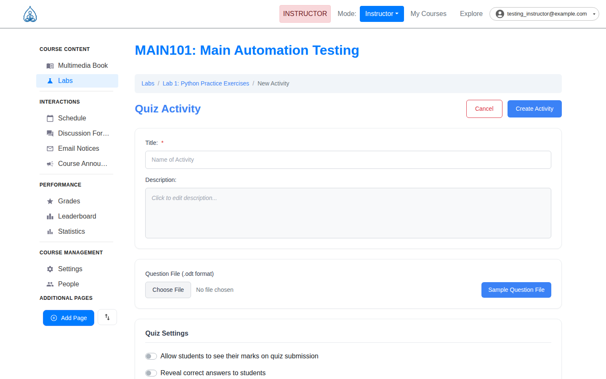
*Figure 24: Quiz Activity Creation Form with Title, Instructions, and Quiz Settings.*

3. Configure the activity settings:
   * **Title:** Enter the quiz title (e.g., `Midterm Lab Quiz: Algorithms & Complexity`).
   * **Description:** Add instructions, syllabus topics, and rules for students.
   * **Allow students to see their marks on quiz submission:** When enabled, students see their score right after submitting.
   * **Reveal correct answers to students:** When enabled, students can see the correct answers after submission.
   * **Allow students to resubmit until deadline:** When enabled, students can update and resubmit their answers as long as the parent lab is active.
   * **Additional Files:** Optionally specify if students must upload supporting files (code files, calculations, or report documents).
4. Click **Create Activity** to save the quiz.

---

### 10.3 Authoring Questions via Web UI Quiz Editor

Once a quiz activity is created, you can build your questions directly on screen:
1. On the lab page, click on the quiz activity to open its view page.
2. Click **Edit** in the top action bar, then click **Edit Questions** to open the interactive **Quiz Editor**, shown in **Figure 25**:

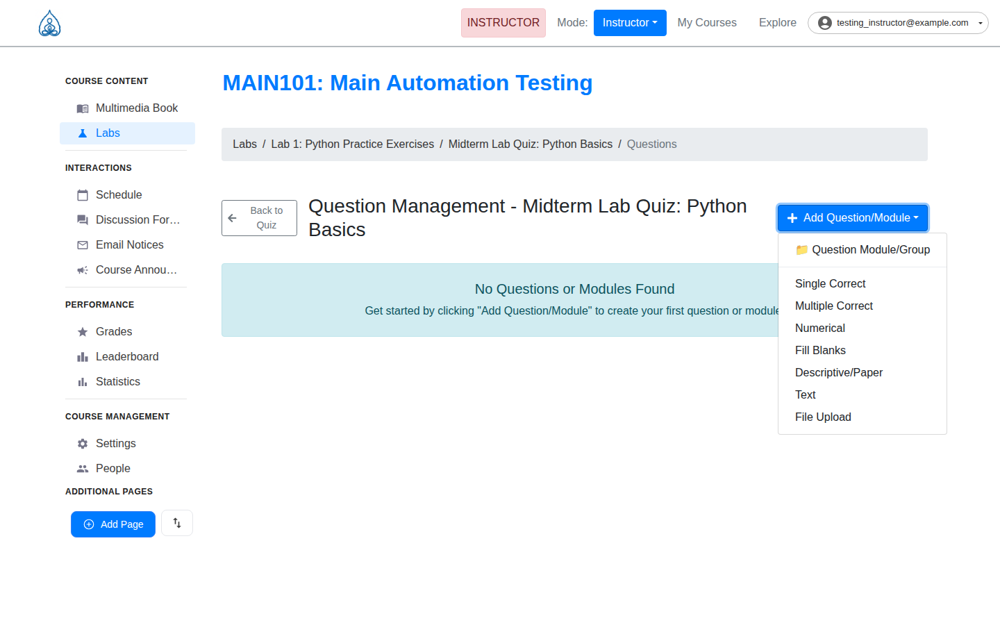
*Figure 25: Quiz Editor showing question modules and expanded Add Question dropdown.*

3. **Organizing with Modules:** Just like in Multimedia Book quizzes, questions are organized into topical modules. Click **Add Module** to create sections.
4. **Question Types Supported:** Click the **Add Question** dropdown to choose from four question formats:
   * **Single Choice (SCQ):** Standard multiple choice with one correct radio option.
   * **Multiple Choice (MCQ):** Multiple options can be selected with checkboxes.
   * **Numerical:** Students enter a number as their response.
   * **Descriptive:** Open-ended essay or short-answer text field.
5. For each question, specify the question statement, choices, points/marks, student hints, and answer descriptions.

---

## Section 11: Submissions Management & Student Evaluation

BodhiTree provides complete tools to inspect student code, view test case evaluations, grade quiz submissions, and export grade sheets.

---

### 11.1 Overall Lab Submissions & Exporting Reports

Access the lab submissions dashboard by clicking the **Submissions** tab inside any lab:

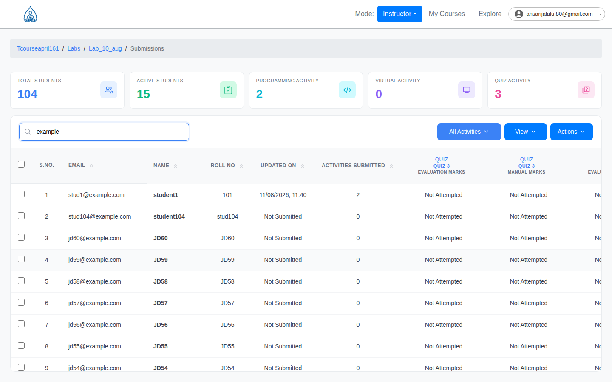
*Figure 26: Lab Submissions Dashboard showing student roster, activity scores, and export buttons.*

As shown in **Figure 26**, this dashboard displays:
* **Search Filter:** Search students by name, email, or roll number.
* **Student Roster:** Displays Roll Number, Name, Email, and overall marks scored across each activity in the lab.
* **Activity Columns:** Displays marks scored for each programming activity and quiz activity.
* **Export CSV Button:** Located at the top-right, lets you download the full class marksheet as an Excel-compatible spreadsheet.

---

### 11.2 Programming Submissions & Subjective Grading

To review student code for a specific programming problem:
1. Open the programming activity and click the **Submissions** tab, as shown in **Figure 27**:

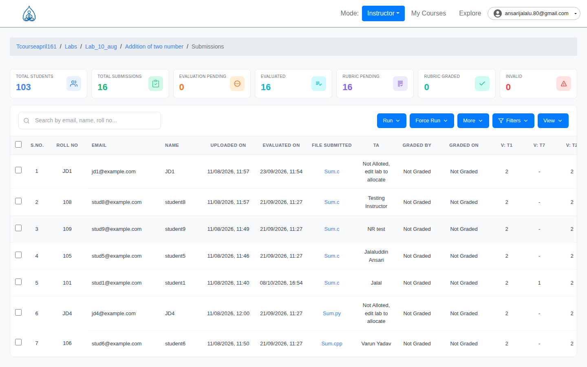
*Figure 27: Programming Submissions list showing student attempts, execution status, and scores.*

2. Each student row shows their submission timestamp, evaluation status (Accepted, Wrong Answer, Time Limit Exceeded), and score.
3. Click **Subjective Grading** next to any student to open the detailed grading workspace, shown in **Figure 28**:

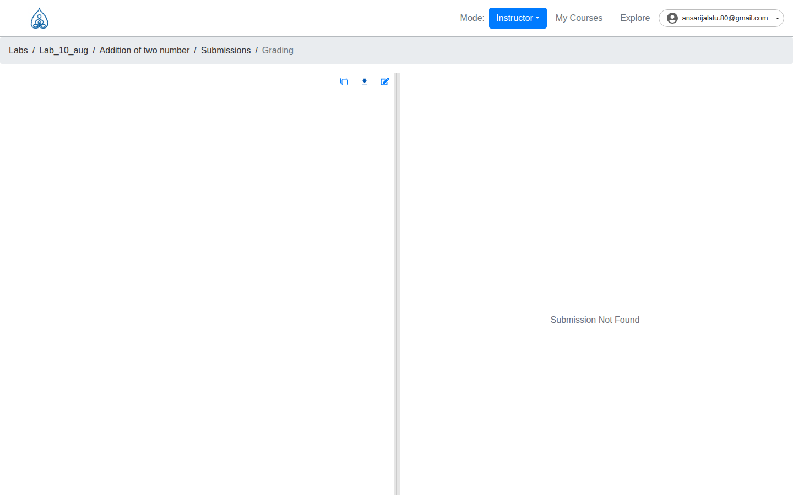
*Figure 28: Subjective Grading Workspace showing submitted code, test case results, score override, and feedback.*

* **Code Viewer:** Inspect the student's exact code with syntax highlighting.
* **Test Case Outputs:** View standard output, error messages, and execution time for each test case.
* **Manual Score Adjustment & Feedback:** Instructors and TAs can override marks and write personalized feedback comments for the student.

---

### 11.3 Lab Quiz Submissions & Individual Grading

To inspect quiz attempts and regrade:
1. Open the quiz activity and click **Submissions**, shown in **Figure 29**:

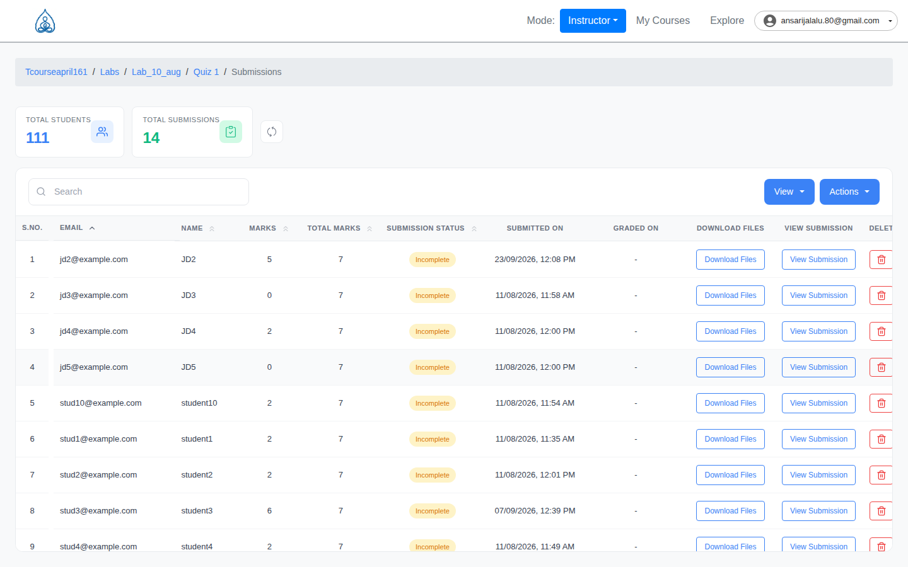
*Figure 29: Lab Quiz Submissions Dashboard showing student marks and Force Run button.*

2. **The Force Run Button:** If you update an answer key or modify point weights after students have submitted, click the **Force Run** button at the top of the table (**Figure 29**). BodhiTree will automatically re-evaluate all past student submissions against the updated answer key and refresh their marks immediately.
3. **Individual Answer Sheet & Grading:** Click on any student row (or click **Grade**) to open their individual answer sheet, shown in **Figure 30**:

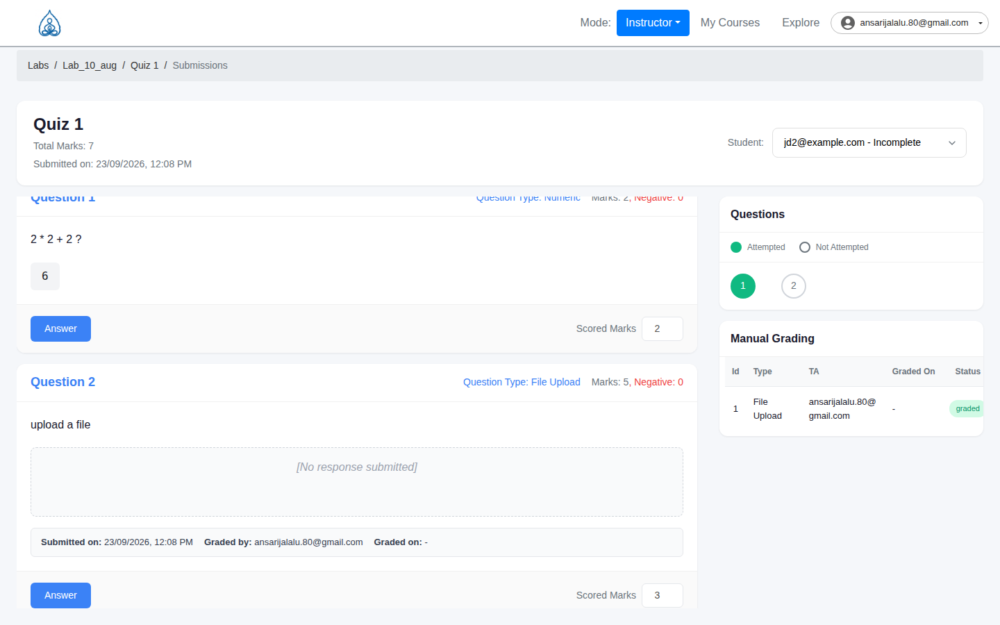
*Figure 30: Quiz Grading Page showing question-by-question responses, awarded points, and manual scoring.*

* Displays the exact option chosen by the student for each question.
* Highlights correct vs. incorrect answers.
* Allows instructors and TAs to adjust marks question-by-question for descriptive questions or partial credit.

---

## Section 12: People & Student Enrollment

The **People** page (`/courseware/course/<id>/management/people`) lets instructors manage course participants, assign roles, and handle enrollment.

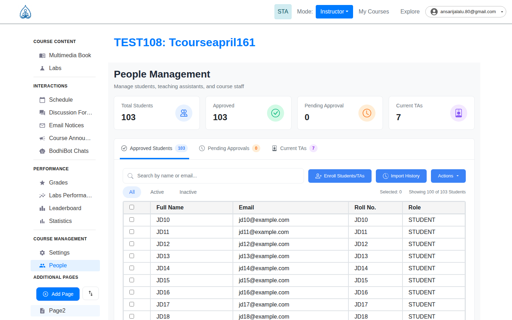
*Figure 31: People Management Dashboard showing enrolled users, roles, and Enroll Students/TAs button.*

---

### 12.1 The People Dashboard

As shown in **Figure 31**, the People dashboard lists all enrolled users in a table with their Name, Email address, Roll Number, and assigned Role. Instructors can:
* Search for any enrolled user by name or email.
* Filter users by role (`Student`, `STA`, `JTA`, `Instructor`).
* Remove users or change their assigned permissions.
* Click **Enroll Students/TAs** to add participants.

---

### 12.2 Single User Enrollment (New User & Existing User Search)

Clicking the blue **Enroll Students/TAs** button opens the enrollment dialog shown in **Figure 32**:

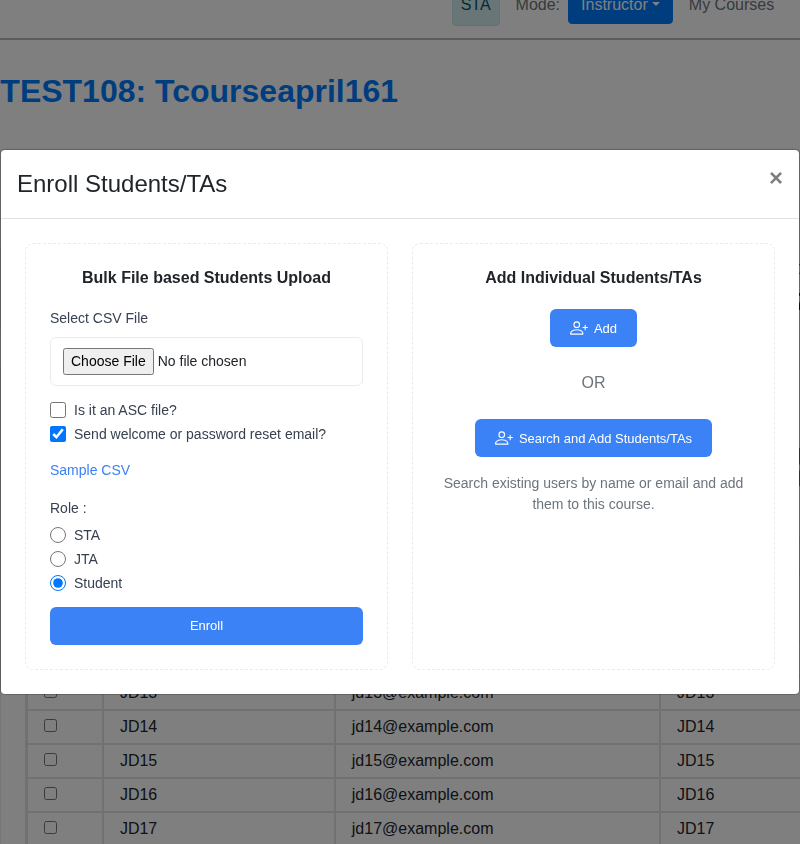
*Figure 32: Enroll Dialog supporting both searching existing portal users and adding new users.*

BodhiTree supports two ways to enroll individual users:
1. **Search Existing User:** If the student or TA is already registered on the portal, simply type their email or name in the search box and select them from the list.
2. **Add New User:** If the user does not have an account yet, fill in their details:
   * **Name:** Full name of the user.
   * **Email:** Registered email address.
   * **Roll Number:** Institutional identifier.
   * **Role Selection:** Select their assigned course role.

---

### 12.3 Bulk CSV Student Upload

For classes with dozens or hundreds of students, BodhiTree provides a bulk CSV upload tool:
1. On the People page, click **Upload CSV**.
2. Prepare a standard `.csv` file in your spreadsheet software with the following column headers:
   ```csv
   email,roll_number,name
   student1@example.com,210050001,Aarav Sharma
   student2@example.com,210050002,Diya Patel
   student3@example.com,210050003,Rohan Verma
   ```
3. Click **Choose File**, select your CSV file, and click **Upload**.
4. BodhiTree creates accounts for any new students, enrolls them in the course, and assigns their roll numbers automatically.

---

### 12.4 Course Roles: Students, TAs (STA / JTA), and Instructors

BodhiTree provides fine-grained role separation:

| Role | Access Permissions | Primary Responsibilities |
| :--- | :--- | :--- |
| **Student** | Read published content, submit code/quizzes, post on forums | Attending lectures, completing lab exercises, and participating in discussions |
| **Junior TA (JTA)** | Grade submissions, view student code, assist in lab sessions | Grading lab activities, answering student questions on discussion forums |
| **Senior TA (STA)** | Create/edit lab activities, moderate forums, view gradebook, grade submissions | Managing lab schedules, configuring test cases, supervising JTAs |
| **Instructor** | Full course administrative control: add/delete materials, edit settings, manage grades | Course design, lecture uploads, setting grading policies, and final grade exports |

---

## Section 13: Course Settings & Content Protection

Access course settings by clicking **Settings** under Course Management in the left sidebar (`/courseware/course/<id>/settings/general`).

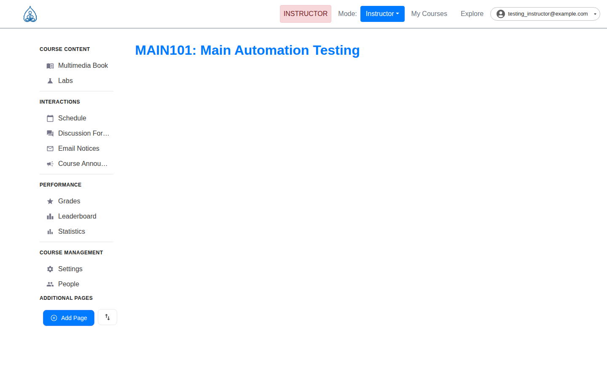
*Figure 33: General Settings showing course title, code, enrollment mode, and syllabus.*

---

### 13.1 General Course Settings

As shown in **Figure 33**, the top section allows configuring:
* **Course Title & Code:** Update the course display name or code.
* **Enrollment Mode:** Switch between Open Enrollment (anyone can join) and Moderated Approval (students request admission).
* **Course Description & Syllabus:** Provide background information, prerequisites, and learning outcomes.

---

### 13.2 Discussion Forum Moderation Settings

Scroll down in the settings page to access communication controls, shown in **Figure 34**:

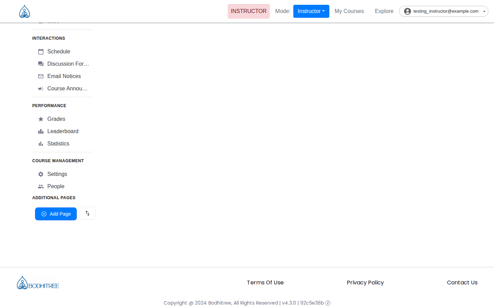
*Figure 34: Settings section showing forum moderation options and file download controls.*

* **Enable / Disable Discussion Forum:** Turn the course discussion board on or off.
* **Moderation Mode:** Require instructor or TA approval before student questions become visible to the whole class, preventing spam or inappropriate posts.
* **Anonymous Posting:** Allow students to ask questions without revealing their identity to classmates (instructors can still see the author's identity).

---

### 13.3 Content Protection & Disabling Downloads

To prevent unauthorized distribution of your lecture notes and handouts:
* **Disable PDF / File Downloads:** When enabled (**Figure 34**), the download button is removed from all document viewers in the course. Students can only read notes inside the secure BodhiTree viewer.

---

## Section 14: Interactions: Discussion Forums & Announcements

BodhiTree includes integrated communication tools so instructors and students do not need external messaging groups.

### 14.1 Class Discussion Forum

Access the forum by clicking **Discussion Forum** under Interactions in the sidebar (`/courseware/course/<id>/interactions/discussion-forum`):

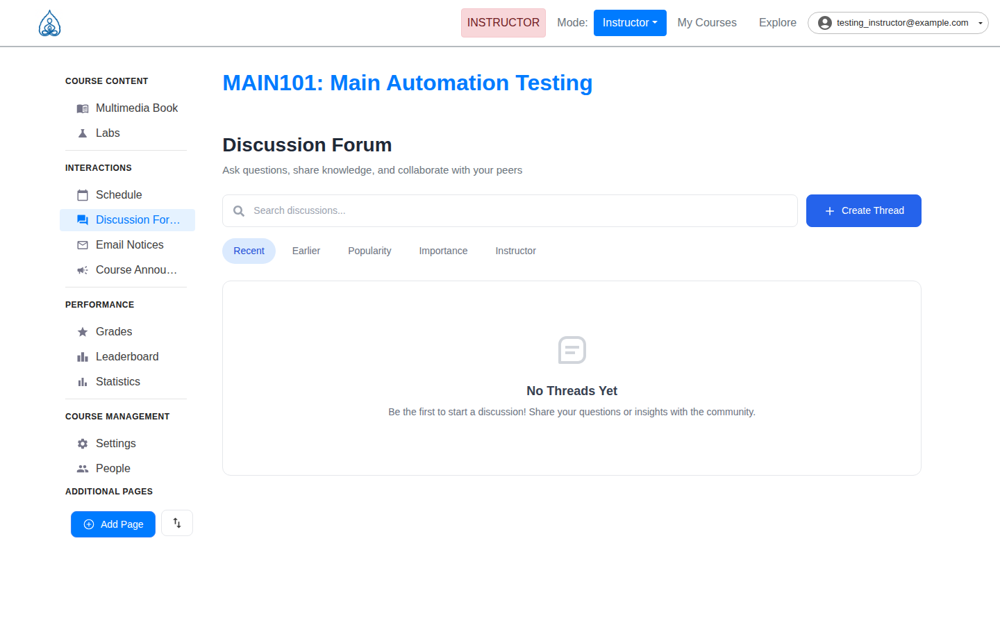
*Figure 35: Course Discussion Forum showing discussion threads and replies.*

* **+ New Thread Button:** Students and instructors can post questions categorized by chapter or lab topic (**Figure 35**).
* **Instructor Endorsement:** Instructors and TAs can click "Approved by Instructor" on correct student replies to highlight the right answer to the class.
* **Upvoting:** Students can upvote helpful questions and answers.

---

### 14.2 Course Announcements

Access announcements by clicking **Course Announcements** under Interactions (`/courseware/course/<id>/interactions/announcements`):

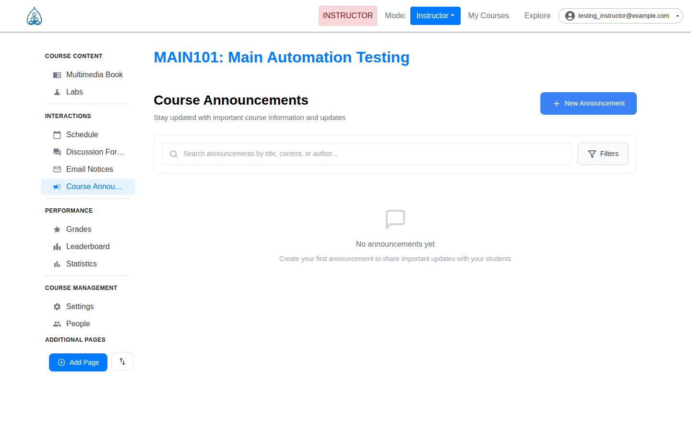
*Figure 36: Announcements Board showing broadcast notices and New Announcement button.*

* Click **+ New Announcement** (**Figure 36**).
* Enter a title (e.g., `Lab 1 Deadline Extended by 2 Days`) and your message body.
* When published, an announcement card appears on every enrolled student's course dashboard.

---

## Section 15: Performance Tracking & Gradebook

The **Grades** dashboard (`/courseware/course/<id>/performance/grades`) gathers student scores across all course activities into one view.

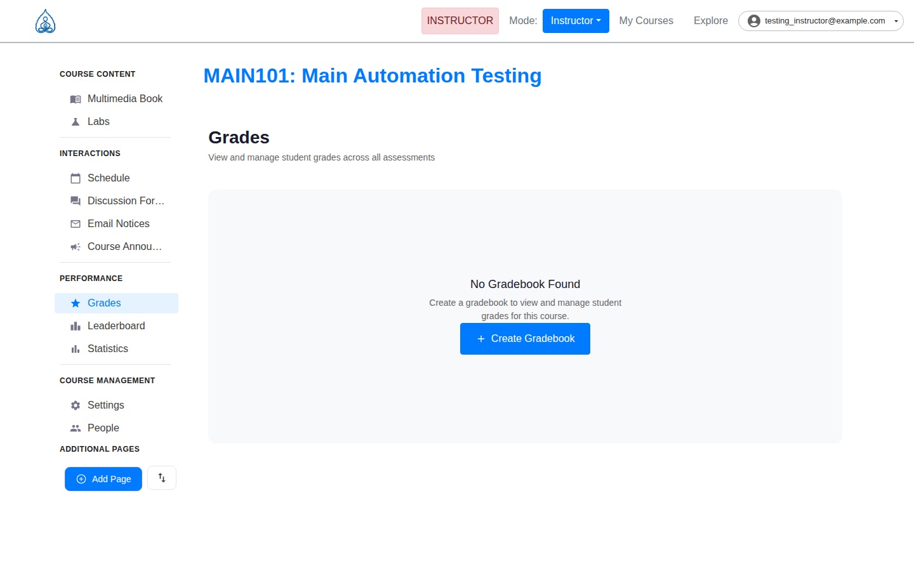
*Figure 37: Gradebook Grid showing student scores across all lab exercises and quizzes.*

---

### 15.1 Grades Dashboard

As shown in **Figure 37**, the gradebook displays:
* Rows for each student with their Roll Number and Name.
* Columns for every lab exercise, programming problem, and quiz.
* Summary statistics at the bottom showing Highest Score, Class Average, and Submission Count.

---

### 15.2 Exporting Grades to CSV

At the end of the semester, click the **Export CSV** button on the top-right of the gradebook. BodhiTree downloads an Excel-compatible spreadsheet containing all student marks, ready for institutional grading.

---

## Section 16: Recycle Bin & Common Troubleshooting

### 16.1 Restoring Deleted Items from Recycle Bin

If you accidentally delete a lab or lab activity, you can easily restore it from the **Recycle Bin** (`/courseware/course/<id>/content/labs/recyclebin`):

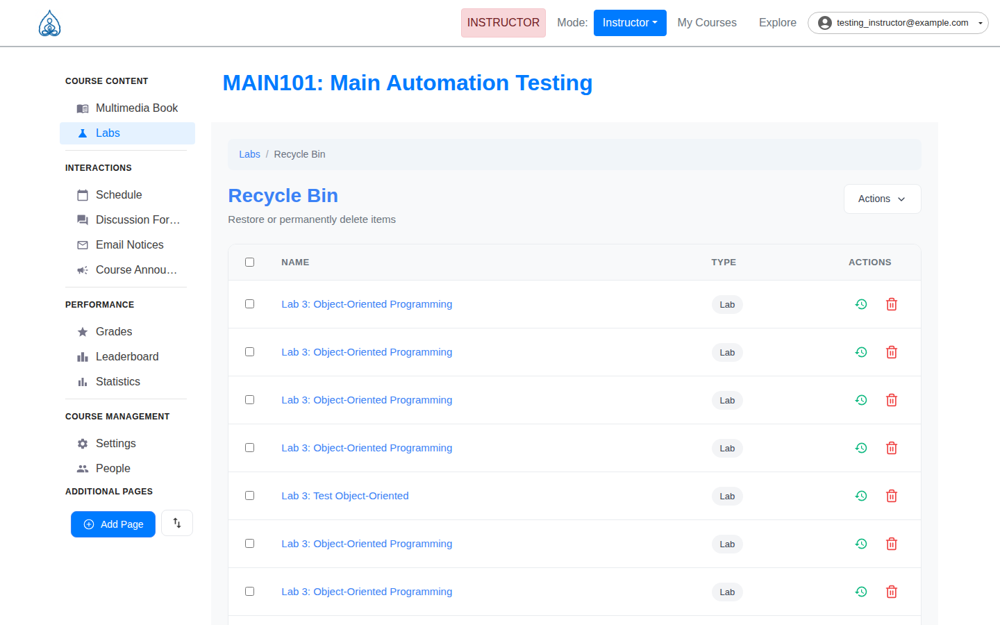
*Figure 38: Recycle Bin showing deleted activities with Restore and Delete Permanently actions.*

1. Open the Recycle Bin from the sidebar or labs menu (**Figure 38**).
2. Locate the deleted item.
3. Click the green **Restore** button. The item returns to its original lab with all student submissions intact.

---

### 16.2 Common Issues & Quick Solutions

| Issue | Likely Cause | How to Fix |
| :--- | :--- | :--- |
| **Students cannot find the course on Explore page** | Course is marked as Unpublished on the dashboard | Click the green Publish button on the course card ([Section 2.1](#21-the-my-courses-dashboard)). Enrolled students can still access it directly. |
| **Students cannot see a chapter, video, or lab** | Item is currently Unpublished (Draft mode) | Open the chapter or lab and click the eye / publish icon to make it visible to students ([Section 4.3](#43-managing-chapters--adding-sections)). |
| **Code submission gives "Time Limit Exceeded"** | The student's code contains an infinite loop | Ask the student to check their loop termination conditions, or increase the CPU time limit in activity settings ([Section 9.4](#94-setting-resource-limits)). |
| **Need to re-evaluate quiz after correcting answer key** | Questions or marks were modified after student submissions | Open the Lab Quiz Submissions page and click the **Force Run** button ([Section 11.3](#113-lab-quiz-submissions--individual-grading)). |
| **Students are sharing handouts online** | Raw document downloads are currently permitted | Go to Course Settings and turn on **Disable PDF / File Downloads** ([Section 13.3](#133-content-protection--disabling-downloads)). |

---

*End of BodhiTree Product Manual & Instructor Guide.*
# BodhiTree Product Manual & Instructor Guide

Welcome to the **BodhiTree Instructor Guide and Product Manual**. BodhiTree is an interactive e-learning platform developed at IIT Bombay for blended learning, digital coursebooks, hands-on programming labs, and automated grading. This manual provides instructors, teachers, and teaching assistants (TAs) with a complete walkthrough of course setup, learning content management, laboratory exercises, and student evaluation.

> [!NOTE]
> This manual covers the core teaching tools on BodhiTree:
> * **Course Setup & Management** (creating courses, managing settings, publish controls)
> * **Multimedia Book (MMB)** (chapters, sections, documents, videos, URLs, and in-book quizzes)
> * **Multimedia Quiz Editor** (creating question modules and questions directly via the web UI)
> * **In-Video Quizzes** (timeline markers, video checkpoints, and inline editing)
> * **Labs Management** (creating labs, bulk show/hide actions)
> * **Programming Activities** (problem setup, template code, visible and hidden test cases, autograding)
> * **Lab Quizzes** (timed lab assignments created via the web UI or `.odt` templates)
> * **Submissions & Grading** (lab overview submissions, programming code viewer and test runs, quiz submissions, and Force Run re-evaluation)
> * **People & Enrollment** (single student enrollment, searching existing users, STA/JTA roles, and bulk CSV upload)
> * **Course Settings & Protection** (general course details, forum moderation, and disabling file downloads)
> * **Interactions** (discussion forums and class announcements)
> * **Performance & Grades** (gradebook table and CSV export)
> * **Recycle Bin** (restoring deleted lab activities)

---

## Table of Contents

* [Section 1: Getting Started & Signing In](#section-1-getting-started--signing-in)
  * [1.1 Accessing the BodhiTree Portal](#11-accessing-the-bodhitree-portal)
  * [1.2 Signing In with Your Instructor Account](#12-signing-in-with-your-instructor-account)
* [Section 2: Course Dashboard & Course Management](#section-2-course-dashboard--course-management)
  * [2.1 The My Courses Dashboard](#21-the-my-courses-dashboard)
  * [2.2 Creating a New Course Offering](#22-creating-a-new-course-offering)
  * [2.3 Course Card Options (Three-Dot Menu)](#23-course-card-options-three-dot-menu)
* [Section 3: Course Navigation Overview](#section-3-course-navigation-overview)
  * [3.1 The Course Sidebar Navigation](#31-the-course-sidebar-navigation)
  * [3.2 Organization of Menu Items](#32-organization-of-menu-items)
* [Section 4: The Multimedia Book (MMB): Chapters & Sections](#section-4-the-multimedia-book-mmb-chapters--sections)
  * [4.1 Book Organization & Structure](#41-book-organization--structure)
  * [4.2 Creating a New Chapter](#42-creating-a-new-chapter)
  * [4.3 Managing Chapters & Adding Sections](#43-managing-chapters--adding-sections)
* [Section 5: Adding Learning Materials (Sections, In-Book Quizzes, Documents, Videos & URLs)](#section-5-adding-learning-materials-sections-in-book-quizzes-documents-videos--urls)
  * [5.1 The Add Content Menu](#51-the-add-content-menu)
  * [5.2 Adding a Section](#52-adding-a-section)
  * [5.3 Adding an In-Book Quiz](#53-adding-an-in-book-quiz)
  * [5.4 Adding a Document (File Attachments)](#54-adding-a-document-file-attachments)
  * [5.5 Adding a Video Lecture](#55-adding-a-video-lecture)
  * [5.6 Adding External Web URLs](#56-adding-external-web-urls)
* [Section 6: The Multimedia Quiz Editor: Generating Quizzes via UI](#section-6-the-multimedia-quiz-editor-generating-quizzes-via-ui)
  * [6.1 Purpose of the Quiz Editor](#61-purpose-of-the-quiz-editor)
  * [6.2 Organizing Questions with Modules](#62-organizing-questions-with-modules)
  * [6.3 Adding and Configuring Questions](#63-adding-and-configuring-questions)
  * [6.4 Understanding Hints, Answer Descriptions, and Error Descriptions](#64-understanding-hints-answer-descriptions-and-error-descriptions)
* [Section 7: In-Video Quizzes & Timeline Markers](#section-7-in-video-quizzes--timeline-markers)
  * [7.1 Purpose of In-Video Quizzes](#71-purpose-of-in-video-quizzes)
  * [7.2 The Video Player Workspace](#72-the-video-player-workspace)
  * [7.3 Section Markers vs. Quiz Markers](#73-section-markers-vs-quiz-markers)
  * [7.4 Adding, Editing, and Deleting Markers (CRUD Operations)](#74-adding-editing-and-deleting-markers-crud-operations)
* [Section 8: Labs Management & Bulk Actions](#section-8-labs-management--bulk-actions)
  * [8.1 The Labs Dashboard](#81-the-labs-dashboard)
  * [8.2 Creating a New Lab](#82-creating-a-new-lab)
  * [8.3 Bulk Show & Hide Operations](#83-bulk-show--hide-operations)
  * [8.4 Inside a Lab: Activities, Editing, and Actions](#84-inside-a-lab-activities-editing-and-actions)
* [Section 9: Programming Activities & Autograding](#section-9-programming-activities--autograding)
  * [9.1 What is a Programming Activity?](#91-what-is-a-programming-activity)
  * [9.2 Problem Statements, Template Code, and Instructor Solutions](#92-problem-statements-template-code-and-instructor-solutions)
  * [9.3 Configuring Test Cases: Visible vs. Hidden](#93-configuring-test-cases-visible-vs-hidden)
  * [9.4 Setting Resource Limits](#94-setting-resource-limits)
* [Section 10: Lab Quizzes: Creation & Authoring](#section-10-lab-quizzes-creation--authoring)
  * [10.1 Important Difference: In-Book Quiz vs. Lab Quiz](#101-important-difference-in-book-quiz-vs-lab-quiz)
  * [10.2 Creating a Lab Quiz Activity](#102-creating-a-lab-quiz-activity)
  * [10.3 Authoring Questions via Web UI Quiz Editor](#103-authoring-questions-via-web-ui-quiz-editor)
* [Section 11: Submissions Management & Student Evaluation](#section-11-submissions-management--student-evaluation)
  * [11.1 Overall Lab Submissions & Exporting Reports](#111-overall-lab-submissions--exporting-reports)
  * [11.2 Programming Submissions & Subjective Grading](#112-programming-submissions--subjective-grading)
  * [11.3 Lab Quiz Submissions & Individual Grading](#113-lab-quiz-submissions--individual-grading)
* [Section 12: People & Student Enrollment](#section-12-people--student-enrollment)
  * [12.1 The People Dashboard](#121-the-people-dashboard)
  * [12.2 Single User Enrollment (New User & Existing User Search)](#122-single-user-enrollment-new-user--existing-user-search)
  * [12.3 Bulk CSV Student Upload](#123-bulk-csv-student-upload)
  * [12.4 Course Roles: Students, TAs (STA / JTA), and Instructors](#124-course-roles-students-tas-sta--jta-and-instructors)
* [Section 13: Course Settings & Content Protection](#section-13-course-settings--content-protection)
  * [13.1 General Course Settings](#131-general-course-settings)
  * [13.2 Discussion Forum Moderation Settings](#132-discussion-forum-moderation-settings)
  * [13.3 Content Protection & Disabling Downloads](#133-content-protection--disabling-downloads)
* [Section 14: Interactions: Discussion Forums & Announcements](#section-14-interactions-discussion-forums--announcements)
  * [14.1 Class Discussion Forum](#141-class-discussion-forum)
  * [14.2 Course Announcements](#142-course-announcements)
* [Section 15: Performance Tracking & Gradebook](#section-15-performance-tracking--gradebook)
  * [15.1 Grades Dashboard](#151-grades-dashboard)
  * [15.2 Exporting Grades to CSV](#152-exporting-grades-to-csv)
* [Section 16: Recycle Bin & Common Troubleshooting](#section-16-recycle-bin--common-troubleshooting)
  * [16.1 Restoring Deleted Items from Recycle Bin](#161-restoring-deleted-items-from-recycle-bin)
  * [16.2 Common Issues & Quick Solutions](#162-common-issues--quick-solutions)

---

## Section 1: Getting Started & Signing In

BodhiTree is an interactive e-learning platform developed at IIT Bombay. It allows teachers to build structured course textbooks, conduct coding labs with instant automated evaluation, share videos with in-video checkpoints, and review student grades in one place.

### 1.1 Accessing the BodhiTree Portal

To access BodhiTree, open your web browser (Google Chrome or Mozilla Firefox work best) and type the web address given by your institution (for example, `https://tiger.bodhi-tree.in`).


*Figure 1: BodhiTree Landing Page with Login button.*

As shown in **Figure 1**, the landing page displays general platform information. In the top-right corner of the navigation bar, you will find the **Login** button.

---

### 1.2 Signing In with Your Instructor Account

1. Click the **Login** button on the top-right navigation bar (**Figure 1**).
2. The sign-in dialog opens in the center of your screen, as shown in **Figure 2**.
3. In the **Email** field, enter your registered email address (e.g. `abc@example.com`).
4. In the **Password** field, enter your password.
5. Click the blue **Sign In** button.


*Figure 2: BodhiTree Sign In Dialog for entering email and password.*

> [!TIP]
> BodhiTree automatically keeps your login session active in your browser. You do not need to sign in repeatedly when opening different courses or chapters. If you stay away for several days, your session will automatically time out for security, and you can simply log in again.

---

## Section 2: Course Dashboard & Course Management

After logging in, BodhiTree takes you to the **My Courses** dashboard. This is your home screen where every course you teach or manage is listed.


*Figure 3: My Courses Dashboard showing course cards, search bar, and Add Course button.*

---

### 2.1 The My Courses Dashboard

As shown in **Figure 3**, the dashboard has three main areas:
* **Course Cards:** Every course is shown as a card displaying the Course Code, Course Title, and Institution name. If the course is not published yet, you will see a green **Publish** button to make it visible in the Explore catalog. Once published, the card displays a green published badge.
* **Search Courses Input:** Located at the top-left, this search bar lets you find any course instantly by typing its code (like `CS101`) or title keyword.
* **+ Add Course Button:** Located at the top-right, this blue button opens the course creation form.

---

### 2.2 Creating a New Course Offering

To create a new course:
1. Click the **+ Add Course** button on the dashboard (**Figure 3**).
2. The **Add Course** popup dialog appears on your screen, as shown in **Figure 4**.


*Figure 4: Add Course Dialog with Course Image, Course Code, and Enrollment Type.*

3. Fill in the fields:
   * **Course Image:** Drag and drop or browse an image file (such as `.png`, `.jpg`, or `.webp`). This image acts as the poster on the course card shown on your dashboard and the course catalog.
   * **Course Code:** Enter a unique identifier up to 8 characters for your course (e.g., `CS101`, `EE204`, or `MAIN101`).
   * **Course Name:** Enter the full course title (e.g., `Computer Programming Fundamentals`).
   * **Institute & Department:** Select your institution and academic department from the dropdown menus.
   * **Enrollment Type:** Choose between:
     * **Open Course:** Any student registered on the portal can click and join the course directly.
     * **Moderated Course:** Students can request to join, but an instructor or TA must review and approve their request before they get access.
   * **Course Content:** Select **Create on own** to start with a blank course, or choose **Import using File** or **Import using URL** to bring in an existing course archive.
   * **Discussion Forum Settings:** Select whether email notifications are sent to everyone for every discussion post, and whether to show the identity of anonymous posts to the instructor.
4. Click the blue **Add Courses** button inside the modal to save.
5. Your new course card will appear on the dashboard right away.

> [!IMPORTANT]
> Course codes must be unique in your institution. If another course is already using that exact code, the system will show an error asking you to choose a different course code.

---

### 2.3 Course Card Options (Three-Dot Menu)

On every course card (shown in **Figure 3**), there is a three-dot menu button (`⋮`) in the top-left corner. Clicking it reveals two actions:
1. **Download Course:** Creates and downloads an archive file containing the course structure and materials.
2. **Delete Course:** Permanently deletes the course and all its student records from the database.

> [!NOTE]
> There is **no Edit Course option** inside the three-dot menu on the course card. If you want to change the course name, description, or enrollment mode, open the course and go to **Course Settings** (described in [Section 13.1](#131-general-course-settings)).

---

## Section 3: Course Navigation Overview

Click on any course card from your dashboard to enter that course workspace. The left sidebar gives you quick access to all parts of the course.


*Figure 5: Course Workspace Sidebar showing navigation sections.*

---

### 3.1 The Course Sidebar Navigation

As shown in **Figure 5**, the sidebar organizes your course into distinct functional areas.

### 3.2 Organization of Menu Items

| Section | Menu Option | What It Is Used For |
| :--- | :--- | :--- |
| **Course Content** | **Multimedia Book** | The digital textbook view. Contains chapters, sections, lecture notes, video lessons, and in-book quizzes (see [Section 4](#section-4-the-multimedia-book-mmb-chapters--sections)). |
| **Course Content** | **Labs** | The laboratory section for practice coding problems and graded lab quizzes (see [Section 8](#section-8-labs-management--bulk-actions)). |
| **Interactions** | **Schedule** | Displays the course calendar with scheduled activities, assignment deadlines, and lecture timings. |
| **Interactions** | **Discussion Forum** | The class discussion board where students post questions and instructors/TAs reply (see [Section 14.1](#141-class-discussion-forum)). |
| **Interactions** | **Email Notices** | Send official email notices directly to all enrolled students' registered email inboxes. |
| **Interactions** | **Course Announcements** | Post broadcast notices that display on students' course home screens (see [Section 14.2](#142-course-announcements)). |
| **Performance** | **Grades** | The complete gradebook table showing marks across all labs, coding tasks, and quizzes (see [Section 15.1](#151-grades-dashboard)). |
| **Performance** | **Labs Performance** | Detailed activity-wise performance statistics and completion percentages. |
| **Performance** | **Leaderboard** | Shows student rankings based on points scored in practice activities. |
| **Performance** | **Statistics** | Visual charts showing score distributions and class averages. |
| **Course Management**| **Settings** | General course information, forum moderation settings, and content protection toggles (see [Section 13](#section-13-course-settings--content-protection)). |
| **Course Management**| **People** | View enrolled students, invite teaching assistants, or upload a class list via CSV (see [Section 12](#section-12-people--student-enrollment)). |
| **Additional Pages** | **Add Page** | Create custom markdown or rich-text web pages (e.g. Course Syllabus, Grading Policy, TA Office Hours). |

---

## Section 4: The Multimedia Book (MMB): Chapters & Sections

The **Multimedia Book (MMB)** is the digital textbook of your course. You can organize your syllabus into **Chapters**, subdivide them into **Sections**, and add learning materials inside each section.


*Figure 6: Multimedia Book Overview showing expanded chapter accordion and content items.*

---

### 4.1 Book Organization & Structure

As shown in **Figure 6**, the Multimedia Book displays your chapters in vertical sequence. Each chapter functions as an accordion card that expands to show its sections and contents.

---

### 4.2 Creating a New Chapter

To add a new chapter to your book:
1. Click the blue **+ Add Chapter** button at the top-right of the Multimedia Book (**Figure 6**).
2. The **Add Chapter** modal dialog opens, as shown in **Figure 7**.


*Figure 7: Add Chapter Modal with Title, Description, and Save button.*

3. Enter the **Chapter Title** (e.g., `Chapter 1: Python Fundamentals`).
4. Enter an optional **Description** giving an overview of the chapter topics.
5. Click **Save**. The new chapter accordion appears in your book immediately.

---

### 4.3 Managing Chapters & Adding Sections

Once a chapter is created, you can manage it using the controls shown in **Figure 8**:


*Figure 8: Chapter Card showing header bar, Add Content button, and publish toggle.*

* **Expand / Collapse Accordion:** Click on the chapter header bar to reveal or hide the contents inside.
* **Chapter Menu (`⋮`):** Provides options to edit the chapter title/description or delete the chapter. When deleting a chapter, BodhiTree asks for a confirmation and permanently removes the chapter (chapters do not move to the Recycle Bin).
* **Publish / Eye Icon:** Click to toggle the chapter between Published (visible to enrolled students) and Unpublished (hidden from students).
* **+ Add Content Button:** Opens the menu to add learning materials inside this chapter.

---

## Section 5: Adding Learning Materials (Sections, In-Book Quizzes, Documents, Videos & URLs)

Inside any chapter, clicking the **+ Add Content** button opens the dropdown menu shown in **Figure 9**:


*Figure 9: Add Content Dropdown offering Section, Quiz, Document, Video, and URL options.*

---

### 5.1 The Add Content Menu

The dropdown provides five distinct content types in exact order:
1. **Section:** Group learning materials into clear topical sub-sections within the chapter.
2. **Quiz:** Add an interactive In-Book Quiz directly inside the chapter to test concepts while reading.
3. **Document:** Upload reading handouts and lecture slides for students (`.pdf`, `.txt`, and other document formats).
4. **Video:** Upload video lectures for students to watch.
5. **URL:** Link external web pages and reference documentation.

---

### 5.2 Adding a Section

Sections act as sub-folders inside a chapter to organize your topics cleanly:
1. Select **Section** from the dropdown (**Figure 9**).
2. In the popup dialog, enter the **Section Title** (e.g., `1.1 Variables and Assignment Statements`).
3. Enter an optional **Description** explaining the topics covered in this section.
4. Click **Save Section**. A new section card appears inside the chapter accordion where you can attach reading documents, videos, and quizzes.

---

### 5.3 Adding an In-Book Quiz

An **In-Book Quiz** is an interactive practice checkpoint placed directly inside a chapter or section. While students read through textbook chapters, they can solve questions on-screen to check their understanding right away:
1. Select **Quiz** from the dropdown (**Figure 9**).
2. The **Add Quiz** modal opens, as shown in **Figure 10**.


*Figure 10: Add Quiz Modal showing Title, Description, Sample Files download, and Quiz File upload.*

3. Enter the **Quiz Title** (e.g., `Concept Check 1: Python Data Types`).
4. Enter an optional **Description** describing what the quiz covers.
5. **Sample Files:** Click the **Sample Files** dropdown button at the top-right of the modal to download reference templates (such as `.odt` or `.csv`) for offline authoring.
6. **Quiz File:** Optionally attach a quiz file (`.odt`, `.csv`, or `.txt`) using the drag-and-drop file upload area. If you prefer creating questions directly using the web interface, leave this empty.
7. Click **Save** to attach the quiz card inside your chapter.
8. Once created, click on the quiz card to open the **Quiz Editor** and add question modules and questions directly via the web UI (detailed in [Section 6](#section-6-the-multimedia-quiz-editor-generating-quizzes-via-ui)).

---

### 5.4 Adding a Document (File Attachments)

BodhiTree allows uploading reading handouts in multiple formats, including `.pdf`, `.txt`, and other text extensions:
1. Select **Document** from the dropdown (**Figure 9**).
2. The **Add Document** modal appears, as shown in **Figure 11**.


*Figure 11: Add Document Modal with Title, Description, and Document File upload.*

3. Enter the **Document Title** (e.g., `Lecture 1 Notes - Variables & Expressions`).
4. Enter an optional **Description** giving a summary of the reading material.
5. Drag and drop or browse to select your **Document File** (`.pdf`, `.txt`, etc.) from your computer.
6. Click **Save** to attach the document.

---

### 5.5 Adding a Video Lecture

1. Select **Video** from the dropdown (**Figure 9**).
2. The **Add Video** modal appears, as shown in **Figure 12**.


*Figure 12: Add Video Modal with Title, Description, Video File, Camtasia File, and Slides upload fields.*

3. Fill in the video details:
   * **Title:** Enter the title for the lecture (e.g., `Lecture 2: Python Functions and Scope`).
   * **Description:** Enter an optional description summarizing what this video lesson covers.
   * **Video File:** Drag and drop or browse your video recording (`.mp4`, `.webm`, `.avi`, `.mpeg`, or `.ogv`).
   * **Camtasia Config File:** If you recorded and edited your video using TechSmith Camtasia with chapters or markers, you can upload the exported `.xml` config file to import chapter timestamps automatically.
   * **Slides etc...:** Attach accompanying presentation slides (`.pdf`, `.pptx`, or documents) for students to follow along while watching.
4. Click **Save** to upload and attach the video lesson under your chapter.
5. Once uploaded, click on the video card to open the **Video Player Workspace** and add interactive timeline markers or in-video checkpoints (detailed in [Section 7](#section-7-in-video-quizzes--timeline-markers)).

---

### 5.6 Adding External Web URLs

1. Select **URL** from the dropdown (**Figure 9**).
2. The **Add URL** modal opens, as shown in **Figure 13**.


*Figure 13: Add URL Modal with Title, Description, and URL fields.*

3. Fill in the resource details:
   * **Title:** Enter the resource title (e.g., `Python Standard Library Documentation`).
   * **Description:** Enter an optional description summarizing what students will find at this link.
   * **URL:** Enter the full web address (e.g., `https://docs.python.org/3/`). You can also click **+ Add Another URL** if you want to attach multiple links under a single card.
4. Click **Save**. When students click this card, the webpage opens in a clean inline frame or in a new browser tab.

---

## Section 6: The Multimedia Quiz Editor: Generating Quizzes via UI

BodhiTree provides a built-in web-based **Quiz Editor** that lets instructors author interactive quizzes directly in their browser. You do not need to prepare complex spreadsheet templates or external files; you can create questions, set correct options, and configure marks using simple visual forms.

### 6.1 Purpose of the Quiz Editor

The Quiz Editor is used to author questions for both **In-Book Quizzes** in the Multimedia Book and **Lab Quizzes** in Labs. It provides a visual interface for:
* Grouping questions into structured modules.
* Adding questions across multiple formats (Single Choice, Multiple Choice, Numerical, and Descriptive).
* Setting point values, answer explanations, and student hints.
* Reordering, editing, and deleting questions directly on screen.

---

### 6.2 Organizing Questions with Modules

In BodhiTree, questions inside a quiz are grouped into **Modules**. A module represents a topic or subsection of the quiz (for example, "Module 1: Python Basics & Data Types" or "Module 2: Control Flow & Iteration").


*Figure 14: Quiz Editor showing question modules, question list, and action buttons.*

As shown in **Figure 14**, the Quiz Editor workspace provides:
* **Add Module Button:** Creates a new question module to group related questions by topic.
* **Add Question Button:** Opens the question builder modal to author a new question.
* **Reorder Button:** Switches the workspace into reorder mode so you can drag and drop modules and questions to rearrange their sequence.
* **Created Module Container:** Shows the module header (`Module 1: Python Basics & Data Types`), total question badge, visibility toggle, and nested questions.
* **Created Question Card:** Displays the question format badge (e.g. `MCQ`), question prompt (`Which format specifier is used for floating-point numbers in Python?`), and action controls.

---

### 6.3 Adding and Configuring Questions

To add a question to any module:
1. Click the blue **+ Add Question** button inside that module (**Figure 14**).
2. The **Add Question** modal dialog opens, as shown in **Figure 15**.


*Figure 15: Add Question Modal showing Question Title (Description), Question Type, and Options.*

3. Configure the question details (**Figure 15**):
   * **Question Title (Description):** Click the description box to enter the main question statement, problem prompt, or code snippet that students will see.
   * **Question Type:** Select the question format from the dropdown:
     * **Multiple Choice (MCQ):** Questions with one or more correct choices.
     * **Single Choice (SCQ):** Questions with only a single correct option.
     * **Fixed Answer (FAQ):** Questions requiring an exact text answer match.
     * **Numerical Answer (FIB):** Questions where students enter a numerical value within an acceptable range.
   * **Options:** Click to type each choice's text, select the checkbox/radio button to mark correct answers, and click **+ Add Option** to add more answer choices.
   * **Marks & Attempts:** Set points awarded for correct submissions and the number of allowed attempts.
4. Click **Add Question** to save the new question into the module.

---

### 6.4 Understanding Hints, Answer Descriptions, and Error Descriptions

The Quiz Editor gives students rich educational feedback:
* **Hints:** You can provide one or more hints that students can open if they are stuck during practice.
* **Answer Description:** Enter a detailed solution explanation that students see after submitting their quiz, explaining why the correct choice is right.
* **Error Description:** Enter specific explanations displayed when a student selects an incorrect option, helping them understand where their reasoning went wrong.

---

## Section 7: In-Video Quizzes & Timeline Markers

In the **Multimedia Book**, instructors can embed interactive assessments directly inside lecture videos. This transforms passive lecture viewing into active learning by verifying comprehension at key points in the video.

### 7.1 Purpose of In-Video Quizzes

Unlike traditional quizzes that are attempted separately, **In-Video Quizzes** pause video playback automatically when a student reaches a designated timestamp. The student must answer the prompt before playback continues. This ensures students understand each concept before the lecture moves forward.

---

### 7.2 The Video Player Workspace

When you open an uploaded video lesson as an instructor, BodhiTree presents an interactive video player workspace with the **Chapters & Markers** toolbar located directly beneath the player screen:


*Figure 16: Video Player Workspace showing the video screen with playback controls, Actions menu, and Chapters & Markers toolbar.*

As shown in **Figure 16**, the workspace provides:
* **Interactive Video Screen:** Displays the lecture video with on-hover playback controls (center play/pause, rewind/fast-forward, timeline seek bar with marker ticks, elapsed time, and volume).
* **Actions Menu Button:** Located at the top right of the video player, letting instructors switch to Student View, toggle bookmark visibility, and export/import quiz ODT files.
* **+ Add Marker/Quiz Button:** Placed on the Chapters & Markers header, enabling you to add a new Section or Quiz marker at the current timestamp.
* **Generated Section Marker:** Visual bookmark card (`SECTION 0:00 Introduction to Iteration`) indexing lecture topics for quick student navigation.
* **Generated Quiz Marker:** In-video assessment card (`QUIZ 0:05 Concept Check: While Loops`) that pauses playback at that exact second to test comprehension.

---

### 7.3 Section Markers vs. Quiz Markers

BodhiTree supports two types of timeline markers on video lectures:

1. **Section Marker (`S`):**
   * Acts as a named bookmark on the video progress bar (e.g., `0:00 - Introduction to Iteration`).
   * Indexes long lectures into topics so students can quickly jump to concepts without scrubbing.
2. **Quiz Marker (`Q`):**
   * Placed at an assessment timestamp (e.g., `0:05 - Concept Check: While Loops`).
   * Automatically pauses playback and displays an interactive assessment prompt.
   * When setting up a Quiz Marker, BodhiTree gives you two creation paths:
     * **Add Question:** Creates a single question right at that timestamp.
     * **Add Module:** Links a whole question group/module containing multiple questions.

---

### 7.4 Adding, Editing, and Deleting Markers (CRUD Operations)

Instructors can perform full management operations directly from the video workspace:

* **Adding Markers:** Play or scrub the video to your desired timestamp, then click **Add Marker/Quiz** above the timeline bar. Choose the marker type (`Section Marker` or `Quiz Marker`), enter the title, and save.
* **Editing Markers:** Click on any marker in the timeline bar. The inline **Edit Marker** panel opens directly below the video player, as shown in **Figure 17**:


*Figure 17: Inline Edit Marker Panel showing Update, Delete, and Cancel action buttons.*

* **Updating Content:** Inside the Edit Marker panel (**Figure 17**), modify the marker title in the input field and click the green **Update** button to save the new title immediately.
* **Deleting Markers:** Click the red **Delete** button at the top right of the panel to permanently remove the marker from the video timeline.
* **Canceling Edits:** Click the gray **Cancel** button to close the edit panel and return to the horizontal marker cards without making changes.

---

## Section 8: Labs Management & Bulk Actions

The **Labs** section (`/courseware/course/<id>/content/labs`) is where instructors host hands-on coding exercises and laboratory assignments.


*Figure 18: Labs Dashboard showing search filter, status tabs, and All Labs table.*

---

### 8.1 The Labs Dashboard

As shown in **Figure 18**, the Labs dashboard provides controls to organize all laboratory coursework:
* **Search Bar & Filter Tabs:** Located at the top, allowing you to filter labs by typing titles or clicking filter tabs: **All Labs**, **Visible**, and **Hidden**.
* **Reorder Button:** Lets instructors drag and drop labs to rearrange their presentation order.
* **+ New Dropdown:** Located at the top-right, lets you create a new lab or import a lab package.
* **Labs Table Rows:** Each row displays:
  * **Title:** The name of the laboratory.
  * **Status:** Current visibility (Visible or Hidden).
  * **Timeline:** Availability date and time window.
  * **Submissions Count:** Number of student attempts received.
  * **Actions:** Quick links to edit, export, or manage activities.

---

### 8.2 Creating a New Lab

1. Click the **+ New** dropdown at the top-right (**Figure 18**) and choose **New Lab**.
2. The **Create Lab** modal opens, as shown in **Figure 19**.


*Figure 19: Create Lab Modal showing Title, Instructions, Availability Dates, Submission Grace Period, and Action Buttons.*

3. Configure the lab parameters (**Figure 19**):
   * **Title:** Enter the lab name (e.g., `Lab 1: Python Basics Practice`).
   * **Instructions:** Detailed problem overview, objectives, and laboratory rules.
   * **Availability (Available From & Available Till):** The date and time window when the lab is open for student submissions.
   * **Submission Grace Period:** Specifies an extra buffer period (in HH:MM:SS) after the deadline during which students can still submit without being locked out.
   * **Preview as Student:** Click this button in the modal header to preview the student-facing view before saving.
   * **Submit:** Click the blue **Submit** button in the footer to create and save the lab.

---

### 8.3 Bulk Show & Hide Operations

When managing multiple labs across a semester, you do not need to publish them one by one. You can use bulk actions:


*Figure 20: Labs List with multiple checkboxes selected and floating Bulk Action Bar at bottom.*

1. Check the selection checkbox next to one or more labs in the list (highlighted as **Selected Labs in Table** in **Figure 20**).
2. The floating **Bulk Action Bar** pops up at the bottom of the screen.
3. Click **Show** to publish all selected labs to students at once.
4. Click **Hide** to unpublish and hide the selected labs from students.

---

### 8.4 Inside a Lab: Activities, Editing, and Actions

Click on any lab title to open its detail page, shown in **Figure 21**:


*Figure 21: Lab Detail Page highlighting the Activities Table, Create Activity dropdown, and Edit Icon with Action Button.*

The highlighted controls on this page include:
* **Edit Icon & Action Button:** Located at the top right next to the lab title. Click the **Edit** pencil icon to change the lab title, instructions, and availability dates. Click the neighboring **Action** button (`⋮` three-dot menu) to view the lab as a student, proctor the lab, download submission CSVs, or export the lab archive.
* **Create Activity Dropdown:** Click this blue dropdown above the table to add a new **Programming Activity** (hands-on coding problem with automated test cases) or a **Quiz Activity** (lab quiz).
* **Activities Table:** Lists every activity in this lab with its name, activity type, submission count, student visibility toggle, and row action buttons (view submissions, edit, delete, or clone).
* **Submissions Tab:** Switch to this tab to view all student submission attempts, check scores, and download reports (see [Section 11.1](#111-overall-lab-submissions--exporting-reports)). In the submissions table, using the **Actions** dropdown next to any student row allows viewing their individual submission.

---

## Section 9: Programming Activities & Autograding

A **Programming Activity** provides a hands-on coding environment. Students write and run code directly in their browser, and BodhiTree automatically evaluates their solutions against test cases.


*Figure 22: Create Programming Activity Form highlighting Title, Description, Files to be Submitted, and the Preview as Student button.*

---

### 9.1 What is a Programming Activity?
In a programming activity, students write code in an interactive code editor. When they click "Run Code", the platform executes their program inside a secure sandbox and checks the output against your test cases.

---

### 9.2 Creating a Programming Activity: Basic Details & Setup

When creating a new programming activity (**Figure 22**), configure the primary settings in the **Basic Info** card:

1. **Title:** Enter a descriptive name for the activity (e.g., `Check Palindrome String` or `Matrix Multiplication`).
2. **Description:** Click inside the description box to open the editor and write clear problem instructions, expected inputs, outputs, and any constraints.
3. **Files to be Submitted:** Specify the expected submission file names without file extensions (e.g., `palindrome` or `Solution`). For Java activities, this must match the public class name (such as `public class Solution` in `Solution.java`).
4. **Preview as Student:** Click the **Preview as Student** button in the top action bar to inspect how the problem statement and editor interface appear from a student's perspective before publishing.
5. **Language Selection & Solution:** Further down the page, choose the programming language (e.g., Python 3, C, C++, Java), provide template skeleton code for students, and enter the instructor reference solution.
6. **Helper Document:** Reference material or notes uploaded by the instructor that students can open for background assistance while solving the problem.

---

### 9.3 Configuring Test Cases: Visible vs. Hidden

Scroll down inside the programming activity editor to access the test cases section, shown in **Figure 23**:


*Figure 23: Test Cases section showing Visible and Hidden test cases with inputs, outputs, and Actions menu.*

BodhiTree supports two types of test cases:

* **Visible Test Cases:** Students can see both the input given to the program and the expected output. These help students test and debug their code while working on the problem.
* **Hidden Test Cases:** Students cannot see the inputs or outputs. These test edge cases, large inputs, and boundary conditions. During evaluation, hidden testcases are run and evaluated by Teaching Assistants (TAs) to ensure students did not hardcode outputs.

---

### 9.4 Setting Resource Limits

To keep the platform responsive and prevent accidental infinite loops, configure resource limits:
* **CPU Time Limit:** Maximum execution time allowed per run (e.g., 2.0 seconds). If a student writes an infinite `while` loop, execution stops with a "Time Limit Exceeded" message.
* **Memory Limit:** Maximum RAM allocated per run (e.g., 256 MB) to prevent out-of-memory errors.

---

## Section 10: Lab Quizzes: Creation & Authoring

A **Lab Quiz** is a graded assessment activity housed inside a lab. It evaluates student performance as part of lab coursework alongside programming activities.

### 10.1 Important Difference: In-Book Quiz vs. Lab Quiz

| Feature | In-Book Quiz (In Multimedia Book) | Lab Quiz (In Labs) |
| :--- | :--- | :--- |
| **Location** | Inside chapter reading view (see [Section 5.3](#53-adding-an-in-book-quiz)) | Inside Labs activity list (see [Section 8.4](#84-inside-a-lab-activities-editing-and-actions)) |
| **Primary Goal** | Self-paced practice with instant learning feedback | Graded lab assessment and evaluation |
| **Timeline & Deadlines** | Available whenever the chapter is released | Governed by the parent Lab timeline (`Available From` / `Available Till`), identical to programming activities |
| **Authoring Method** | Built directly on screen using Modules & Questions (see [Section 6](#section-6-the-multimedia-quiz-editor-generating-quizzes-via-ui)) | Web-based Quiz Editor via **Edit Questions** (identical UI to In-Book Quiz), or optional ODT upload |
| **Resubmission Control** | Unlimited practice attempts | Configurable: **Allow students to resubmit until deadline** |
| **Score Visibility** | Instant score and explanations displayed | Configurable: **Allow students to see their marks on quiz submission** |
| **Answer Revelation** | Direct solution explanation provided | Configurable: **Reveal correct answers to students** |
| **Feedback & Grading** | Immediate formative hints | Graded submissions dashboard with individual student answer sheets |

---

### 10.2 Creating a Lab Quiz Activity

To create a Lab Quiz:
1. Inside your lab (**Figure 21**), click **Create Activity** and choose **Quiz Activity**.
2. The Quiz Activity creation form opens, as shown in **Figure 24**:


*Figure 24: Quiz Activity Creation Form with Title, Instructions, and Quiz Settings.*

3. Configure the activity settings:
   * **Title:** Enter the quiz title (e.g., `Midterm Lab Quiz: Algorithms & Complexity`).
   * **Description:** Add instructions, syllabus topics, and rules for students.
   * **Allow students to see their marks on quiz submission:** When enabled, students see their score right after submitting.
   * **Reveal correct answers to students:** When enabled, students can see the correct answers after submission.
   * **Allow students to resubmit until deadline:** When enabled, students can update and resubmit their answers as long as the parent lab is active.
   * **Additional Files:** Optionally specify if students must upload supporting files (code files, calculations, or report documents).
4. Click **Create Activity** to save the quiz.

---

### 10.3 Authoring Questions via Web UI Quiz Editor

Once a quiz activity is created, you can build your questions directly on screen:
1. On the lab page, click on the quiz activity to open its view page.
2. Click **Edit** in the top action bar, then click **Edit Questions** to open the interactive **Quiz Editor**, shown in **Figure 25**:


*Figure 25: Quiz Editor showing question modules and expanded Add Question dropdown.*

3. **Organizing with Modules:** Just like in Multimedia Book quizzes, questions are organized into topical modules. Click **Add Module** to create sections.
4. **Question Types Supported:** Click the **Add Question** dropdown to choose from four question formats:
   * **Single Choice (SCQ):** Standard multiple choice with one correct radio option.
   * **Multiple Choice (MCQ):** Multiple options can be selected with checkboxes.
   * **Numerical:** Students enter a number as their response.
   * **Descriptive:** Open-ended essay or short-answer text field.
5. For each question, specify the question statement, choices, points/marks, student hints, and answer descriptions.

---

## Section 11: Submissions Management & Student Evaluation

BodhiTree provides complete tools to inspect student code, view test case evaluations, grade quiz submissions, and export grade sheets.

---

### 11.1 Overall Lab Submissions & Exporting Reports

Access the lab submissions dashboard by clicking the **Submissions** tab inside any lab:


*Figure 26: Lab Submissions Dashboard showing student roster, activity scores, and export buttons.*

As shown in **Figure 26**, this dashboard displays:
* **Search Filter:** Search students by name, email, or roll number.
* **Student Roster:** Displays Roll Number, Name, Email, and overall marks scored across each activity in the lab.
* **Activity Columns:** Displays marks scored for each programming activity and quiz activity.
* **Export CSV Button:** Located at the top-right, lets you download the full class marksheet as an Excel-compatible spreadsheet.

---

### 11.2 Programming Submissions & Subjective Grading

To review student code for a specific programming problem:
1. Open the programming activity and click the **Submissions** tab, as shown in **Figure 27**:


*Figure 27: Programming Submissions list showing student attempts, execution status, and scores.*

2. Each student row shows their submission timestamp, evaluation status (Accepted, Wrong Answer, Time Limit Exceeded), and score.
3. Click **Subjective Grading** next to any student to open the detailed grading workspace, shown in **Figure 28**:


*Figure 28: Subjective Grading Workspace showing submitted code, test case results, score override, and feedback.*

* **Code Viewer:** Inspect the student's exact code with syntax highlighting.
* **Test Case Outputs:** View standard output, error messages, and execution time for each test case.
* **Manual Score Adjustment & Feedback:** Instructors and TAs can override marks and write personalized feedback comments for the student.

---

### 11.3 Lab Quiz Submissions & Individual Grading

To inspect quiz attempts and regrade:
1. Open the quiz activity and click **Submissions**, shown in **Figure 29**:


*Figure 29: Lab Quiz Submissions Dashboard showing student marks and Force Run button.*

2. **The Force Run Button:** If you update an answer key or modify point weights after students have submitted, click the **Force Run** button at the top of the table (**Figure 29**). BodhiTree will automatically re-evaluate all past student submissions against the updated answer key and refresh their marks immediately.
3. **Individual Answer Sheet & Grading:** Click on any student row (or click **Grade**) to open their individual answer sheet, shown in **Figure 30**:


*Figure 30: Quiz Grading Page showing question-by-question responses, awarded points, and manual scoring.*

* Displays the exact option chosen by the student for each question.
* Highlights correct vs. incorrect answers.
* Allows instructors and TAs to adjust marks question-by-question for descriptive questions or partial credit.

---

## Section 12: People & Student Enrollment

The **People** page (`/courseware/course/<id>/management/people`) lets instructors manage course participants, assign roles, and handle enrollment.


*Figure 31: People Management Dashboard showing enrolled users, roles, and Enroll Students/TAs button.*

---

### 12.1 The People Dashboard

As shown in **Figure 31**, the People dashboard lists all enrolled users in a table with their Name, Email address, Roll Number, and assigned Role. Instructors can:
* Search for any enrolled user by name or email.
* Filter users by role (`Student`, `STA`, `JTA`, `Instructor`).
* Remove users or change their assigned permissions.
* Click **Enroll Students/TAs** to add participants.

---

### 12.2 Single User Enrollment (New User & Existing User Search)

Clicking the blue **Enroll Students/TAs** button opens the enrollment dialog shown in **Figure 32**:


*Figure 32: Enroll Dialog supporting both searching existing portal users and adding new users.*

BodhiTree supports two ways to enroll individual users:
1. **Search Existing User:** If the student or TA is already registered on the portal, simply type their email or name in the search box and select them from the list.
2. **Add New User:** If the user does not have an account yet, fill in their details:
   * **Name:** Full name of the user.
   * **Email:** Registered email address.
   * **Roll Number:** Institutional identifier.
   * **Role Selection:** Select their assigned course role.

---

### 12.3 Bulk CSV Student Upload

For classes with dozens or hundreds of students, BodhiTree provides a bulk CSV upload tool:
1. On the People page, click **Upload CSV**.
2. Prepare a standard `.csv` file in your spreadsheet software with the following column headers:
   ```csv
   email,roll_number,name
   student1@example.com,210050001,Aarav Sharma
   student2@example.com,210050002,Diya Patel
   student3@example.com,210050003,Rohan Verma
   ```
3. Click **Choose File**, select your CSV file, and click **Upload**.
4. BodhiTree creates accounts for any new students, enrolls them in the course, and assigns their roll numbers automatically.

---

### 12.4 Course Roles: Students, TAs (STA / JTA), and Instructors

BodhiTree provides fine-grained role separation:

| Role | Access Permissions | Primary Responsibilities |
| :--- | :--- | :--- |
| **Student** | Read published content, submit code/quizzes, post on forums | Attending lectures, completing lab exercises, and participating in discussions |
| **Junior TA (JTA)** | Grade submissions, view student code, assist in lab sessions | Grading lab activities, answering student questions on discussion forums |
| **Senior TA (STA)** | Create/edit lab activities, moderate forums, view gradebook, grade submissions | Managing lab schedules, configuring test cases, supervising JTAs |
| **Instructor** | Full course administrative control: add/delete materials, edit settings, manage grades | Course design, lecture uploads, setting grading policies, and final grade exports |

---

## Section 13: Course Settings & Content Protection

Access course settings by clicking **Settings** under Course Management in the left sidebar (`/courseware/course/<id>/settings/general`).


*Figure 33: General Settings showing course title, code, enrollment mode, and syllabus.*

---

### 13.1 General Course Settings

As shown in **Figure 33**, the top section allows configuring:
* **Course Title & Code:** Update the course display name or code.
* **Enrollment Mode:** Switch between Open Enrollment (anyone can join) and Moderated Approval (students request admission).
* **Course Description & Syllabus:** Provide background information, prerequisites, and learning outcomes.

---

### 13.2 Discussion Forum Moderation Settings

Scroll down in the settings page to access communication controls, shown in **Figure 34**:


*Figure 34: Settings section showing forum moderation options and file download controls.*

* **Enable / Disable Discussion Forum:** Turn the course discussion board on or off.
* **Moderation Mode:** Require instructor or TA approval before student questions become visible to the whole class, preventing spam or inappropriate posts.
* **Anonymous Posting:** Allow students to ask questions without revealing their identity to classmates (instructors can still see the author's identity).

---

### 13.3 Content Protection & Disabling Downloads

To prevent unauthorized distribution of your lecture notes and handouts:
* **Disable PDF / File Downloads:** When enabled (**Figure 34**), the download button is removed from all document viewers in the course. Students can only read notes inside the secure BodhiTree viewer.

---

## Section 14: Interactions: Discussion Forums & Announcements

BodhiTree includes integrated communication tools so instructors and students do not need external messaging groups.

### 14.1 Class Discussion Forum

Access the forum by clicking **Discussion Forum** under Interactions in the sidebar (`/courseware/course/<id>/interactions/discussion-forum`):


*Figure 35: Course Discussion Forum showing discussion threads and replies.*

* **+ New Thread Button:** Students and instructors can post questions categorized by chapter or lab topic (**Figure 35**).
* **Instructor Endorsement:** Instructors and TAs can click "Approved by Instructor" on correct student replies to highlight the right answer to the class.
* **Upvoting:** Students can upvote helpful questions and answers.

---

### 14.2 Course Announcements

Access announcements by clicking **Course Announcements** under Interactions (`/courseware/course/<id>/interactions/announcements`):


*Figure 36: Announcements Board showing broadcast notices and New Announcement button.*

* Click **+ New Announcement** (**Figure 36**).
* Enter a title (e.g., `Lab 1 Deadline Extended by 2 Days`) and your message body.
* When published, an announcement card appears on every enrolled student's course dashboard.

---

## Section 15: Performance Tracking & Gradebook

The **Grades** dashboard (`/courseware/course/<id>/performance/grades`) gathers student scores across all course activities into one view.


*Figure 37: Gradebook Grid showing student scores across all lab exercises and quizzes.*

---

### 15.1 Grades Dashboard

As shown in **Figure 37**, the gradebook displays:
* Rows for each student with their Roll Number and Name.
* Columns for every lab exercise, programming problem, and quiz.
* Summary statistics at the bottom showing Highest Score, Class Average, and Submission Count.

---

### 15.2 Exporting Grades to CSV

At the end of the semester, click the **Export CSV** button on the top-right of the gradebook. BodhiTree downloads an Excel-compatible spreadsheet containing all student marks, ready for institutional grading.

---

## Section 16: Recycle Bin & Common Troubleshooting

### 16.1 Restoring Deleted Items from Recycle Bin

If you accidentally delete a lab or lab activity, you can easily restore it from the **Recycle Bin** (`/courseware/course/<id>/content/labs/recyclebin`):


*Figure 38: Recycle Bin showing deleted activities with Restore and Delete Permanently actions.*

1. Open the Recycle Bin from the sidebar or labs menu (**Figure 38**).
2. Locate the deleted item.
3. Click the green **Restore** button. The item returns to its original lab with all student submissions intact.

---

### 16.2 Common Issues & Quick Solutions

| Issue | Likely Cause | How to Fix |
| :--- | :--- | :--- |
| **Students cannot find the course on Explore page** | Course is marked as Unpublished on the dashboard | Click the green Publish button on the course card ([Section 2.1](#21-the-my-courses-dashboard)). Enrolled students can still access it directly. |
| **Students cannot see a chapter, video, or lab** | Item is currently Unpublished (Draft mode) | Open the chapter or lab and click the eye / publish icon to make it visible to students ([Section 4.3](#43-managing-chapters--adding-sections)). |
| **Code submission gives "Time Limit Exceeded"** | The student's code contains an infinite loop | Ask the student to check their loop termination conditions, or increase the CPU time limit in activity settings ([Section 9.4](#94-setting-resource-limits)). |
| **Need to re-evaluate quiz after correcting answer key** | Questions or marks were modified after student submissions | Open the Lab Quiz Submissions page and click the **Force Run** button ([Section 11.3](#113-lab-quiz-submissions--individual-grading)). |
| **Students are sharing handouts online** | Raw document downloads are currently permitted | Go to Course Settings and turn on **Disable PDF / File Downloads** ([Section 13.3](#133-content-protection--disabling-downloads)). |

---

*End of BodhiTree Product Manual & Instructor Guide.*
